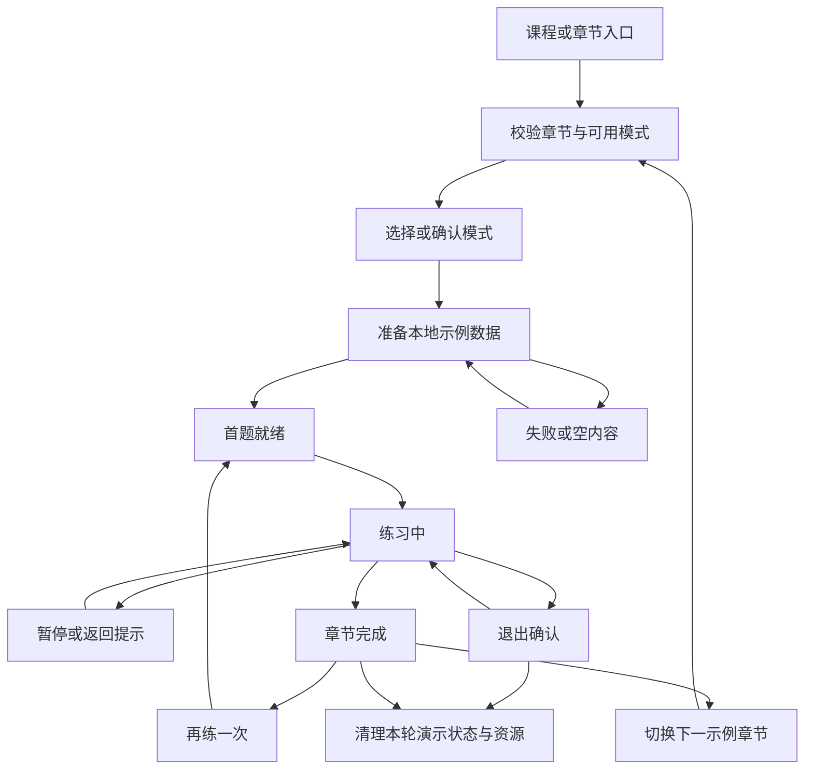
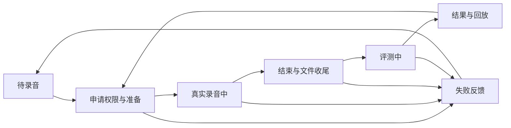

# 练习页开发文档

## 三种单词模式静态 UI 完成（2026-10-21）

用户已确认单词拼读、单词拼写、单词默写三种模式优化完成。本次归档默写及配套通用输入、快捷键、归焦和下拉适配，作为下一模式开发基线，见[默写完成快照](checkpoints/2026-10-21-word-dictation-static-ui.md)。录音／评分／回放继续全模拟，其余接口和模式不在完成声明内；本轮只做格式化与静态差异检查，未运行测试、构建或项目验收。后续按用户指定模式继续，不从旧历史条目推断当前规则。

## 全模式作答输入统一（2026-10-21）

用户已确认所有模式采用同一受控推进逻辑。`PracticeAnswerInput`统一原生桥与位置，所有真实输入分支通过`onAnswerController/onAnswerSubmit`接入页面；鼠标和左右键不定位，空格编辑／循环，Enter完整校验。保留不同模式视觉和业务边界，其他文字模式的本地精确校验不进入拼写统计。详见[实施与待验收记录](practice-answer-input-development.md)。

2026-10-21：新增[全模拟口语评测公共能力](practice-oral-assessment-development.md)，首先接入单词拼写答对后入口；准备、录音、评测中、结果四态共用设计弹窗，设置声纹由页面注入，V键沿用唯一快捷键分发。其他模式继续原演示，当前无真实录音或接口。

## 当前进度与单窗口开发入口（2026-10-20）

本节是当前开发入口。下文保留各轮设计和验收历史；状态冲突时，以本节及对应最新专项为准。历史的“暂无快捷键／输入高亮”“三张二维卡堆”“暂停默认启用”“所有提交均不判题”已经分别被后续实现覆盖，不能直接作为新任务依据。

### 当前实现与适配进度

- **方向键不再干扰纠错（2026-10-21）**：对照哇学社将音标高亮与答题光标分离；左右键不再把整词输入跳回第0位，仍有错位时编辑已处理位置也继续纠错，覆盖全错后改前两位再导航的卡住路径。拼写／默写共用，绿色反馈保留；补回归用例但未执行，仅格式化与静态核对，实际按键及各端效果待用户验收。

- **默写方向键绿色反馈（2026-10-21）**：首位锁定模型已复用，原缺失来自高亮时间线仅在拼写外壳；控制器和动画现归两种模式共用题面，空输入按左右键不移动并显示当前段绿色反馈。保留原动画节奏与清理，不增加默写翻面。仅格式化与静态核对，实际按键／动画及各端效果待用户验收。

- **拼写／默写四排布局（2026-10-21）**：用户确认题面、口语、统计占位、底栏依次排布。两种模式共用结果区占位，口语隐藏时保留46px槽，拼写显示原统计、默写保留空统计槽；H5低高度时前三排同一main整体滚动，标题及现有固定底栏位于滚动区之外。具体边距和源码边界见[单词布局记录](practice-word-games-development.md#2026-10-21-拼写默写统一四排与整块滚动)；仅格式化与静态差异检查，未运行测试、构建或浏览器验证，各端视觉／真实缩放及H5软键盘滚动待用户验收。

- **单词拼写静态 UI 完成（2026-10-21）**：用户已确认 `word:spell` 静态效果完成，代码按要求归档并推送，作为下个模式开发基线。输入纠错、音标联动、翻转、统计、公共音效及全模拟口语评测均随本次保存；准确代码定位和后续接口／验证边界见[拼写完成检查点](checkpoints/2026-10-21-word-spelling-static-ui.md)。下方实现过程与未验证记录保留历史，本次不运行测试或构建。

- **拼写单词槽稳定与音标溢出修正（2026-10-21）**：输入与正确单词行在同一默认98px Grid槽叠放，隐藏层仍参与占位且禁用／inert／移出读屏，提交只切换可见内容；音标／释义跨题态统一位置，长词／自选字号在流式布局共用较大占位。仅拼写音标密度改为片段换行及单倍行高，移除组内自动滚动导致的意外竖滚动条。详情与回归用例见[单词记录](practice-word-games-development.md#2026-10-21-拼写单词区域稳定与音标滚动条修正)；仅格式化与差异核对，未运行测试、构建或浏览器验收，PC／平板／H5及Electron待用户查看。

- **拼写输入间距按横线基准修正（2026-10-20）**：按Figma `546:31334`的图片下缘y=509／输入线y=571，将62px作为实际横线距离。未答／答错移除父层64px，输入组件随字号计算顶部留白，宽屏从图片底部定位、窄屏沿同一几何流式排列，修正旧整体高度倒推及内外留白叠加。答对、揭晓和输入／纠错／统计行为保持；公式及样式边界见[单词记录](practice-word-games-development.md#2026-10-20-拼写输入区间距按横线基准修正)。仅格式化与源码／差异核对，未测试、构建或浏览器验收，PC／平板／H5及Electron待用户查看。

- **拼写正确态复用拼读单词行（2026-10-20）**：提取页内`WordCardHeading`供拼读和拼写correct态共用，答对后显示绿色粗体、四条虚线和右侧圆形朗读入口，替换单条绿色下划线；正确态卡内单词／音标／释义沿拼读305／379／434px锚点。朗读由`PracticeContent.onReadAloud`接现有动作，保留缺音源处理和禁用门控，不自动播放或补请求。输入纠错、音标选择、统计、口语与答案手动展开规则保持；仅格式化和差异核对，未测试、构建或运行时验收，PC／平板／H5及Electron效果待用户查看。

- **拼写提示与统计位置纠正（2026-10-20）**：移除卡下与底栏上方的自定义作答结果文字，错误字母标红、纠错定位和音效保持。重读Figma `546:31334`，核实1920×1080统计区y=896、高68px，底边距快捷栏区域16px；拼写内容区改为纵向Flex，结果区用自动上间距贴近内容区底部，高窗口不再紧跟卡牌，短窗口仍保留最小间距和页面滚动。三项统计常显、46px口语占位及正确态入口保持；仅格式化和差异核对，未测试、构建或浏览器验收，各端效果待用户查看。下方卡下错误提示记录仅为历史。

- **共用静态音效接入（2026-10-20）**：完成新版哇学社37份本地音源注册，`features/learning-settings`统一选择和试听，`shared/lib/sound-player`负责按需播放／复用／清理。拼读接实际切题、再来／记住和完成，拼写接有效编辑、完整正确／错误提交、切题／完成；已有明确口语演示阶段接开始及评价提示，不新增录音或评分。四组开关／音色／音量及两项其它开关沿同一偏好，已删除旧“章节完成音效1”，默认落幕并迁移旧缓存。MP3静态MIME／Range同步Web与Electron；实现和未执行验证见[素材清单](practice-feedback-assets.md)。本轮不运行测试、构建或试听，各端效果待用户验收；下方声音待迁入、32项空映射和9项完成音色均为历史。

- **拼写切题对齐解析翻面（2026-10-20）**：前后题作为同一卡牌两面，复用解析的1000px透视、600ms及`power2.inOut`，下一题向右180°、上一题向左180°，移除侧面淡入、缩放和回摆。`PracticeContent`的拼写外壳跨题保留，题内状态仍按题目与修订号重建；旧题仅动画期间显示，禁用交互、控制器及朗读，完成或中断后释放。覆盖下方650ms入场的历史方案，统计及口语门控保持。源码与未执行验证见[单词记录](practice-word-games-development.md#2026-10-20-拼写切题对齐解析翻面)；未运行测试、构建或浏览器验收，各端效果待用户查看。

- **拼写答案手动展开（2026-10-20）**：移除`submitWordSpelling`正确分支的答案面板展开动作；↓展开、↑收起和既有点击命令保持。答对反馈、统计、黄晶与正确态口语入口不变，下方历史自动展开说明由本条覆盖。仅更新回归脚本预期、格式化和差异核对，未运行测试或构建，各端效果待用户查看。

- **拼写删除后纠错定位（2026-10-20）**：修正Backspace先清错误标记导致补字后停止跳转的问题。待纠错位置在删除时保留，重新输入与直接覆盖同样自动定位下一处错误；空位按原默写／抄写提示规则渲染，填字不提前判对错，全部修改后空格／回车重新校验。适用于四档音标，不改变提交统计。回归用例及未执行验证见[单词记录](practice-word-games-development.md#2026-10-20-删除错字后的自动纠错定位)；本轮不测试、不构建，各端效果待用户查看。

- **拼写双向切题与统计常显（2026-10-20）**：用户确认增加650ms卡牌Y轴翻入，下一题向右、上一题向左，沿最新哇学社的透视／缩放／回摆阶段镜像实现。`PracticePage.move`按实际题号确定方向，拼写私有动画Hook控制外壳，解析翻面继续控制内层；连续切题取消旧卡动画，首屏／同题／设置切换／重练不触发，reduced-motion直接归正。`WordSpellingResult`现始终显示三项本轮统计，只有口语入口受正确态与原设置门控；预留口语高度，答错提示不再撑高统计位置。详见[单词记录](practice-word-games-development.md#2026-10-20-拼写切题双向翻转与统计常显)。按用户要求只格式化和差异核对，未执行测试、构建或浏览器验收，各端效果待用户查看。

- **拼写逐字输入与音标联动（2026-10-20，当前）**：用户确认按新版哇学社改用固定字母位；原始／无音标逐字短线，音节／自然拼读同步分段输入线，12题补齐显式字母映射。填满后校验、仅错位标红与首错定位、逐错覆盖、空格跳字母／片段及删除流程由私有`WordSpellingInput`／`word-spelling-input`负责，Enter／底栏经注册控制器同源提交；完整校验才进入现有统计、口语与黄晶。仅可编辑且映射完整的拼写音标注入定位按钮，其他模式沿原公共整词输入。旧拼写的原生全文／末槽提交及公共feedback透传记录由本轮覆盖；模式内撤销／重做与IME边界见[单词记录](practice-word-games-development.md#2026-10-20-拼写逐字输入与音标联动)及[文本输入契约](compatibility/text-input.md)。按用户要求不运行测试、lint、类型检查、构建或浏览器操作，PC／平板／H5及Electron效果待用户查看。

- **拼写设置关联（2026-10-20）**：按用户指定的新版哇学社源码修正既有控件接线，默写隐藏输入提示、抄写显示剩余字母；原始／拆分／自然／无音标对应源码0／1／2／3，拼写局部选择优先于全局输入／答案音标显隐。可选提示参数默认关闭，其他输入消费者保留原行为；原生输入值、选区／撤销与判题保持原路径。接线及数据边界见[单词专项](practice-word-games-development.md#2026-10-20-拼写设置与输入提示关联)。按用户要求不运行测试／构建，PC／平板／H5及Electron效果待用户查看。

- **单词拼写四项精修（2026-10-20）**：按用户确认的`546:31334`范围对齐卡底解析翻面／欧路查词／不熟占位三个图标，正确态口语复用句子图标及渐变胶囊；右上角增加本轮黄晶，按有效正确提交数×10派生，切题保留、重复提交不累加、重练清零。原始音标排第一且作为无有效缓存默认值，合法个人选择继续保留。只有黄晶补充全局`practice-crystal`双主题token，其余能力留在本page；详见[单词专项](practice-word-games-development.md#2026-10-20-单词拼写四项精修)。按用户要求仅格式化和差异检查，不执行测试、构建或运行时验收，四项效果待用户查看，不将整个拼写模式标为精修完成。

- **单词拼读静态 UI 已完成（2026-10-20，用户确认）**：`word:pronounce`当前卡面、工具栏、拖拽甩出、再来／记住、末题完成、解析翻面及查词入口作为本模式静态 UI 检查点归档。代码范围、保留的笔记组件、待接接口／音源及未运行验证见[当前代码快照](checkpoints/2026-10-20-word-pronunciation-static-ui.md)。本次按用户授权提交并推送当前工作区代码，不把其他模式或真实学习业务一并标为完成。

- **单词拼读查词与加号（2026-10-20）**：正面放大镜与背面单词旁图标共用`WordDictionaryLink`，按当前英文生成欧路词条链接，Web新标签页打开、Electron经主进程受限规则交给默认浏览器。按钮不再用本地词义提示代替外链；保留现有样式／配色／禁用态，不提前抓取词典内容。加号与底栏“不熟”的语义已统一登记`PRACTICE-UNFAMILIAR-LIST`；本轮不接保存接口、不修改记住／再来队列，实际列表保存待后续接口。按要求未测试或构建，浏览器／桌面外链实测待用户查看。

- **单词拼读解析（2026-10-20）**：卡牌首个文档图标已按用户纠正改为解析，原位绕Y轴翻转，背面显示当前单词／完整音标／释义及三条双语例句，左上返回或Esc翻回。十个模拟词各补三句及显式中英文重点词；无例句用空态，无音源点击提示。切题恢复正面，翻面与CardSwap物理位移分层，600ms结束后恢复二维展示，支持反向接续、reduced-motion及清理。不改正面绿色词／音标，背面按截图消费深灰表面、紫边和蓝色重点词的既有语义token。
- **保留的笔记组件（2026-10-20）**：`PracticeNotesPanel`及每题一条的本轮内存模型／素材继续保留，首图标已移除笔记事件，暂未另增入口；其他模式原笔记保持。共享侧滑和配色见下方“章节笔记侧栏”。本次按用户要求未运行测试、构建或浏览器验收，效果待用户查看。

- **公共练习框架**：12个内容族、40个本地组合具备入口和基础编排；六族模式选择、按`family:mode`保存局部选项、真实计时、统一命令与快捷键、底栏、输入高亮、草稿、内容／报错／设置／退出／完成弹窗已接入。这不代表40组合已逐稿精修或接入正式学习业务。
- **单词拼读 `word:pronounce`**：10个本地词例、四张可见3D卡堆、hover与原手势、记住移出待练队列、再来放回业务队尾及可见末槽已实现。2026-10-20新增全视口四线、遮住中文／英文及本地正序／乱序／A-Z排序；章节完成与记住状态已分开，进入末题不结束，末题再切下一题退场后打开完成窗，无需全部记住，也不补写记住进度。按用户要求本轮未测试或构建，效果待用户查看。记住进度仅本轮内存，不写服务端。
- **单词拼写 `word:spell`**：12题固定字母位、逐错标红／纠正、四档音标与输入分段联动、本轮统计及正确态口语已接。填满且无待修改错位时才提交本地比对，未填满／仍在纠错时空格和提交动作只导航；完整校验沿既有ignoreCase规则，正式题库和服务端判题未接。
- **其他单词模式**：默写、句中练义、指法、口语已有基础组合与工具栏，仍需按各小模式最新设计逐项核对；口语是明确的状态演示，不是真实录音或评分。
- **句子七模式**：工具栏已接入；中译英、理解自查、拼块使用专用`SentenceExercise`，沉浸听力已提取`SentenceListeningExercise`并接线，阅读、指法、口语仍走通用`PracticeContent`。听力不消费完整／拆分；历史局部行及专项预期待清理，旧缓存过滤与图片／切读恢复待统一验证。完整／拆分、抄写运行策略仍待接，不宣称七模式精修完成。
- **共用输入与媒体**：默写、句子及通用内容继续共用整词词槽与原生编辑；拼写采用上述模式专用输入。彩色键帽／双手和实输高亮已接。28种支持切读的模式已接统一调度，但正式演示数据缺少课程音源，显示静态声纹和“音源待接入”；技术WAV／MP4只验证播放器。`PRACTICE-SOUND-MIGRATION`正式声音资源迁入仍待开发。
- **共用音标展示（2026-10-20）**：`PracticeWordPhonetics`与`word-phonetics`已接原始音标／音节拆分／自然拼读／无音标；当前模拟词例已补显式分组，拼读和拼写的既有控件即时消费各自选项，默写、通用题面和逐词标注复用展示或格式规则并保留原门控。移除两处woman专用分块，缺数据回退完整IPA；配色与密度见[配色方案第9节](practice-page-color-scheme.md#9-单词音标展示2026-10-20)。本轮按用户要求未测试、构建或视觉验收；真实音源及音标课程专用朗读策略不在本次接线中。
- **当前暂停规则**：`model/practice-pause.ts`中的`PRACTICE_PAUSE_ENABLED = false`；顶部和更多菜单无暂停，窗口失焦／隐藏不触发游戏暂停。设置、退出、完成等有效浮层仍按原规则阻断。重新启用时统一修改公共开关并重验。
- **PC及缩放**：已有各专项的1920×1080或1440×900基准、深浅主题、较窄PC及真实125%／150%／200%缩放记录；以各节实际范围为准，不把历史专项拼成一次当前全站验收。
- **响应式代码**：小于1280px顶部操作收为更多菜单；单词手机音标改为同值下拉，极窄工具栏局部横滚；小于`md`底栏隐藏键位与朗读，上下题保留24px箭头和40×40触控区，其他动作为文字；词槽自然换行，超长词局部滚动。
- **待用户验收**：平板／H5视觉、触摸、系统软键盘、OS输入法、横竖屏、外接键盘及真机声音／媒体兼容。390／768等自动几何检查不等于这些项目通过。
- **未闭合的广域验收**：最新整站`runtime:smoke`未完整重新通过；历史较广检查保留卡片行高`normal`与38px期望不符的失败，暂停40组合扩大尝试保留宿主销毁原因未定位的记录。本次主分支归档的测试／构建结果单独记录，不能覆盖上述运行时缺口。

word:spell公共依赖历史：答案Portal层级、聚焦命令及可选逐字反馈契约的678项测试、生产构建和相关双端专项结果见[公共交付说明](#wordspell-公共依赖契约2026-10-20)。当前卡面逐字比较／纠错由上述拼写专用输入接管，已移除原未使用的feedback透传链；历史公共验证不覆盖本轮新实现。本轮改动尚未提交。

### 单窗口工作区与服务

练习页的公共组件、单词模式、句子模式、公共接线、文档和验收统一在同一个窗口内完成。

- 固定工作目录：`/Users/sly/react_work/漫奇说web`，分支`main`。
- Web预览端口：3000；启动命令：`pnpm run dev --port 3000`。先确认已有服务是否来自本工作区，已运行时不重复启动。
- 单词和句子共用同一服务，例如`http://localhost:3000/practice/?demo=word-basic&mode=pronounce`、`http://localhost:3000/practice/?demo=sentence-basic&mode=translate`。统一使用`localhost`，避免与`127.0.0.1`产生额外存储来源差异。
- 同目录dev与build／typecheck不能并行；需要构建时正常停止本目录服务，不删除活锁。Electron及生产验证的服务要求见[环境配置](environment.md#练习页开发服务)。
- 每项任务开始前核对目录、分支和Git状态，保留已有未提交改动；仅修改当前需求涉及的模块，提交及远端操作按当前任务授权执行。

### 模块职责：公共能力与模式专用内容

以下按代码概念说明范围，均由同一窗口维护。这里的“练习共用”表示`pages/practice`内部多个模式共享，不代表要移到FSD的`shared`层。单词、句子属于同一个practice页面slice，通过根`index.ts`对外暴露；同名测试跟随被测文件。

**全站公共基础与练习共用内容。**

- 全站基础：`src/fsd/shared/ui/tld-*`、`shared/lib/animation`、`shared/lib/storage`、`shared/lib/time`、`shared/theme`、`shared/config`，全局样式`src/fsd/app/styles/index.css`；公共入口、Props、主题token和存储键按真实消费者统一评估。
- 独立功能：`features/learning-settings`与`features/practice-mode-selection`的公共入口、跨族配置及资源；课程入口、`src/app/(practice-session)`、`app/router/PracticePageRoute.tsx`和路由配置。
- 页面装配与共用数据：`pages/practice/index.ts`、`ui/PracticePage.tsx`、`ui/PracticeContent.tsx`及其测试、`model/practice-demo.ts`及测试、`model/reference-layout.ts`及测试。
- 共用输入：`ui/PracticeWordSlotsInput.tsx`、`model/word-slot-input.ts`及测试。名称含Word，但被单词、句子等共同使用；`AnnotatedText`、`TypingKeyboard`／`TypingHands`及实输映射同属共用能力。
- 共同交互：`PracticeNavigation`、`PracticeFooter`、`PracticeModeToolbar`、`PracticeToolbarControls`、`PracticeMedia`、`PracticeReadingOverlay`、`PracticeFeedback`及共用弹窗；导航、底栏、命令／绑定／快捷键、可见性、计时、暂停、切读、媒体互斥、偏好缓存及相应`usePractice*`生命周期模型和测试。
- 共同资源：`assets/word-woman-e23d5f.png`也被猜词使用，`reading-scene.png`被句子和音频等使用，`word-toolbar-*.svg`被共用工具栏使用；不能只按文件前缀认定专用。暂停／退出／完成等素材同属共用资源。
- 文档与验证入口：本文、练习页`README.md`、根`README.md`、总待办、架构／兼容性／环境／测试文档、`package.json`、lockfile、CI和共用运行时宿主／总runner。

**单词专用实现。** 以下路径相对`src/fsd/pages/practice/`，进度与验收记录在[单词开发记录](practice-word-games-development.md)。

- UI：`ui/WordPronunciationCard.tsx`、`WordPronunciationDeck.tsx`、`WordAnswerCard.tsx`、`WordRememberFeedback.tsx`、`WordSpellingResult.tsx`、`WordPracticeToolbar.tsx`、`CardSwap.tsx`。
- 模型：`model/word-card-deck.ts`、`word-card-outline.ts`、`word-remember-session.ts`、`word-spelling.ts`、`word-spelling-input.ts`、`word-toolbar-options.ts`、`card-swap-dismissal.ts`、`card-swap-gesture.ts`、`card-swap-presentation.ts`、`card-swap-seed.ts`、`card-swap-sequence.ts`及`card-swap-source.md`。`ui/WordSpellingInput.tsx`只服务单词拼写，不能当作其他模式的通用输入替换。
- 专用资源：`assets/word-card-*.svg`和`word-card-remember.json`；其他资源先检查真实消费者，新增专用资源仍留在practice owner的`assets`内。
- 专用验证：`scripts/word-mode-runtime-smoke.cjs`、`word-pronunciation-runtime-smoke.cjs`、`word-remember-runtime-smoke.cjs`、`word-toolbar-runtime-smoke.cjs`、`card-swap-presentation-runtime-smoke.cjs`。跨模式输入专项`practice-word-input-runtime-smoke.cjs`按全部受影响消费者验证。
- 新增专用文件使用可识别的`Word*`／`word-*`概念，继续留在practice页面内；公共Props或类型变化时，在同一任务内同步调用方、测试和说明。

**句子专用实现。** 进度与验收记录在[句子开发记录](practice-sentence-games-development.md)。

- `ui/SentenceExercise.tsx`及对应行为测试：目前只覆盖`sentence:translate/check/blocks`。
- `ui/SentencePracticeToolbar.tsx`、`model/sentence-toolbar-options.ts`及同名测试，`scripts/sentence-toolbar-runtime-smoke.cjs`。
- `ui/SentenceListeningExercise.tsx`、同名`.test.ts`及`assets/sentence-listening-note.svg`、`assets/sentence-listening-oral.svg`只服务`sentence:listen`；公共标注、几何和接线仍按共用能力维护。
- `sentence:read/typing/oral`当前仍在通用内容中；开发这些模式时，依据真实代码判断是否需要提取页面内部专用入口，并在同一任务内完成接线。
- 新增专用文件使用可识别的`Sentence*`／`sentence-*`概念；专用资源跟随practice owner。

### 每个小模式的开发与交付流程

1. **评估需求**：先读本文、对应模式记录及真实源码，写明大模式／小模式、设计节点、题态、改动文件、公共依赖和PC／平板／H5验收边界。设计驱动任务执行[编码前方案和确认](ai-collaboration.md#设计稿驱动任务的编码前方案)。
2. **统一实现**：在本窗口完成需求涉及的公共能力、模式专用逻辑与接线；一次完成一个可独立验收的小模式或明确增量，保护已有改动，不扩大到无关模块。
3. **按影响验证**：遵守[开发期验证分级](testing-standards.md#0-开发期间按影响验证2026-10-19)。开发微调先做对应静态检查、定向测试与受影响PC状态检查；小模式或公共契约稳定交付时，对最终源码集中运行一次`pnpm run test`和`pnpm run build`。Electron构建边界受影响时用`desktop:build`替代`build`，相关生产专项按真实影响选择。
4. **同步记录**：在同一任务内更新本文、练习README及对应单词／句子记录，按需要更新总待办与公共契约说明；区分本轮执行、未执行、历史证据、失败和待用户验收。同一有效源码结果可复用，源码改变后按影响重验。
5. **验收交付**：提供实际改动、稳定契约、验证证据和剩余事项；PC设计基准、适配与相关生产专项集中在正式交付时完成，平板／H5视觉及真机明确待用户验收。提交、推送按用户当前授权执行。

纯文档更新不运行源码构建；CI门禁保持不变，历史专项报告仅代表当次范围。

### 本次主分支基线验证（2026-10-19）

- 原工作区重新运行`pnpm run test`，633项源码／Electron测试与24项脚本测试通过，共657项；`pnpm run format`、`pnpm run lint`及`git diff --check`通过。lint保留共享弹窗已有的3条warning，没有降低门禁。
- 为保留正在运行的3000服务与Next锁，在独立冻结副本运行完整`pnpm run desktop:build`：包含生产lint、路由类型生成、TypeScript、Next静态导出、275份业务HTML和完整RSC／资源验证，以及Electron主进程编译，全部通过。
- 原工作区与构建副本的1182份非Markdown源码／配置／资源逐文件SHA-256一致；本次后续变化仅为协作与进度文档。日志及源码对照归档于被忽略的`dist/main-baseline-20261019/`，不提交构建产物或个人配置。
- 本次未重新执行全部练习专项或整站运行时、未新增PC视觉验收；旧专项证据仍限于各自记录范围。上述静态验证不代表遗留广域运行时问题、平板／H5或真机验收已通过。

## 单词拼读四张展示、原生3D/hover与动画溢出（2026-10-19）

本节按用户诊断后确认的方案，覆盖前轮“三张可见、二维后卡、hover关闭、再来回到不可见真实队尾”的实现说明。业务队列仍有10条，不改记住进度、左右滑只浏览下一题、不循环及上一题规则。

- `CardSwap`继续使用已提供的React Bits组件及原rAF积分、速度/阻尼和clearance阶段。`card-swap-presentation`集中记录4个显示槽、32px层间水平位移、2px竖向位移、80px深度、900px透视、0.5鼠标视差和0.12悬停展开；后卡恢复`translate3d`的真实z投影，不再使用492×472等横纵非等比缩放。主卡500×500@(710,228)、卡面内容和66px按钮保持。hover仅用于非触屏且未开启reduced-motion的输入，离开后沿原弹簧收回；触屏继续原拖动，reduced-motion立即停止视差/展开，避免无终点rAF。
- 完整业务顺序与四张展示槽独立：再来先展示真正的后续题目，再把当前同一节点放回第4层（少量题目按实际可用数）；补位期间不提前出现第五张。回插完成后该卡仍在可见底层，同时宿主按原`retryWord`移到完整业务队尾。下一次操作按真实业务顺序补位，不提前把回插词当下一题，不删除题目或增加进度。连续再来、普通上一/下一题、记住及末位再来共用同一受控索引。
- 引擎以稳定卡片key绑定物理节点，成员身份由排序后的key集合表达；业务重排不销毁同一个节点或重启运动。逻辑索引通过最新key序列映射到物理实例，导航/拖动仍返回业务索引；仅增删成员（如记住删除）重建实例并采用新的有效索引。静态首帧样式也按key保存，避免React重排覆盖刚回插的尾卡位姿/显隐。前轮按完整顺序重建`card-swap-seed`的方案不再用于仅重排。
- 滚动条根因曾经双端隔离复现：1920×1080向下拖动后，已隐藏卡仍保留约679px位移，文档高度约1407px；临时排除该隐藏盒后恢复1080px。2026-10-20用户进一步发现局部`data-word-deck-motion-viewport`裁切会截断仍在拖动的可见卡。本次将动画溢出裁切移至单词拼读会话根容器，局部卡堆保持可见溢出；隐藏卡的DOM transform继续清为none，保留内部实例和布局盒供上一题恢复。整页边界限制拖动造成的文档溢出，正常长内容仍决定页面高度，不锁body滚动；其他模式保留原滚动和底栏。
- 拼读卡堆及其局部容器为z-0；标题／进度、局部工具栏、卡下再来／记住、底部快捷栏与状态文字在上一层。`CardSwap`继续隔离内部卡片层级，拖动卡的高z-index不能越过页面控件；底栏使用`PracticeFooter floating`透明变体，空白处不拦截指针，实际按钮恢复指针事件。100px／安全区占位、按钮位置、局部横滚及命令入口保留；没有改拖动角度、弹簧、阈值或题序。修复仅做定向格式化和差异检查，未重跑本节历史专项、测试、构建或视觉验收，PC／平板／H5效果交由用户查看。

验证入口为`card-swap-presentation.test.ts`与`scripts/card-swap-presentation-runtime-smoke.cjs`，原记住和卡牌专项同步按四层真实投影验收。已在Web与真实Electron生产协议验证：4张静止可见、左右hover的透视中心/后卡位移变化、连续再来的同DOM可见尾卡、无第五张、业务导航、手动向下拖动后文档仍1080px、记住删除与reduced-motion；PC1920×1080/100%过程图已人工核对。

- 四层专项及完整记住专项两端通过，包含同DOM回插、连续再来、剩2/3张及末位回插、记住动画/进度、全部完成和重练，设置/真实尺寸变化能取消未提交动作。当前其他任务已统一关闭暂停功能，因此旧暂停入口场景明确记为不适用，不恢复按钮或以Esc替代；其他浮层和中断验证保留。
- 原单词拼读完整专项也在Web/Electron通过：全角度跟手、单move快速轻甩与停顿后旧速度失效、短拖回弹、连续切换、上一题、末题不提前完成、底栏接管及弹窗中断保留；卡面500×500和原字号/控件几何通过。静止后卡按900px透视投影验收，hover与静止测量分开，不沿用旧二维坐标断言。深浅主题、1280/1440PC和真实125%/150%/200%缩放无页面横向溢出；390/768仅自动几何检查。三组专项的控制台错误、资源失败和业务请求均为0。
- 当前工作区`pnpm run test`通过633项源码/Electron测试及24项脚本测试；本轮展示/手势/生命周期/记住25项定向测试通过。`pnpm run lint`与格式检查通过，保留共享弹窗3条既有warning。早先并行输入/导航测试断言失败已由对应任务更新，最后完整重跑通过，未修改该任务实现来凑验收。
- 为避免共享Next锁和持续变动的并行源码影响验收，在冻结副本执行环境runner生产构建，通过275份业务HTML及完整RSC/资源验证；本轮主要实现与回归脚本逐文件SHA-256对照，不将副本构建扩大为其他并行任务的产物验收。报告、PC过程截图、命令日志及源码对照归档在[四层卡堆验收目录](../dist/card-swap-presentation/source-verification.json)。

平板/H5视觉、触摸、外接键盘及真机兼容仍待用户验收。

没有新增API、Storage、路由、依赖、主题token或Electron bridge；课程音源、正式判题及记住记录的服务端持久化仍待后续接口任务。

## 单词拼写本地判题与固定词槽（2026-10-19）

用户确认在原2条拼写示例上新增10个不同单词，共12题；所有题复用已有`word-woman-e23d5f.png`，图片为共用示意，不宣称匹配每个词。数据仅扩展`word:spell`，其他小模式题数不变。实现仍由页面私有`practice-demo`、`word-spelling`、`PracticeWordSlotsInput`及`WordAnswerCard`拥有，不新增路由、存储、依赖、接口或Electron bridge。

- 词槽数量由题目英文的词数决定，`woman`一条、`how are you`三条；末尾或连续空白不会新增线条。超额录入保留在最后一个词槽，原生全文和UTF-16选区不截断；点击末槽可定位到完整末尾。静态首尾标点和词内连字符/撇号沿用已有规则。
- 单词拼写Enter或末词末尾的普通空格提交。末槽尚空、光标在中部或存在选区时继续原生编辑；没有按词长自动判题。实体keydown拦截提交空格，原生input仅消费追加的单个`insertText`空格，以覆盖无keydown输入；IME合成、229、粘贴及修改键组合不触发这条提交路径。Tab/Shift+Tab、裸方向键、Undo/Redo继续使用原生语义。其他模式的空格和提交规则不变。
- 仅本地单词拼写使用确定性样例比对：去除首尾空白，并遵守既有`ignoreCase`；不归一化内部空白、标点、全角字符或等价答案。空提交只提示，不计错；错误输入原文保留，可修改再提交；正确进入`correct`，复用现有反馈事件并自动打开当前题答案面板。正式题库、后端裁决、自动显答案与真实口语录音评分仍未接入。
- `PracticeSession.spellingStatistics`累计本轮非空提交次数、正确提交次数，正确率为正确次数/提交次数并四舍五入到整数百分比。空提交、揭晓、开关面板和正确态重复提交不计次；切题保留统计，返回旧题仍重新作答，重置/重练/换模式清零，不写账号记录。Enter在正确态继续原有下一题动作。
- 根据[Figma 546:31334](https://www.figma.com/design/z7SIwUb9ep0j0ZaEwFrxJl/ManiShare?node-id=546-31334)及用户补充，卡下口语与统计区域在`answering`、`incorrect`、`revealed`全部隐藏，仅`correct`展示。口语按钮和V仍共同遵守`showEvaluation`与目标门控，关闭设置只隐藏口语入口，不隐藏统计；打开沿用演示评测。1920×1080/100%基准沿原500×500卡面，口语234×46@(843,813)，统计385×68@(767,896)，口语字16px/500/0.08em，统计标签16px、数值18px/500；窄屏流式重排，不缩放整页。平板/H5视觉、系统软键盘及真机仍待用户验收。

本节覆盖下方较早“提交不判对错”和“末词空格不提交”的`word:spell`范围；其他模式仍维持本地编辑与既有演示边界。单元测试覆盖固定词槽、末槽提交意图、大小写、错误重试、重复提交和统计重置；生产输入专项增加12题判题、共图、结果门控、原生input空格及口语返回检查。

实际验证：657项测试（源码/主进程633、脚本24）、format与lint通过；隔离副本经原环境runner完成生产构建，校验275份业务HTML及完整RSC/资源，Electron主进程编译通过，现有开发服务与锁不变。最终生产Web/Electron专项全部通过，每端覆盖8个输入消费者、12题判定、原生input追加空格、Shift+空格保持编辑、原生撤销/重做、口语返回与统计清零；零业务请求、资源失败和渲染报错。PC人工检查1920×1080/100%正确/错误图及1440窗口200%缩放图；每端另记录1280/1440和真实125%/150%/200%的5项结果态重排、16项原输入几何记录。口语实测234×46@(843,813)，统计385×68@(767.5,896)，0.5px为385px容器居中的半像素；正确词下划线按文本自然宽度。报告和截图归档`dist/word-spelling/`，10份实现文件与构建来源SHA一致。开发阶段暂停已由原有契约关闭，专项不声称验证暂停恢复；组合输入/粘贴的DOM注入与原生键盘证据分开，平板/H5视觉、OS输入法、系统软键盘、触摸和真机仍待用户验收。

## 整词输入显示与原生编辑（2026-10-19）

用户本轮确认：保留现有 Enter 提交和 Tab 原生焦点导航，只对齐所给哇学社截图的词槽展示、输入与适配。参考为旧 `src/game/components/Content/PlayModes/InputWord` 的整词横线，而非 `soloPractice` 的逐字母方案；不将参考工程的判题、错题本请求、自动显答案、全局按键和 px→rem 管线一并移植。

- `ui/PracticeWordSlotsInput.tsx` 统一服务 `WordAnswerCard`、`SentenceExercise` 与 `PracticeContent` 的文字输入。移除固定 woman 五条装饰线、句子固定四段网格及通用边框输入；当前题目的每个词独立撑宽，标点在槽外展示，实际输入居中覆盖透明小写占位。占位采用参考的“已输入小写＋未输入的目标词尾”，输入超长时自然扩宽；不是等宽字符格，也不按 viewport 缩小整页。
- 完整原生 `input.value` 仍是唯一文本源，`model/word-slot-input.ts` 只派生词槽和 UTF-16 选区位置；不建立第二份词数组、不改写大小写/粘贴内容。目标按空白分词，词内撇号/连字符保留，首尾标点独立；不是参考项目的 NLP、人名或等价答案算法。点击尚未存在的后续词只补定位需要的空格，已有输入不被覆盖；额外输入仍可见。
- 当前词的线随原生选区移动，失焦恢复中性线；输入保留答题色，已有 `incorrect` 题态消费错误色，不自行判对错。Enter 继续走统一主动作，Tab/Shift+Tab 保持一个原生输入焦点位，空格保留原生文本与词间移动，不新增“填满空格自动提交”；裸方向键、选区、Ctrl/Meta 编辑与输入法交给真实输入元素。没有“字母输够自动跳词”或参考新版实时纠错。
- 可视槽不捕获键盘生成字符；指法反馈继续订阅同一个完整值输入。组合输入期间不通过点击调整选区；暂停保留输入，切题/重练沿原会话 key 清空。完整/拆分、抄写运行策略、正式判题和统计不在本轮扩展。
- 点击尚不存在词的定位空格仅尝试原生编辑命令，以保留撤销历史；不支持时保留原文末尾焦点，可继续原生空格录入，不直接赋value兜底。已存在词的点击只改变选区；单次初始可操作聚焦尊重已有控件/弹窗焦点，暂停恢复不反复抢焦点。已确认问题与失败语义见[文本输入兼容契约](compatibility/text-input.md)。
- 同一 DOM 使用自然文字宽度、Flex 按词换行，单个超长词在自身横滚；小写占位和真实输入字形共同参与自然测宽，避免长串大写字母向左裁切。编辑/选区变化时用可见文本的 DOM Range 把光标位置移入局部可视范围，没有新编辑时保留手动回看；不改变真实value/selection或滚动整页。活动词下划线表达焦点，不在整组外画输入框。默认输入字号为 H5 28、md 34、design 40px，卡面紧凑输入为24/30px，自定义字号继续来自既有偏好。1920×1080/100%沿已有卡面/句子下划线位置锚定，旧固定线宽不再是验收目标。参考截图的实际 CSS 视口与字体未提供，不将源码70px或图片像素伪称实测计算样式。

### 本轮实际验证

- 最终源码的643项测试通过（源码/主进程619、脚本24）；format、format:check、lint与TypeScript通过，保留共享弹窗和既有CardSwap警告。原开发服务/锁未改变；在独立冻结副本经原环境runner执行生产build并校验275份业务HTML与完整RSC/资源，Electron主进程编译通过。
- `scripts/practice-word-input-runtime-smoke.cjs` 在同一生产产物的Web/Electron均通过，每端8个实际输入消费者；使用真实演示题brush teeth、Nice to meet you.，Hi there.在模型/SSR夹具验证。原生Enter单次提交、不判题不切题、Tab离开、裸方向移动、Shift大写、编辑快捷键放行、选区替换/退格、点击后词补空格、撤销回空及重做全文、插入命令拒绝后的原生空格路径、暂停保留与切题清空均有证据。
- 验证透明占位与不同词宽、独立句号、输入超长扩宽、160个大写W的完整可见、超长词局部滚动/新增字符末尾可见，以及无新编辑时手动回看不被拉回。每端深浅主题×1920/1440/1280与真实125%/150%/200%缩放，另有768/390自动几何；共24张PC截图。100%严格核对3px线宽，真实缩放按最多一个物理像素的舍入验证，保留CSS基准值，不把2.8px计算结果误写成设计值。
- 严格资源/CSP/控制台错误与业务请求均为0。原生键盘事件与后台Chromium宿主selectAll/undo/redo编辑命令分开记录，后者不代表macOS菜单快捷键端到端验收；composition/paste与编辑命令失败为明确DOM夹具，不代表操作系统输入法、系统剪贴板或真机软键盘通过。
- [两端汇总](../dist/practice-word-input-runtime-validation.json)、[Electron](../dist/practice-word-input-electron-validation.json)、[Web](../dist/practice-word-input-web-validation.json)、[源码与验收副本摘要对照](../dist/word-input/source-comparison.json)归档于ignored dist。人工查看PC1920深色与1440浅色输入截图，布局与缩放记录分别保留；平板/H5视觉、触摸、软键盘、输入法和真机仍待用户验收。本轮不宣称整站或全部40模式专项重新运行。
- 另在相同最终产物补拍单词拼写/默写及句子中译英两端共6张1920×1080/100%图片，人工查看卡面和句子布局；实际横线底边分别为571/610/723px，句子四词均与723px锚点一致。移除曾使横线抬高4px的多余内边距，并显式限定词槽只横向滚动；计算样式及几何同时证明无纵向滚动条、横线未被裁剪，输入不与已显示翻译重叠。该默认夹具没有显示音标，不冒称覆盖音标开启态。[PC几何汇总](../dist/word-input-pc-snapshot-validation.json)、[句子PC图](../dist/word-input-pc-web-translate.png)、[单词默写PC图](../dist/word-input-pc-electron-dictate.png)另存于ignored dist。

## 单词拼读章节笔记侧栏（2026-10-20）

用户确认Figma `546:35888/36010`，每题最多一条、先本轮内存、按草稿动画从右侧弹出。此前把`WordPronunciationCard`首图标误识别为笔记，现按用户纠正改为卡内解析翻面；笔记组件、`PracticePage`预留接线、Hook／模型与素材保留，暂不分配新入口，其他模式保留原居中笔记。组件／Hook／模型留在`pages/practice`，现有笔记本多记录静态展示不共享本轮状态。

- `practice-notes`按原始题库ID保存已提交正文和当前编辑，列表按原始章节顺序，每题唯一。空白或超过原生1000 UTF-16单位不能保存，保存保留正文换行／空白；同题改写不重复，取消恢复已保存文本，关闭丢弃未保存输入，删除只影响目标。记住／排序／再来及重练保留笔记，换模式或退出会话释放；不新增API、Storage键或跨页面同步。条目显示所属单词与本轮真实经过时间，分钟任务只在打开时运行并清理。
- PC参考1920×1080／100%：外框544×743@(1326,169)、r12；标题20px/500/normal行高与字距0，正文14/20、辅助12/17；关闭24×24@(1826,194)、标题图30×30。编辑框504×100@(1346,750)，保存76×26@(1774,864)，空态插图156×104@(1520,362)。这些是设计及实现目标，尚未读取浏览器计算样式或实测几何，不记为已验收。
- `TldDialog placement="right"`显式提供右侧定位，沿原遮罩、焦点循环、Esc／遮罩关闭及背景命令隔离；右滑240ms与草稿同节奏，不缩放。共享默认仍为center，退场保留内容、快速反向接续、reduced-motion及卸载清理沿用。右侧打开时订阅可见视口，H5／平板按可用宽高约束，列表内部滚动，极矮时整面板可滚动；H5隐藏保存键位图并保留40px触控。
- 表面／边框／绿色控件均用语义token，八份原稿素材归`assets/notes`。`TldButton note-action + solid`提供26px PC密度及原浅绿禁用态，dark/light补齐`button-solid-disabled`；用户答题颜色不覆盖笔记控件。不新增依赖、路由或Electron bridge。
- 就近补状态／边界、右侧退场几何及SSR用例，更新旧卡堆关闭选择器和弹窗专项侧滑断言。按要求未执行测试、lint、类型检查、构建、浏览器或Electron专项；仅定向Prettier、素材根尺寸／引用及diff核对。PC视觉／缩放、实际进出／快速反向、中文输入法及平板／H5软键盘均待用户查看，历史结果不代表本轮通过。

## 单词拼读章节完成与记住进度分离（2026-10-20）

用户明确确认：最后一题继续切下一题时提示章节完成，进入最后一题时仍可查看和练习；无需全部点击“记住”。本节覆盖历史“只有全部记住才完成”“末题下一题停留提示／拖动回弹”的限制，复用已有完成弹窗及原样式。

- `WordPronunciationDeck`移除`allowFinish={false}`覆盖，使用`CardSwap`原有末题退场完成路径。手势、底栏下一题和统一快捷键经过同一引擎，退场完成后由`onFinish`调用页面`advanceQuestion`／`finishSession`。进入末题不提前完成；收尾互斥、阻断取消、迟到回调和reduced-motion沿既有生命周期处理。
- `getWordPronunciationSession`只从待练队列取得题号，章节结束继续由`PracticeSession.finished`持有，避免未全记住时覆盖已经完成的会话。完成窗统计仍按原始题库总量，不自动把未记住词移出或标为记住，记住进度允许保持0%或部分比例。
- 全部记住后待练队列为空仍可完成；“再来”继续回插队尾，末位再来从队首继续。再练一次清理章节完成状态，恢复完整待练队列与0记住进度；本轮不新增接口、持久化、主题、路由、依赖或统计规则。
- 就近补齐无记住浏览完成、进入末题不结束、部分记住后的剩余末题、单题与重练回归用例；更新两份既有卡堆／记住专项的旧末题预期。按用户要求未执行测试、lint、类型检查、构建或运行时专项，仅定向格式化与diff核对；PC效果及平板／H5视觉和真机仍待用户验收，历史结果不代表本轮通过。

## 单词拼读“再来”放回队尾（2026-10-19）

用户最新要求：“再来”把当前卡放到剩余待练数组的最后一张，并呈现原插件明显的回插效果。核对[React Bits官方源码](https://github.com/DavidHDev/react-bits/blob/main/src/ts-tailwind/Components/CardSwap/CardSwap.tsx)及用户原附件后，`CardSwap.requeue`从旧向右飞出改为：向下退场（`DOWN`）→清除顶层层级→同一张卡沿原弹簧回到队尾槽。`enter/under`属于源码反向切卡，不混入本次正向回插。卡面500×500、描边、后卡尺寸、原积分/阻尼与手势阈值保持。

回插期间保留原真实节点及待提交动作，绕开该卡的历史索引隐藏/停止积分；尾槽各轴位置和速度收敛后才一次提交父级队列，避免提前重建卡集合或瞬移尾卡。只显示前3张的规则继续保留，超过3张的真实队尾最终隐藏，回插过程仍连续可见；剩2/3张时尾卡完整保留。末卡从队首继续，只有一张时顺序不变。已记住数量、进度分母和完成条件不变；“记住”仍走独立向上移除，普通滑动仍只浏览下一题。暂停、设置、后台、尺寸中断和重置取消未完成回插；reduced-motion直接完成一次。本节覆盖下方历史记录中“再来仅演示当前题”及“向右退场后归位”的旧规则。

本次验证：635项单元/脚本测试（615+20）、TypeScript、格式化及lint通过；隔离副本经完整`pnpm run build`生成275个业务HTML与完整RSC/资源。`word-remember-runtime-smoke.cjs`在Web及真实Electron生产协议通过，1920×1080/100%下对10/3/2张队列记录同一DOM的真实逐帧位姿、层级和提交次数：先向下超过500px，再降到后卡之下、连续回插到尾槽，只在结束时更新一次业务队列且不增记住进度；设置在回插中打开后取消、无迟到重排。原记住Lottie、进度过渡、全部记住完成与重练也通过。截图经过合成等待，精确阶段以轨迹和实际图像共同核对。报告与PC过程截图归档`dist/word-requeue/`；平板/H5视觉、触摸及真机仍待用户验收。

运行时夹具同步：reduced-motion切换等待媒体查询change监听和实际绘制后再操作，避免值已改变而引擎尚未同步；原卡牌专项的单move快速甩卡在移动后立即松手，可视拖动仍等待绘制，不把双RAF等待混入快速手势。上述只调整测试输入/等待，不修改产品90ms采样窗、700px/s阈值或弹簧参数。

原`word-pronunciation-runtime-smoke.cjs`最终在Web/Electron均通过：八方向快速轻甩、停顿回弹、短拖、底栏接管、再来队列、原500px卡面/66px按钮、双主题、PC宽度/真实缩放及其他5个单词模式。两套专项均无renderer错误、资源失败和业务请求；此次不改路由、主题、存储、依赖或Electron bridge。

## 单词拼读“记住”与剩余待练队列（2026-10-19）

本节保留当日实现与验收历史；章节完成条件以[2026-10-20最新规则](#单词拼读章节完成与记住进度分离2026-10-20)为准，以下旧有“末题停留／回弹、全部记住才完成”不再是当前约束。记住队列、真实记住进度及专用动画仍沿用。

本节按用户确认覆盖单词拼读旧有“会了仅提示、不记录”和“末题下一题即完成”的演示规则；其他小模式、底部“掌握/不熟”、既有按键绑定和拖动参数保持。

### 本轮实现

- 卡下右侧按钮改为“记住”，保留原66×66图标槽及原卡面尺寸。点击后播放原版单段Lottie：转圈→对号和彩带；完成后由`CardSwap.dismiss`沿现有弹簧退场，再一次提交当前词完成、删除与后卡补位。退场前保留全部真实卡节点，避免过滤children造成闪跳；不借普通next提前推进索引。
- `word-remember-session`是该模式的本轮队列：剩余ID、已记住ID和剩余索引为唯一业务状态。题目ID用于去重和迟到校验；pending期间不重复记住，也不接受切题命令，普通手势期间底栏仍保留既有可用规则。暂停、设置等阻断弹窗、后台、重置、尺寸中断或卸载取消尚未提交的动作。
- 合并“再来”后按稳定卡片key序列管理`card-swap-seed`：只在卡集合/顺序变化时重建数值索引和当前渲染种子，普通上下题/拖动继续同一引擎。删题后的新前卡不会沿用旧尾槽或隐藏样式；再来完成时退场卡归位真实队尾，剩2/3张和末位再来也保留连续可见的后卡，不残留gone状态。
- 初始10条，标题显示1/10；记住首条后显示下一词1/9，进度为1/10（10%）。进度分母固定原始总量，从0开始，沿用300ms ease-out宽度过渡；20条数据同理每记住1条增长5%。普通滑动、上一题、下一题只浏览，不增加完成数，也不循环；剩余末题下一题停留并提示，末题拖动回弹，不触发完成。
- 中间词记住后由其后词接位；记住剩余末题但仍有其他词时显示剩余末题。上一题只在待练列表中导航，不恢复已记住词；“再来”按上方最新规则移到待练队尾。只有剩余列表为空才进完成弹窗，进度100%，标题显示已完成的原始题数，完成统计仍为原始10条，避免0/0或1/0。重练恢复10条及0进度。
- `WordRememberFeedback`只负责单次视觉反馈，经`shared/lib/animation.createLottiePlayback`播放，未伪造答对事件或触发全屏答对彩带。减少动态效果或加载失败时使用原静态对号并继续本地动作；没有记住音效、接口请求、Storage或正式学习记录。刷新、退出或换模式后本轮记录清除。

### 素材来源与参考差异

原素材为用户提供参考源码`src/assets/lottie/remember.json`，落地到本页面`assets/word-card-remember.json`；54178字节，SHA-256 `1e30bd5a764bbe2dac93f7388e03c590f1ff3e3810e4e9f84b2aa1568d08c87f`。1080×1080、60fps、0～151帧，单次1.5倍速约1.678秒；自包含矢量，无外部图片、字体或音频，原字节保留。旧`src/game/components/Content/Word/Card.vue`使用该视觉反馈；较新的soloPractice已改为不含按钮Lottie的抽卡，不混淆两个版本。

参考源码进度使用当前位置/当前列表长度，且新版存在“旧末位记住就完成”的条件；本项目采用用户新确认的已记住/原始总量、全部记住才完成，不照搬其接口、提前完成或失败后仍写入的业务流程。

### 验证与下一步

纯模型覆盖固定总量、导航零增长、重复/错误ID、连续同索引新词、删末题不提前完成、全记住与重练；退场提交与取消、逻辑卡集合/顺序种子有独立生命周期测试。最终`pnpm run test`通过620项（600+20），`pnpm run lint`及TypeScript通过，lint仅保留原有3条警告；隔离副本经环境runner生产构建校验275个业务HTML及完整RSC/资源，Electron主进程构建通过，避免占用当前开发进程的Next锁。

`scripts/word-remember-runtime-smoke.cjs`在Web和真实Electron生产协议均通过：真实转圈/对号/彩带、重复点击仅提交一次、10→9与0→10%中间过渡、普通导航不记住、末题不提前完成、再来后记住目标一致、暂停/设置/尺寸中断不迟到删题、剩2/3张末位再来后卡持续可见、删末题后剩余前卡绘制为完整500×500、全部记住100%/完成题数10、重练恢复10条与0进度。`word-pronunciation-runtime-smoke.cjs`双端回归通过，保留原卡面500×500、66px按钮、全角度/短甩/回弹/底栏接管、末题停留、深浅主题、PC窄屏及125%/150%/200%真实页面缩放；390/768宽度仅自动几何检查，不算移动端视觉验收。两套专项均无renderer错误、静态资源失败或业务请求。

验证报告及截图归档在`dist/word-remember/`，其中`source-verification.json`核对当前1100份实现/资源/测试及专项脚本与已测隔离副本一致。原卡牌脚本将音素定位收紧到目标IPA，避免把新朗读声纹的role=img误当音素行；可见性采样等待实际绘制，保留2/3张补位回归，不用题号或DOM挂载替代视觉状态。

PC沿用1920×1080 CSS视口/100%基准，按钮仅增加绝对定位的158.4px动画画布以展示彩带，不增加布局占位；平板/H5延续流式卡面与原按钮槽，视觉、触摸和真机兼容待用户验收。下一步提供正式题库与记住接口后，再确认跨模式/跨会话记录、失败回滚和恢复策略；当前未伪造后台保存成功。

## 切读朗读声纹与卡面裁切（2026-10-19）

本节补充并覆盖旧文中“切读仅保留开关、普通题目暂未封装朗读”的描述；其他模式设计及后台边界保持。

### 已确认行为

开启当前小模式的“切读”后，图片底部显示渐变阴影和设置里的朗读声纹。进入题目自动尝试一次；切到下一题、上一题或重新练习形成新访问，各再尝试一次。普通重渲染、音标/翻译等选项变更、关闭设置及已尝试后的关闭重开均不自动重播。此前关闭或缺源尚未发出请求时，首次开启或合法音源到达仍可尝试一次。浏览器拒播后保留现有朗读入口手动重试，不反复自动请求。

**正式演示题目前均没有课程音源。按用户确认，展示静态声纹和“音源待接入”。** 无合法音源不构造Audio、不发朗读请求、不假装发声，也不把已有技术纯音当作单词/句子发音。音视频原技术片段仍可手动测试播放，不代表正式课程资源接入。

只有真实媒体playing时声纹动态；暂停、等待、结束或停止时收起，播放失败显示静态重试提示。关闭切读、暂停、阻断弹窗、后台、切题及离页取消旧任务；返回或关闭弹窗不自动恢复已尝试的发声。草稿继续沿用非模态规则。隐藏图片同时隐藏该图遮罩，不另造媒体区域。

### 实现与组件组合

- `practice-cut-reading`从真实控件行获取28种白名单：单词6、句子6（排除阅读）、音频6（排除阅读）、视频5（排除沉浸听力）、看图学词3（排除沉浸听力）、猜词2（猜词/拼写）。单词默写保留局部默认关闭；没有切读控件的独立指法/音标、纯媒体及其他阅读模式不会误触发。
- `practice-reading-runtime`与`usePracticeReading`负责访问资格、单路Audio懒创建、手动重试、媒体互斥和清理，复用现有`createPracticeMediaController`；不会给10张卡各建播放器。只将status/error/playRequested低频回写React，timeupdate不推动整页重渲染；可取消微任务保证Strict Effect重演不吞掉或重复消费首次尝试。
- `PracticeSession`集中调度当前题；`PracticeContent`将展示传给单词卡、句子题图、音频封面、视频槽、看图场景及通用图片。卡堆后卡图片始终存在，但只有当前卡展示声纹；场景说明展开不会改变遮罩位置，图上工具保持在遮罩之上。
- `PracticeReadingOverlay`复用学习设置根入口的`LearningAudioWave`与`readingWave`五种样式，区别于口语录音的`recordingWave`。这是播放状态驱动的样式动画，不是实时音频频谱分析；缺源也可静态预览样式。使用现有主题token，遮罩不接收指针事件。
- 内容音视频保持原播放器DOM、source、进度、音量和倍速，只回报低频播放状态。切读模式将声纹放到图面，避免旧固定底部声纹重复；没有切读的模式/纯媒体保留原展示。局部图片、译文、音标和声纹样式修改不重建内容播放器。内容媒体与朗读共用原互斥组，新的发声会停止旧媒体。

### 后续音源接入

`PracticeQuestion.readingSource?`是页面内部可选输入，**不是后台DTO字段约定**。后续拿到真实接口后，由校验后的适配器映射可播放资源；本轮不新增接口或逐题补请求。继续使用`practiceMediaSource`的同源站内根路径和现有CSP。若正式接口返回远程CDN，应根据实际域名、鉴权、有效期和CSP另行接入，不放开任意地址。

自动一次不套用朗读次数循环，不新增自动下一题、真实判题、录音、评分或练习页按键逻辑；现有底栏/按键仅复用原朗读动作入口。本轮预留播放器调度，正式发音对应关系和手机自动播放限制仍需真实资源与设备验收。

### 圆角与适配

图片与文字交界的描边连续性：朗读遮罩为z-10，整卡SVG描边为z-20，保证描边覆盖在遮罩上。此前SVG虽位于最后DOM，但z-auto仍被图底渐变压暗，导致图底处明暗突变。本次仅修正卡内绘制层级，描边仍不接收指针事件；保留原渐变、尺寸、圆角、近远层几何及滑动效果。

拼读、拼写卡已同步修正；`practice-reading-runtime-smoke.cjs`增加实际层级与描边像素回归。PC1920×1080、100%下，Web/Electron在同一静止题目对比切读开启/关闭截图，图片底上方18至2px的左右各64个物理像素RGB差均为0，遮罩不再压暗描边；拼写卡同样验证描边高于遮罩且不拦截点击。600项测试、lint、TypeScript及隔离生产构建通过，产物275页。[描边专项报告](../dist/practice-card-border/practice-reading-runtime-validation.json)、[开启遮罩截图](../dist/practice-card-border/practice-reading-web-border-reading-on.png)、[关闭遮罩截图](../dist/practice-card-border/practice-reading-web-border-reading-off.png)。平板/H5视觉与真机仍待用户验收。

前卡原SVG为500×500、外圆角20；近卡492×472和远卡492×444、外圆角24。原图片固定20px圆角且surface未裁切，后卡露出时会超出描边。`word-card-outline`按各层SVG宽高计算百分比椭圆半径，由surface裁切图片与内容，使非等比缩放后的轮廓一致。保留500×500卡面、500×281图片、近远层位置、光晕及拖动惯性，不裁切整个卡堆。

PC继续按1920×1080 CSS内容视口、100%缩放核对原尺寸；遮罩沿用既有70px声纹高度，内边距是本轮实现值，不冒充新增Figma测量。平板/H5沿用流式容器，视觉、触控、横竖屏、软键盘及真机声音兼容待用户验收。

### 验证与下一步

本轮完整单元测试通过600项（源码/主进程580、脚本20），覆盖28模式能力门控、单次访问、缺源/迟到源、Strict Effect、拒播/重试、暂停/后台、换源/卸载、迟到play及卡面轮廓。格式、lint、TypeScript与diff检查通过；lint保留共享弹窗已有3条warning。为保留现有开发服务，生产构建在独立副本经环境runner执行，校验275份业务HTML及完整RSC/资源；未修改Electron主进程、bridge、依赖或正式音源数据。

正式无源生产Web与Electron均通过6族代表模式及9种排除模式专项：当前卡唯一静态声纹、切题、设置样式改选、切读开关、图片显隐均正常；单词全程0媒体请求，其余音视频仅有原技术片段请求。业务/权限请求、控制台及资源/CSP错误均为0。PC1920×1080 CSS/100%验证500×500卡、500×281图片、70px声纹和图底定位，已人工查看深浅主题PC截图。另做两端各14组深浅主题×1920/768/390/320宽度及真实125%/150%/200%缩放自动几何检查，无页面横向溢出，遮罩保持图片内部；这不代表平板/H5视觉或真机已验收。

真实播放另用独立构建夹具验证：仅在隔离的10条拼读数据映射现有技术WAV，以CDP观测原生Audio/play；测试包装临时循环短音源、模拟首个NotAllowed拒播及延迟play，未写React状态或添加产品后门。Web/Electron均通过进入1次→下一题2次→上一题3次、选项不重播、关闭重开/设置/暂停不自动续播、手动重试、旧play不能复活及真实自然ended后声纹收起。测试宿主静音，不把原生playing证据说成人工试听或正式词音验收；结束后恢复正式无源数据。隐藏宿主的CDP前台仿真也不替代真实设备后台验收。

报告及PC截图保存在ignored dist：[正式双端](../dist/practice-reading/practice-reading-runtime-validation.json)、[响应式与缩放](../dist/practice-reading/practice-reading-reflow-runtime-validation.json)、[技术音源夹具](../dist/practice-reading/practice-reading-fixture-runtime-validation.json)、[源码对照](../dist/practice-reading/source-comparison.json)、[深色PC](../dist/practice-reading/practice-reading-web-dark-pc.png)、[浅色PC](../dist/practice-reading/practice-reading-web-light-pc.png)。本次没有宣称整站runtime:smoke或其他模式手感专项重新运行。

下一步等待每个大模式下小模式的精确设计稿及真实课程音源，由真实数据适配器映射资源后复验发音对应、网络失败、手机自动播放限制与后台恢复。接口、录音评分和正式学习业务规则继续单独开发；平板/H5视觉、触摸、软键盘及真机兼容待用户验收。

## 暂停弹窗与窗口自动暂停（2026-10-16）

### 开发阶段暂时停用（2026-10-19）

按当前开发需求，页面私有`model/practice-pause.ts`的`PRACTICE_PAUSE_ENABLED`设为`false`，不区分开发服务器或静态生产预览。顶部平铺和三点菜单均不提供暂停；题面Esc仍可收起答案/详情，其他浮层继续处理自己的Esc，但不再打开“游戏暂停”。控制器拒绝手动暂停，失焦/隐藏暂停监听不注册，因此切换窗口、标签隐藏、后台挂载及返回均不要求继续操作，也不会因这个功能冻结计时、内容媒体或口语演示。设置、退出、完成等已有浮层仍按原规则阻断；输入高亮、指针取消等独立生命周期清理不受此开关影响。

暂停弹窗、原素材、控制器及重新启用后的状态/清理测试保留；后续明确启用时统一恢复该开关，并重新验收原生失焦、后台挂载、显式继续、媒体位置与计时余量。以下历史实现和验收描述的是启用状态，不代表当前开发预览仍会弹窗。不新增存储、环境变量、网络请求或用户设置。

当前专项沿用`scripts/practice-pause-runtime-smoke.cjs`，关闭分支逐模式验证Esc及事件注入均不暂停，再用真实原生窗口失焦、隐藏/返回和后台挂载验证无需继续；同时确认设置浮层仍冻结计时、关闭后恢复。原暂停几何/继续动画分支仅在重新启用后执行。导航预期同步为游戏8项、独立指法/音标5项、猜词6项、阅读器3项；通用计时和动画检查改用仍启用的设置/重置浮层。并行输入/卡堆任务的专用脚本仍应在各自验收中把旧暂停场景替换为有效浮层或停用断言，不能把当前不存在的暂停入口作为通过前提。

`usePracticePause`的对外快照、同步阻断查询及手动动作均服从同一开关，开发热更新即使保留了旧控制器的暂停状态，也不再向会话暴露暂停或冻结计时。

本次验证结果：

- 当前工作区与隔离验收副本各通过657项测试（633项源码/宿主测试及24项脚本测试）；默认禁用用例与显式重新启用后的原状态/清理用例均保留。隔离副本格式、lint及生产构建通过，输出275个业务HTML和完整RSC/资源；构建在副本执行，保留并行开发服务及其锁。
- 最终生产Web静态预览与Electron协议宿主的`PAUSE_SMOKE_LIFECYCLE_ONLY=1`专项均通过：单词拼读的真实Esc及失焦事件不进入暂停；句子练习原生窗口失焦时计时继续、隐藏/返回不弹窗，后台打开并等原加载动画完成后无需继续；设置弹窗仍冻结计时，关闭后恢复。隐藏窗口的原动画帧调度不修改，HTTP测试宿主仅在原生可见性检查时恢复后台节流，退出专项后还原。
- 两端权限请求、业务请求、资源错误和控制台错误均为0。PC人工查看1440×900、100%缩放截图，顶部无暂停入口、返回题面无暂停窗。平板/H5视觉、触控、软键盘及真机仍待用户验收。
- 40组合的较广尝试中测试宿主窗口被销毁，原因未确认，保留失败和部分进度记录，不声称40组合或整站全部通过；当前通过证据限定为上述生命周期专项、模型与导航渲染测试。并行输入和卡堆新增行为不在本次验收范围，不覆盖其源码或专用脚本。

[本次验证汇总](../dist/practice-pause-disabled/validation.json)、[Web/Electron原始报告](../dist/practice-pause-disabled/runtime-validation.json)及[PC截图](../dist/practice-pause-disabled/practice-pause-disabled-electron-pc.png)已归档。

### 历史启用状态的实现与验收（当前不执行）

原生Chrome补充验收：使用未绑定DOM前台仿真的原生新标签，单词拼写输入`wa`后以Tab移出输入框，页面仍运行；原生新建about:blank后返回练习，明确显示“游戏暂停”，未自动继续。点击“继续游戏”后原输入保留、计时续接；两个临时标签已关闭。记录在`dist/practice-pause-native-chrome-validation.json`，只作为此模式的真实标签切换证据，不替代全部模式专项。

依据[Figma 2094:20061](https://www.figma.com/design/z7SIwUb9ep0j0ZaEwFrxJl/ManiShare?node-id=2094-20061)及已确认方案，12类40模式共用页面私有`PracticePauseDialog`／`usePracticePause`。右上暂停和题面Esc（先收答案／详情）进入同一暂停流程；`window.blur`／`document.visibilitychange`覆盖切标签、窗口、应用与隐藏，普通输入间的焦点转移不会暂停。加载结束挂载会话时检查可见性和焦点，后台挂载直接暂停。返回不自动续计，只有“继续游戏”、X或暂停窗Esc才触发退场，结束后再次检查前台条件再恢复；遮罩不解除。240ms退场仍阻断命令，再次失焦取消继续。

暂停位独立于原overlay，不覆盖原设置、报错、笔记、内容或口语阶段；继续后若原浮层仍开，计时仍保持停止。失焦事件同步调用既有timer.pause、媒体pause及口语任务清理，不等待后台React提交；effect启动前读取最新暂停位，防初次挂载／旧render重启。媒体保留原DOM、音源和播放位置，继续游戏不自动播放；口语演示保留阶段／秒数。卸载移除两类监听及计时任务，旧事件经活跃位取消，旧计时回调沿既有代次校验失效，StrictMode清理可重入。不新增接口、Storage、路由、依赖、主题token或Electron bridge；今日时长仍未接入聚合，不把本轮计时当作今日时长。

复用`TldDialog`的Portal、遮罩、模态堆叠、焦点隔离、主题及240ms动画。`TldButton dialog-slim`显式提供PC高32px、r8、左右10px内距、14/20常规字及sRGB品牌渐变，H5触控高44px、md恢复32；原slim及默认消费者不变。

1920×1080 CSS视口／100%基准：外框470×195@(725,442)、r12和1px渐变边，遮罩黑50%／backdrop blur 2px；标题相对(16,16)、20px／500，分隔线中心y58.5。吉祥物相对(34,70)、106×86；提示相对(161,102)、210×22、16px／400；继续按钮相对(378,140)、76×32、14px／400；关闭SVG相对(434,16)、20×20，点击外层PC40×40／H5 44×44。原稿未明确返回文本line-height，28／22／20按已核实文本框采用为实现行高，实际计算样式另行核对，不称为原稿显式值。原始图片来自`2398:5700` imageRef，1396×1127，以object-cover还原FILL；关闭SVG来自`2094:20266`，坐标不同于完成窗素材，保留原路径。设计整屏导出仅作ignored dist参考。

窄屏流式宽度和自然换行，较短视口沿共用内部滚动，不使用固定画布或抵消用户缩放。PC专项核对原稿几何、双主题、窄／宽PC和真实125%／150%／200%页面缩放；平板／H5视觉、触摸、软键盘及真机待用户验收。

验证入口：`practice-pause.test.ts`覆盖独立暂停位、窗口／可见性、重复事件、后台挂载、清理／StrictMode重挂／迟到回调、退场继续意图被再失焦取消及计时余量；暂停窗SSR不读取浏览器或提前恢复。`scripts/practice-pause-runtime-smoke.cjs`复用隔离Web／Electron生产宿主，批量40模式使用CDP前台仿真和同一blur事件入口检查冻结／命令阻断／手动继续；原生窗口焦点转移、真实隐藏的Page Visibility及后台挂载专项前显式关闭仿真，不改写DOM hasFocus或visibilityState。专项还检查原报错表单保留、剩余浮层阻断、媒体位置／不自动播放、口语阶段、退场再失焦、X／Esc／Tab／遮罩及运行中SPA退出后的任务／监听清理。两类结果分别记录，执行结果待实际产物补录；脚本落盘不代表通过。

> 当前状态（2026-10-16）：已按确认契约实现固定底部快捷栏、统一命令、自定义切题缓存、顶部答案 / 音标讲解及切题重置。历史阶段中“练习按键暂缓 / 未实现”的描述保留为当时边界，以第32节最新实施及验证记录为准；指法虚拟键盘现按第36节接入真实本地输入高亮；正式判题、真实录音评分与课程TTS仍未接入。

更新日期：2026-10-16。范围：普通单人练习、看图学词、章节入口、练习内辅助浮层、口语评测画面，以及已完成设置页与练习 UI 的衔接。PK 对战、AI 助教对话和课程创作不在本次范围。六族模式选择与全部章节演示入口的最新实现见第20节；第17～19节保留各轮交付及验收历史。

本文根据最新 Figma 分组、用户配色表、当前设置源码和哇学社参考源码重新整理，不恢复已删除的旧练习规则。开发资料包括本文、[练习页配色方案](practice-page-color-scheme.md)、[练习快捷键契约](practice-keyboard-shortcuts.md) 和独立的 [特效素材缺项清单](practice-feedback-assets.md)。已确认的设置弹窗、统一输入 / 指法示意及首版音视频范围继续保留；本轮明确第一版包含动画和本地短音效封装，通过演示事件触发，详见第 7.3 节。真实判题、录音评分后续开发；固定底栏和统一快捷键现已按第32节接入本地示例。

**统一输入与指法映射确认（2026-10-15）**：PC 使用实体键盘输入；平板 / H5 使用系统软键盘，平板接入实体键盘后可直接使用实体键盘。所有输入共用同一套处理逻辑，再统一映射到自定义键盘的高亮与手指提示。PC、平板、H5 均展示彩色自定义键盘和半透明手，按容器宽度局部等比适配；键帽只作示意，不点击录入，也不新增输入方式切换设置。静态 UI 阶段只展示可明确识别的演示状态；真实输入监听、高亮联动、练习快捷键、正式判题和统计仍暂缓。当前已进入第一版实现，已实现内容与尚未完成的彩色键盘素材见第17节。

**当前没有后台接口，开发阶段为前期静态 UI。** 为避免将后续接入要求误作当前门槛，本文使用两个阶段标签：

- **P0 首版 UI、本地播放与演示反馈**：本地类型明确的示例数据、各模式布局、输入与选项的局部交互、题态 / 浮层 / 评分样例切换、设置的可见效果，以及音视频基础播放、动画和本地短音效封装。已有授权本地 / 同源素材可真实播放或渲染，动画 / 短音效由明确的演示事件驱动；录音仅界面和状态演示。可以演示开始、切题、答对、揭晓、完成等流程，但不把模拟反馈称为真实判题、录音、评分或保存成功；不新增业务请求。
- **P1 后续真实接入**：正式题库与媒体来源、判题规则、云端 TTS 与正式朗读 / 自动切题调度、麦克风采集和评测、账号笔记、报错上传、进度 / 时长 / 积分 / 权限等。本文保留对应设计与风险，等待后续独立接入任务；这些服务契约不阻塞 P0 的本地基础播放。

**首版媒体范围已确认**：包含音频 / 视频展示组件与基础播放控制封装，使用已有授权本地 / 同源资源验证真实播放；缺少素材时展示明确的未接入 / 演示状态，不假装正在播放、不接入参考站音源、外部 TTS 或评分服务。录音、评分和练习页按键逻辑留到后续任务；基础控制封装已实现，业务素材与真实接入边界见第17节。详细职责、素材条件和验收见第 9.4 节。现有设置的本机保存继续保留，不等同新增学习业务持久化。

**首版特效范围已确认**：设置 Tab 继续配置参数，练习页封装动画层、本地短音效控制器和演示事件入口，模拟答对 / 答错 / 切题 / 完成等事件可触发真实本地视觉和声音。素材未落实的项目单独登记，不假播、不以同一素材冒充全部类型；打字和评测结束音效也只由明确演示事件验证，不提前接入真实输入、判题或评分。

**本次按键决策**：Enter 推进当前主流程，空格按输入 / 媒体 / 阅读 / 结果阶段分发，V 仅在可用的口语作用域操作评测、打字时仍输入字母 v。完整模式与阶段映射统一记录在快捷键契约，后续按稳定动作标识集中管理绑定与提示。彩色键盘的静态示意和演示选择不接入该动作派发，不新增练习监听、快捷键绑定配置对象或存储字段。

**本次布局决策**：句子、音频、视频游戏仅在中译英子模式支持对应位置设置，选择“默认”表示媒体在上、文字与作答在下的垂直居中布局；本期这三种组合只开发垂直布局，左右变体后续实现。看图学词按子模式布局：中译英本期采用图左、提示 / 输入右，指法与口语采用上下垂直居中，沉浸听力组合场景图、列表与当前词信息，不受上述位置设置控制。平板和 H5 按可用宽度自适应换行，空间不足时上下重排，详见第 4.1 节。

## 1. 事实来源和使用边界


### 1.1 来源

1. **最新设计事实**：[普通练习分组 2642:8970](https://www.figma.com/design/z7SIwUb9ep0j0ZaEwFrxJl/ManiShare?node-id=2642-8970) 与新增 [看图学词分组 2653:11070](https://www.figma.com/design/z7SIwUb9ep0j0ZaEwFrxJl/ManiShare?node-id=2653-11070)。用来确定页面、状态、显式备注和可见操作。
2. **现有设置事实**：[设置模型](../src/fsd/features/learning-settings/model/preferences.ts)、[设置页装配](../src/fsd/pages/settings/ui/SettingsPage.tsx)、相关 UI、恢复与预览代码。用来确定已经交付的字段、默认值、范围和本机保存方式；不把“已有参数”写成“练习执行器已完成”。
3. **参考实现经验**：本机 `/Users/sly/Downloads/waxueshe-client-web-optimize/src/soloPractice`；指法另核对截图实际对应的旧版 `src/game` 与已登录的 `https://www.waxueshe.com/game`。旧版线上行为和新版源码分开记录。只借鉴职责分离、状态处理与兼容经验；其页面、业务口径、接口、供应商、时间常量和技术栈均不是本项目契约。
4. **新增配色资料**：用户本轮提供的词性 / 句子成分表格图片，已逐项转录到 [练习页配色方案](practice-page-color-scheme.md)；包括固定颜色与语法填充亮度边界，原表空白项保持待定。

冲突按具体问题处理：用户已确认的按键契约和模式布局优先于原稿提示及早先描述。单词输入的 Enter 统一提交，不再执行原稿“Enter 代表空格”；朗读 / 掌握 / 不熟继续读取设置，最新默认Shift + L/J/K；含Ctrl旧值按第35节迁移。看图中译英采用左右版，句子 / 音频 / 视频的中译英本期采用垂直布局。设置字段与初始值以当前源码为事实基线；新增“默认”可选值不等于改写现有初始值或历史偏好，也不要求本期练习消费全部字段。未被用户后续确认覆盖的设计修订备注优先于残留模板；其余矛盾列入第 14 节，不用参考项目补齐答案。旧功能规格中被删除的规则不再作为事实来源。

### 1.2 UI 备注读取覆盖

原普通练习分组已读取节点树，展开复用文本模板，并检查分组总览、关键状态截图和外置图片备注。该分组接口返回包含 3741 个 TEXT、80 个直属 FRAME（含一个小型辅助 Frame）、28 个直属文字节点。它们包含标题、重复控件和演示状态，不等于 80 个页面或 28 条业务规则。

新增看图分组已读取节点树，核对模式名称、8 个主要画板及直属文字备注，并查看沉浸听力、中译英两种布局、居中答对、指法和口语的整屏截图。普通 TEXT 备注 `2659:11091` 明确写“看图学词-带发音”。节点和画面差异见第 6.5 节；这不扩大为已读取评论线程或全部 Dev Mode 注释。

可以正确读取的内容分两种：普通 TEXT 直接提取；图片中的备注经原图视觉核对。矢量箭头已通过总览核对关联方向，但未逐个审核所有转曲图形。当前工具不返回 Figma 评论线程、评论气泡或完整 Dev Mode 注释，因此“画布文字及下列图片备注可读”成立，“全部类型备注都已读全”不成立。


| 证据节点                                  | 已读取内容                                                            | 对开发的影响                      |
| ------------------------------------- | ---------------------------------------------------------------- | --------------------------- |
| `2448:6586`，图片备注                      | 单词拼写答对后出现口语评测；空格提交变为空格下一题                                        | 输入态与答对态采用不同动作映射             |
| `2448:6589`，图片备注                      | 单词默写答题时没有口语评测，答对后才有                                              | 不能复制初始帧中残留的口语按钮             |
| `2448:6592`，图片备注                      | 单词默写答对后出现口语评测、空格下一题；图片暂时消失                                       | 答对态独立建模，不能仅给输入框换颜色          |
| `2389:5124` → `2389:5125`             | 单词默写答对后的新版画面在该列最下方                                               | 不遗漏新版答对态，也不与“显示答案”态合并       |
| `2441:5895`，文字备注                      | 原稿单词类 Enter 代表空格                                                   | 保留来源记录；已被用户确认的统一方案覆盖，输入态 Enter 提交，空格处理输入，详见快捷键契约 |
| `2450:6904`，文字备注                      | 其他模式出答案时有口语评测；音标游戏也可用弹窗                                          | 独立口语模式与答案区口语弹窗共用评测内核        |
| `2450:7130`，文字备注                      | “图片不是透明”                                                         | 针对其指向的口语素材验收，不推导为所有图片规则     |
| `546:37453`，文字备注                      | 音频游戏类似句子，但没有拆分、掌握、不熟                                             | 音频能力配置剔除这些操作                |
| `546:40207`，文字备注                      | 视频没有拆分、图片、掌握、不熟；声音按音频切分；视频默认居中且大于图片，其余内容下排                       | 视频独立媒体布局，答案解析与“拆分切换”需区分     |
| `2441:5910` → `2441:5983`、`2441:6107` | 视频中译英答对画面在下方补充                                                   | 两个补充结果态纳入开发核对               |
| `546:43496`，文字备注                      | 猜词游戏要带声音                                                         | 猜词不能交付为纯静态词卡                |
| `2392:5311`，图片参考                      | 阅读区演示“全部、英文+翻译、英文、英文+句子成分、音标+英文+句子成分”                            | 解析区按独立显示项组合，不复制五份文章         |
| `865:51564`，图片备注                      | 视频倍速 0.5/0.75/1/1.25/1.5/2；重复 1/2/3 遍；字幕英文/翻译/音标/词性/词义；连续/句末停；全屏 | 视频菜单有明确选项，具体持久化与设置覆盖关系仍需定义  |
| `2443:6583`、`2393:5693`，图片参考          | 键盘/双手示意中标出 CapsLock、空格、撇号、连字符等按键                                 | 是需要表现和验证的输入场景，不据图片独立决定判题字符集 |

视频`546:40207`的原始文字备注在此保留来源；2026-10-16补充截图中的图片开关及拼块答案态“拆句”另见第24节，不以旧表概括省略本次模式差异。


外置模式插画和模式预览截图可以证明视觉内容，不能代替玩法算法。草稿截图与注释之间的连线也不等同交互原型连线。

### 1.3 本文中的状态标签

- **设计已表达**：能追溯到该分组节点或已读图片备注。
- **设置已实现**：能追溯到当前仓库代码，但其练习运行效果可能尚未接入。
- **用户已确认 / 待实现**：已确认布局、快捷键或门控规则；文档成立不代表练习运行逻辑已经交付。
- **实施建议 / 待确认**：为实现这些需求提出的结构或缺口，不擅自提升为用户已确认规则。


## 2. 实施前仓库基线（当前实现见第17节）

- [课程详情](../src/fsd/pages/awakening/ui/AwakeningCoursePage.tsx) 的“开始学习”仍提示“学习内容暂未开放”；[章节卡片](../src/fsd/pages/awakening/ui/AwakeningChapterCard.tsx) 仍是展示。
- [章节模型](../src/fsd/pages/awakening/model/course-detail.ts) 只有 `id`、`number`、本地展示 `kind`、`locked` 等演示字段，没有完整模式与题目契约。旧数字分类及新增看图语义分类均不作为正式服务端枚举。
- [路由配置](../src/fsd/app/config/routes.ts) 尚无普通练习入口；已有 `/pk/loading/` 是固定进度演示，不能复用为真实课程加载逻辑。
- 设置已具备本机参数恢复、校验、编辑、背景图片和外观预览；全站主题真正生效，朗读、判题、自动切题、录音和评测执行器尚未建立。
- 当前没有练习后台接口；新练习页先使用本地示例数据做静态 UI 与局部状态演示，不等待题库、评分、统计等服务，也不从参考项目移植端点。
- 设置根入口 [index.ts](../src/fsd/pages/settings/index.ts) 目前只导出 `SettingsPage`。不能在新的 `pages/practice` 横向深引 `pages/settings/model` 或 `ui`。

后续实现遵守 [FSD 架构](architecture.md)、[接口能力边界](api-capability-boundaries.md)、[兼容性索引](compatibility.md)、[Next 静态运行时契约](compatibility/next-static-runtime.md) 和 [主题切换契约](compatibility/theme-transition.md)。

## 3. 入口与模式

**章节大类型已明确为8种游戏＋4种纯内容，共12类。** 8种游戏为句子、单词、音频、视频、音标、指法、猜词、看图学词；4种纯内容为纯视频、纯音频、纯图片、纯文章。看图学词是独立游戏，其下再选择沉浸听力、中译英、指法练习、口语评测等小模式，与纯图片阅读器分别建模。

看图学词的章节图标及粉色底图已由用户提供，课程详情末尾新增第13张看图学词示例卡，使用独立语义`kind='picture-word'`，不复用“图片”文字角标或其他游戏图标，不推定后台数字枚举。当前13张演示卡覆盖8种游戏与4种纯内容，共12种唯一类型（句子仍有重复示例）。本轮增加分类和角标展示，实际看图章节模式选择及练习导航后续再接；素材与实施记录见第19节。


### 3.1 设计中实际出现的入口


| 内容类型        | 模式选择画板      | 可见模式（按该画板顺序）                       |
| ----------- | ----------- | ---------------------------------- |
| 单词          | `546:30447` | 单词拼读、单词拼写、单词默写、句中练义、指法练习、口语评测      |
| 句子          | `546:32802` | 沉浸听力、阅读全浏、理解自查、中译英、选词拼块、指法练习、口语评测  |
| 音频          | `546:36653` | 同句子入口列表，共 7 项                      |
| 视频          | `546:39410` | 沉浸听力、理解自查、中译英、选词拼块、指法练习、口语评测；无阅读全浏 |
| 看图学词        | `2647:8971` | 沉浸听力、中译英、指法练习、口语评测                 |
| 猜词          | `546:42057` | 猜词模式、阅读模式、打词模式                     |
| 独立指法、音标、纯内容 | 无章节模式选择弹窗 | 已确认从章节直接进入现有本地演示                     |


句子、音频、视频、看图学词均有直接选择的口语评测，同时答案区还有快捷口语入口。这是两种入口，不应归纳成只能在答题内部进入。看图学词是带场景区域与目标词关联的练习内容族，不与纯图片翻页阅读器合并。

模式弹窗包含当前选中态、独立缩略图、大图、名称、开始练习、取消及关闭。六族章节首次打开均默认列表首项，练习内从当前模式初始化；选择只改变预览，开始才进入，取消不保存草稿。六族共33项已按各稿接通，章节外的“开始学习”仍进入演示目录。VIP仅保留展示，不阻断本地演示；正式权限等待后台契约。“阅读全浏”按本次选择窗原稿保留，既有题面标题“阅读全览”暂不借此全局改写；单词“句中练义”沿已确认的六项命名。详细名单和边界见第20节。

### 3.2 实施建议：分别描述内容、模式和能力

- 内容类型描述题目载体，例如单词、句子、音频片段、视频片段、看图学词场景、富文本。
- 模式描述用户选择的学习方式，例如中译英、理解自查、口语评测。
- 题内阶段描述输入、揭晓、答对等状态；同一模式可能有多个阶段。
- 能力描述此时可执行的动作及媒体展示，例如掌握、不熟、拆分、图片、录音、笔记。

用声明式模式配置和受控阶段决定界面与快捷键；不能按设计画板数量逐一建 page，也不能用一个巨型组件堆叠所有内容类型。图片、答案区、输入展示可以组合复用；全文阅读、视频、看图场景与纯内容阅读器保留各自内容结构，由内容类型与子模式共同选择第 4.1 节规定的布局，并按可用宽度换行。P0 配置只服务本地演示，不先造完整学习引擎。

## 4. 页面结构与能力裁剪

1920×1080 是这些主画面的 PC 设计基准。进入练习后使用练习自己的顶栏和内容区，设计中没有常规侧栏；课程页模式选择弹窗仍位于课程详情壳层上。

1. 顶部：返回、章名/题号、课程名、进度，及当前模式允许的工具入口。
2. 状态与局部选项：计时、数值展示、音标方案、默写/抄写、图片/中文等当前玩法选项。
3. 主内容：媒体、题干、解析、输入、候选词块、词卡或阅读器。
4. 底部：上一题/下一题、朗读、掌握/不熟、提交/揭晓/继续、录音等当前阶段动作。
5. 浮层：模式、内容、报错、草稿、笔记、设置、退出、暂停返回、完成及口语评测。

练习顶栏“设置”打开完整设置内容弹窗，保留外层 `/settings/` 的七个 Tab、现有参数编辑、预览与保存反馈；不另造精简设置页，不通过 iframe 或导航离开当前练习。此为已确认产品行为，复用边界和状态保留见第 7.6 节，当前已实现完整七Tab弹窗，技术边界见第17节。


| 页面族          | 顶部与主体差异                                         |
| ------------ | ----------------------------------------------- |
| 普通单词/句子模式    | 可见完整工具区候选项，具体按钮由能力与阶段控制                         |
| 音频模式         | 按显式备注去掉掌握、不熟和完整/拆分操作；不要直接复制句子底栏                 |
| 视频模式         | 再去掉图片；视频与片段列表、播放器占主要区域                          |
| 看图学词         | 场景图、目标区域高亮与遮罩；沉浸听力有右侧播放列表，其余模式配输入 / 键盘示意 / 录音展示 |
| 独立指法/音标      | 采用简化工具区；不强塞普通输入模式的全部答案工具                        |
| 纯视频/音频/图片/文字 | 使用对应阅读器，顶部主要为章节信息、草稿和设置；图片提供翻页                  |

上表视频“再去掉图片”为原备注概括；第24节已登记本次指法、口语和拼块截图出现图片开关的差异，具体控制对象仍未定义。

“图片开关”“原始音标/自然拼读”“完整/拆分”“默写/抄写”等局部选项与全局设置是不同概念。局部选项是否跨题、跨模式、跨章节保存，需要明示，不能写入全局偏好对象冒充已有设置字段。

### 4.1 已确定：按内容与子模式选择布局

- **设置选项与含义**：`imagePosition` 增加“默认”，选项为默认 / 左 / 右；`videoPosition` 增加“默认”，选项为默认 / 左侧 / 右侧。“默认”表示媒体在上、文字 / 提示与作答在下的垂直居中布局。本次只增加可选值，初始值继续为图片左、视频右侧，合法历史值继续恢复和保存；`imageSize` 的大 / 中 / 小与初始值不变。
- **位置设置只适用三种组合**：句子游戏 → 中译英、音频游戏 → 中译英使用 `imagePosition`；视频游戏 → 中译英使用 `videoPosition`。后续可在这些组合内按设置选择默认垂直、媒体左或媒体右，其他内容 / 子模式不消费这两个位置字段，不能以全局偏好驱动所有玩法重排。
- **三种组合的本期范围**：本期只开发默认垂直布局，图片 / 视频、题干 / 提示、作答 / 解析上下组织并水平居中；设置中的左 / 右值可编辑、恢复和保存，但对应练习显示变体后续实现，本期不随该值切换。图片大小档位仍暂不接入，媒体尺寸按可用空间自适应。
- **看图学词独立布局**：中译英本期采用图片在左、中文提示与输入在右；指法练习、口语评测采用上图下文 / 作答的垂直居中布局；沉浸听力按设计组合场景图、播放列表与当前词信息。上述布局由子模式确定，不受 `imagePosition`、`videoPosition` 控制，也不提供左右 / 上下设置切换。
- **组合边界**：媒体、题干、作答和辅助区保持独立组件职责，页面按“内容类型 + 子模式”组合布局；仅为句子 / 音频 / 视频中译英保留后续位置变体，不改题目数据或输入状态，不预建未使用的公共框架或新存储字段。其他模式按自身设计布局，不由通用垂直规则覆盖。
- **居中与滚动**：采用垂直居中的模式在顶栏与底部操作区之间的可用区域居中；内容超高或软键盘压缩空间时自然向下排布并允许滚动，不能强行居中导致顶部裁切或底栏遮挡。
- **平板 / H5**：随实际可用宽度自适应换行，左右组合空间不足时转为上下重排；题干、词块、工具和底栏操作可换行。词与其音标 / 词性 / 语法标注作为关联单元重排，标注与填充跟随所属词，不拆散对应关系。媒体保持比例并限制在容器内，看图高亮随实际图片映射；不以横向溢出、整页缩放或固定画布替代换行。

看图中译英两版画板均保留为设计证据；本期已明确采用左右版，居中上下版不作为另一套可切换画面。窄屏的上下重排是响应式行为，不代表已实现位置设置切换。

## 5. 会话、题目和副作用

以下是实施建议，状态名称不是后端接口字段。P0 用本地示例驱动可观察状态：加载、空内容、错误、揭晓、答对、暂停、完成均可手动或通过明确演示操作到达，不需要业务请求或真实学习记录。音视频基础播放及其异步结果、取消和清理属于 P0；真实判题、云端媒体加载、真实录音评分和学习记录保存属于 P1，不能将本地播放误列为必须等待后台的能力。

### 5.1 会话主流程




设计依据：加载 `2092:20027`、中途返回 `2094:20061`、退出 `546:31918`、体验结束 `546:32029`、完成 `1782:11061`。P0 的示例题数、题号与进度保持一致，模拟加载与结果明确为演示；稿中 76%、时长等不是正式计算规则。P1 再将准备本地数据替换为真实加载，将章节切换、恢复和完成接入相应服务；必需数据与可失败的媒体预热分开，不能被永远 pending 的预热阻塞。

“中途离开再进入”已表达返回后先提示“游戏暂停 / 继续游戏”。切标签、浏览器后退、重新挂载、刷新、休眠是否都触发，以及如何恢复位置，并未由同一画板完整定义；由第 14 节确认后实现。

### 5.2 题目阶段

建议保留 `ready / answering / submitting / incorrect / revealed / correct` 等互斥阶段，由各模式声明支持哪些阶段；听力、阅读与纯内容不用强制走输入提交流程。

- `revealed` 是主动或错误阈值后查看答案，不能自动记为答对。
- `correct` 是判题成功，可呈现正确反馈、按设置朗读、显示口语入口或进入下一题。
- 当前题内容、输入、错误尝试、解析展开、评测结果和媒体进度由稳定题目 ID 归属。相同文字的两个题目仍必须分开。
- 模式变化、切题、再练、重置的清理范围分别定义；不以一个 reset 清空偏好、所有历史进度和用户笔记。
- 延迟下一题、播放完成、权限返回、评测完成均校验 `sessionId / questionId / runId` 或取消信号，旧回调不能修改新题。


### 5.3 阻断与浮层

建议统一维护阻断原因，如手动暂停、设置、退出、模式切换、返回提示、章节完成；输入、快捷键、媒体和计时根据同一会话状态决定能否继续。允许嵌套浮层时使用所有权或栈，关闭子弹窗不能顺带恢复仍被父弹窗阻断的练习。

这里的统一管理是结构要求；哪些浮层暂停学习时长、关闭后是否自动朗读，属于产品口径，待确认。Esc 优先交给最上层浮层；恢复后回到对应操作或输入焦点。草稿、设置、录音等普通编辑区不被练习按键劫持。

## 6. 各模式的开发行为


### 6.1 单词


| 模式与证据                        | 主体和操作                                              | 需要独立处理的状态                                          |
| ---------------------------- | -------------------------------------------------- | -------------------------------------------------- |
| 拼读 `546:31237`               | 词图、单词、音素/音标、词性释义；乱序、中英显示；原始音标/音节拆分/自然拼读/无音标；再来/会了等 | 展示、显示/继续、发音播放与局部显示项；乱序稳定性另行确认                      |
| 拼写 `546:31334`               | 拼写输入、默写/抄写、翻译、切读、输入统计                              | 输入 Enter 提交；揭晓 / 答对后 Enter 或空格下一题，只有答对后开放快捷口语入口 |
| 默写 `546:31470`               | 默写/抄写、提示图片、音标、翻译及输入                                | 答题时无口语入口；揭晓 `1609:7642` 与答对 `2389:5125` 分开；答对时图片暂隐 |
| 句中练义 `546:31574`、`546:31673` | 打词填空、句中辨义；上下文与目标词、翻译/音标/图片选项                       | 填目标词与显示中文是两种题内流程，不混成普通单词输入                         |
| 指法练习 `546:31762`             | 字符高亮、键盘/双手示意、输入统计及默写/抄写选项                          | 与独立指法页区分；字符集、纠错及统计定义待确认                            |
| 口语 `546:31837` 等             | 词图、英文/中文、录音、评分与回放                                  | 复用第 9 节内核，独立模式保留自己的切题动作                            |


输入数 12、正确数 10、正确率 100% 的样例不自洽，不能据此定义统计公式。单词正文、音标和释义必须来自同一题目数据，不把稿中的 women/woman 示例混合入真实词条。

拼写 / 默写揭晓与答对仍是两种阶段：两者均可按 Enter / 空格继续，只有答对阶段可在设置开启时显示快捷口语入口。句中练义的填空按输入流程，辨义 / 自查按揭晓流程；各模式完整键位只维护在 [练习快捷键契约](practice-keyboard-shortcuts.md)。

### 6.2 句子

- **沉浸听力** `546:33602`：媒体、完整/拆分、逐词音标/词性/释义/句子成分、中文、笔记及口语入口；播放器、重复和切题的联动单独管理。
- **阅读全览** `1658:8332`：章节内容连续排版，显示项独立组合，每句可以有笔记。图片参考中的五种显示组合是组合实例，不应实现成互斥的五份内容。自动播放、悬停/点击单词和定位行为需确认。
- **中译英** `546:33717`、`546:33834`：默写/抄写、完整/拆分、图片/翻译、输入跳格与提交、答案解析；提交和显示答案分别触发。句子中译英属于图片位置设置的适用组合，本期先采用第 4.1 节的默认垂直布局，左右变体后续实现。
- **理解自查** `546:33970`、`546:34045`：先显示目标内容，通过显示/继续进入解析，不伪造输入判题结果。
- **指法** `546:34280`：句子、中文、逐字符高亮，以及完整/拆分、默写/抄写等局部选项；该句子画板未展示单词指法中的输入统计。
- **选词拼块** `546:34436`、`546:34554`：候选词、目标排列、结果解析。点击、撤回、重复词块身份、是否支持拖动及移动端操作需确定；不自行用参考项目的 NLP 库生成干扰项。
- **口语** `546:34349`：既是可选模式，也与答案区快捷评测共享流程。


### 6.3 音频和视频

音频使用句子相近的文本解析与模式，但依据显式备注禁用拆分、掌握、不熟。图中仍有个别“完整/拆分”残留，不能据复制模板重新开放。

视频以视频或当前片段为主媒体，默认居中且比普通题图大，下方为文字与解析；沉浸页 `546:40208` 还有时间点/中英文句子列表。句子片段需要稳定 ID、起止时间和文本，字幕、点击定位、重复播放与下一片段使用同一当前片段状态。

视频菜单已表达倍速六档、重复三档、字幕五类和连续/句末停。设置新增“视频位置：默认”可选值，初始值仍为右侧；该位置设置仅适用视频游戏的中译英，其他视频子模式按各自设计布局。本期视频中译英只开发默认垂直布局，左右变体后续实现，不改写合法历史偏好。倍速 / 循环与全局发音设置的覆盖关系仍见第 14 节，位置适用范围不再是本期冲突。

视频中译英有 `546:40359`、`546:40463` 两张近似题态及 `2441:5983`、`2441:6107` 两张补充答对态；需要进一步确认其版本或选项差异。无拆分不等于没有逐词答案解析，两个概念必须分开。

2026-10-16用户补充的视频左上角设置清单见第24节：共六种模式及一张拼块答案态。截图在指法、口语和拼块中曾展示图片开关，用户后续已明确裁定全部视频模式及答案态均取消该项，与原`546:40207`“视频没有图片”备注保持一致；不再作为待确认冲突。拼块答案态新增的“拆句”单独记录为结果解析操作，不等同于完整/拆分题面切换。第29节的独立本地缓存及视频设置栏现已接入，实现与最终验证边界见第30节。

上述视频设计项不等于参考源码已实现。首版包含第 9.4 节的本地音视频基础播放：展示容器、控制栏、播放 / 暂停、进度和实际使用的音量 / 倍速，以及空态 / 失败态与生命周期清理。字幕选项和遮挡层可先做 UI 与局部状态；精确片段复播、重复间隔、连续 / 句末停、自动切题、全屏及正式字幕时序另行接入，不能由菜单已显示推导为全部播放算法已完成。

### 6.4 其他玩法和纯内容

- 独立指法 `546:41770`：以按键/字符和简化工具区为主；速度、错误修正和完成条件未定义。
- 音标 `546:41805`：音素、发音、记忆信息、词例、图片/视频和自然拼读内容；新版备注明确可用口语弹窗。不能认为参考项目已有音标注册就已有完整实现。
- 猜词 `546:42846`：上下文和目标词卡，明确需要声音。阅读 `546:43117` 与 `1732:9959`、打词 `546:42950` 与 `1734:10225`、答对 `546:43020` 与 `1745:10495` 各有普通/2.0 版本，最终采用关系待确认。
- 纯视频 `546:43497`、音频 `546:43531`、图片 `546:43565`、文字 `546:43593`：专用阅读器，复用必要章节导航与工具。纯图片有翻页；富文本需要定义允许内容及链接行为，不自行引入完整编辑器。

用户已明确四类纯内容的左上角局部区域均仅显示计时，不设局部设置按钮或浮层，见第27节；这与章节导航、全局设置和内容自身的播放/翻页控制分别记录。

纯内容是否要求播放完整才算完成、浏览即完成还是手动完成，不能由上一题/下一题按钮反推。

独立指法与音标游戏的左上角设置项已按2026-10-16用户补充截图登记于第25节；独立指法仅计时，音标为计时及直接显示的自然拼读开关。本次局部截图不改变既有音标内部口语能力。

猜词三个模式的左上角设置项及打词新增切读的截图记录见第26节。本次打词采用用户提供的2.0截图登记局部清单，不据此认定其他普通/2.0题面差异已全部确认。

### 6.5 新增：看图学词

证据来自新增分组 `2653:11070`。模式选择 `2647:8971` 包含沉浸听力、中译英、指法练习、口语评测，以及“开始练习 / 取消”。主画板均为 1920×1080。直属备注 `2659:11091` 为“看图学词-带发音”；因此应保留发音控制，不能只交付图片浏览。


| 子模式 / 状态  | 设计节点                         | 已核对画面与 P0 演示内容                                                               |
| --------- | ---------------------------- | ---------------------------------------------------------------------------- |
| 沉浸听力      | `2647:9783`                  | 场景图与目标区域；右侧播放列表含序号、中英及选中态，稿中示例为 1/32；下方当前词、音标、中文、笔记与口语入口。演示列表选中、切题、目标高亮与词条同步 |
| 中译英左右布局   | `2651:10015`；答对 `2651:10181` | 图在左，中文提示与词槽在右；默写 / 抄写、翻译、切读、跳格与答案操作；初始与答对画板分别记录                              |
| 中译英居中上下布局 | `2653:10647`；答对 `2653:10815` | 图居中，下方中文与输入；已核对的答对态展示 brush teeth、逐词音标、中文、笔记、口语入口，底栏 Enter 为下一题              |
| 指法练习      | `2651:10363`                 | 场景图、目标区域、英文 / 中文、字符高亮、虚拟键盘与双手示意，支持默写 / 抄写和切读的展示                              |
| 口语评测      | `2651:10492`                 | 场景图、目标词与中文、麦克风入口、点击或空格开始，以及翻译 / 切读 / 切题；P0 用待录、录音中、评测中、结果样例演示，不申请麦克风         |

上表记录原画板事实；本期看图中译英采用左右版，图片在左、中文提示和输入在右；指法与口语采用上下垂直居中，沉浸听力组合场景图、播放列表和当前词信息。这些布局由看图子模式决定，不消费图片 / 视频位置设置，不实现两版切换。居中上下版保留为原设计证据；平板 / H5 按可用宽度换行，左右空间不足时上下重排，不强制复制原稿固定尺寸。

四模式左上角的计时与局部设置项已按2026-10-16用户补充截图登记于第28节；该局部清单不改变本节已确认的题面布局或“看图学词—带发音”要求。

目标区域为场景图中的局部：区域内保持原图可见，区域外暗化，目标边缘有绿色描边。图片底色、区域遮罩与语法填充是不同层，不因语法亮度滑块联动。实际颜色在实施时经语义 token 表达；本节的“绿色”是画面描述，不从截图猜 HEX。

**本地示例结构建议**：场景 ID、图片地址、原始宽高、稳定词条 ID、英文 / 中文 / 音标、可选已授权音频，以及每个词条对应的原图目标区域。区域坐标使用归一化几何或带原图基准尺寸的坐标；随实际图片内容框、缩放和裁剪映射，不能直接拿 1920 画板坐标定位。当前选中词条是高亮、列表、提示、输入和答案的共同来源，切题时一起更新。P0 不调用 OCR、AI 识图、分词或逐词补数据服务。

**当前可实现的演示链**：进入模式选择 → 选择四种子模式之一 → 展示本地场景与目标 → 切换列表 / 题目 → 输入或显示答案 → 答对样例 / 口语样例 → 继续或退出。列表点击是否立即发音、图片区域是否可以直接点击选词、自动播放顺序和循环规则尚未明确；不能据画面补成正式学习算法。P0 可展示播放态；有已授权本地音源时再演示播放，否则显式提示未接入，不虚构声音。

以下设计差异须保留，不能把残留模板变成需求：

- 中译英原稿同时有左右版和居中上下版；本期已由用户明确采用左右版。平板 / H5 的上下重排随实际可用宽度发生，不把两个原画板实现成可切换的两套页面，也不让句子 / 音频 / 视频的位置设置影响看图模式。
- 中译英局部词卡出现 books，但当前提示为“刷牙”；指法页是刷牙场景而文字为 Nice to meet you.；口语页英文写作 brush teech。静态示例应使用语义自洽的数据，刷牙统一为 brush teeth，不保留这些样例错误作为合法答案。
- 部分底栏仍是 Shift 组合或混有 Enter / 空格提示。统一采用用户已确认的快捷键契约；朗读等可配置动作读取现有设置，输入与答对后的动作按阶段区分，不据新截图覆盖全局快捷键默认值。布局变化不改变同一模式 / 阶段的动作。

看图学词沿用适用的通用设置、笔记 / 设置浮层和口语布局能力，不复制一套偏好对象或评测服务；图片 / 视频位置设置不属于其适用项。此处描述静态 UI 与本地联动，正式题库、发音调度、判题及评分均留待 P1。

### 6.6 指法键盘：彩色键帽、半透明手与特殊键

**用户已明确的视觉要求**：采用本次第二张截图的彩色立体键帽、圆角底板及手部示意；手部需要透明度，可以看清覆盖区域内的字母。大小写、空格、分号等圈出键位需有相应显示与状态；第三张图还圈有连字符 `-` 和撇号 `'`，不能把撇号误记为分号，也不能只保留 26 个字母键。这里的“切换”先作为键帽标注、状态和指法引导需求记录，不据截图新增设置开关、判题规则或全局快捷键。

**参考实现核对（2026-10-15）**：

- 用户当前 `/game` 由 `src/router/modules/game.ts` 指向 `src/game/index.vue`。旧版 `src/game/components/Content/Common/Typeing/Keyboard.vue` 使用 DOM / CSS 五行键帽与独立 `Hands.vue`，并非一张完整键盘位图。仅在视口宽度不超过 575 且竖屏时，按 `(视口宽度 - 24) / 键盘自然宽度` 等比缩小键盘和手，同时补缩小后的占位；平板和手机横屏不启用该局部缩放。
- 浏览器尺寸核对：1640×1145 下键盘约 769×274；768×1024 下仍约 769×274，左右略越界；390×844 下缩至约 366×130，左右各留 12；667×375 横屏下仍约 769 宽，左右各越界约 51。外围隐藏横向溢出会裁切键盘，不能据“页面没有横向滚动条”认定已适配。上述为桌面浏览器视口观察，不是平板 / H5 真机验收；未输入答案或切换题目。
- 本地新版 `src/soloPractice/runtime/modes/typing/components/TypingKeyboard.vue` 改为基于父容器宽度适配，并监听容器变化；键帽、手与文字分层，部分皮肤采用键帽在下、手在中、文字在上的顺序。手部 SVG 的透明度独立于键盘，覆盖层不拦截输入。这些原则可参考；不复制其全局 rem 转换、设备分类或 Vue 状态实现。
- 旧版运行只消费字母和删除，空格 / 标点为静态文本；新版虽增加 Space 引导且手图包含分号、撇号、连字符等分组，运行仍未完整接入特殊键与大小写状态。资产存在不等于已有对应功能。新版仅在判为平板且开启虚拟键盘时启用自绘输入，并卸载原生输入框避免双键盘；H5 继续使用原生输入。本项目已另行选择系统键盘输入、彩色键盘仅示意，不复制其自绘输入开关和设备分类分支。

**已确认的实施方案（2026-10-15）**：

1. **布局结构**：指法沿用各内容族对应的垂直布局，上方媒体 / 词句与下方键盘组合；固定五行 QWERTY 键位，键帽不随屏幕宽度拆行。只让键盘示意内部按同一比例几何适配，题干、工具区和底栏继续正常换行与重排，不缩放整页或抵消浏览器放大。
2. **视觉与交互状态**：彩色键帽、手部和清晰文字分别渲染，共用一个键位几何模型，避免双份键盘 DOM 漂移或重影。手部单独半透明，建议以约 0.45 作为初始视觉调试值，最终以字母可读性确认；手指目标轮廓与文字保持清晰，手层不拦截事件。分别表示目标键、按下反馈、错误反馈、大小写 / 修饰键状态，不把目标提示当成实际输入。P0 先通过明确演示状态展示，不绑定真实练习按键。
3. **真实模块与封装**：方案确认前的仓库尚无练习页 / 指法组件。按已确认方案先内聚到 `pages/practice`，由 `TypingKeyboard` 装配键帽、手层和标注；键位定义集中记录稳定键标识、位置、宽度、基础 / Shift 字符及对应手指，字符到目标键的映射与视觉组件分离。操作外壳可复用已存在的 `shared/ui/tld-button`、`tld-dialog` 等公开入口；不横向深引设置私有模型，也不因未来可能复用提前建立共享业务键盘。彩色与状态色在实施时经全局语义主题 token 提供；手部需要可用的独立分层素材，不能用整张截图代替键位组件。
4. **PC / 平板 / H5**：所有端均展示同一套彩色自定义键盘与半透明手，根据实际父容器宽度局部等比适配，保持键位 / 标签 / 手型对齐，五行不拆行；横竖屏和窄窗口不能裁切两侧。正文超高或系统软键盘压缩空间时，内容区自然重排并允许滚动，避免题目与操作区被遮挡，不强行垂直居中。PC 实体键盘、平板 / H5 系统软键盘及平板外接实体键盘共用下述统一输入与映射契约；键帽不点击录入、不占用输入焦点，不新增输入方式切换开关或偏好。真实输入与示意视图的联动留到后续任务，静态演示阶段不以只读键帽冒充输入功能。
5. **顺序与验收**：按已确认的示意用途，先核对独立素材，再完成键位模型 / 彩色皮肤、半透明手和标签对齐、特殊键演示、各容器适配；真实输入按独立任务接入。PC 核对设计基准、窄窗口和真实浏览器放大时的几何 / 可读性；平板 / H5 的触摸、系统软键盘、外接键盘、横竖屏视觉与真机兼容交由用户验收。当前先交付静态示意和演示状态，不新增练习监听、判题、录音或后台请求。

**统一输入与自定义键盘高亮映射（已确认，后续实现）**：

- **PC**：实体键盘输入 → 统一输入处理 → 自定义键盘高亮与手指示意。
- **平板**：系统软键盘输入 → 同一套输入处理与高亮映射；接入实体键盘后可直接使用实体键盘输入，仍使用同一映射，不要求手动切换练习模式或设置。
- **H5**：系统软键盘输入 → 同一套输入处理 → 自定义键盘高亮与手指示意。
- **输入与显示分工**：实体键盘和系统软键盘通过真实可聚焦的原生输入元素更新统一输入状态；自定义键盘只消费字符 / 按键反馈及当前练习目标，显示对应键位、手指与状态，不产生字符输入事件。所有端均保留自定义键盘；不能将“使用系统软键盘输入”解释为不展示自定义键盘。
- **映射同源**：集中维护字符到键位 / 手指的映射，实体与系统软键盘复用；下一目标提示、实际输入高亮和错误反馈分别表示。字符反馈基于统一输入结果，不以物理 `keydown` 作为唯一字符来源，同一次输入不得因两类事件重复录入。CapsLock / Shift 等实际物理状态仅在有可靠信息时反馈；系统软键盘只提供字符时，按字符映射，不伪造物理按键状态，也不改变既定大小写 / 标点判题边界。
- **当前交付边界**：本轮仅记录上述规则，不新增原生输入监听、实体键盘监听、软键盘处理、高亮映射运行代码或快捷键派发。P0 可用演示状态表现这些视觉效果，不能声称已经完成真实输入联动。

**特殊键范围与现有契约的关系**：

下列左右 Shift 展示与成对符号映射已随上述方案一并确认；它们用于大小写、空格、分号及图中的连字符和撇号等键位的显示与指法引导，不据此新增正式判题规则。

- 大小写：显示 CapsLock、左右 Shift 及大小写键帽状态，后续通过同一映射描述所需修饰键；是否按大小写判对仍服从 `ignoreCase` 等正式规则，不能由键帽显示推导严格判题。
- 空格：显示 Space 及目标手指 / 按下反馈。指法输入阶段仍是输入空格，不被全局播放或下一题动作抢占；完成阶段遵守快捷键契约。
- 标点：至少覆盖分号 / 冒号 `; :`、撇号 / 双引号 `' "`、连字符 / 下划线 `- _` 的基础与 Shift 标注，并保留扩展其他符号的定义位置。标点必须输入、允许跳过及纠错口径留待正式输入规则确认；当前只做可区分的演示目标。
- 删除与确认：Backspace、Enter 保留对应键位和状态扩展；Enter、空格、V 的阶段动作仍以 [练习快捷键契约](practice-keyboard-shortcuts.md) 为唯一来源，不在键盘组件复制一套规则。键位示意、真实按下反馈与可点击输入是三项独立能力；本项目当前只采用示意视图，键帽使用展示语义，不添加操作光标、按钮语义或点击输入事件。演示控件与键帽分开，实际可操作的演示控件保留按钮语义与操作光标。

## 7. 现有设置与练习的衔接


### 7.1 已交付范围

当前设置 Tab 为发音、专项、答题、特效、外观、快捷键、系统。`LearningPreferences` 有 62 个字段，其中 55 个由当前界面配置，7 个仅保留旧数据兼容；系统面板不占偏好字段。下表记录本次源码快照，后续字段变化应同步更新本节。

字段和默认值来源：[preferences.ts](../src/fsd/features/learning-settings/model/preferences.ts) 的 `LearningPreferences`、`defaultPreferences`、`preferenceGroups`。本节中的“练习接入”描述待实现消费者，不能视为当前已完成。

P0 优先展示字体、颜色、背景、音标 / 词性 / 语法开关、输入提示和快捷键文案等可见效果；图片位置 / 大小、视频位置的布局切换按第 4.1 节暂不接入。音视频基础播放按第 9.4 节实现，动画和本地短音效按第 7.3 节由演示事件触发；播放器实际使用的音量 / 倍速由明确的局部状态或已确认的参数传入。全局发音设置与视频局部参数的覆盖关系尚未明确时，不擅自建立同步或改写保存值。正式自动朗读、自动切题、真实评测后播放等业务调度仍暂缓，不因参数存在就建立真实执行器。

### 7.2 发音、专项与答题


| 分组  | 字段                    | 当前默认及允许范围        | 练习接入重点                                     |
| --- | --------------------- | ---------------- | ------------------------------------------ |
| 发音  | `voice`               | 美式男音；美式女/男、英式女/男 | 明确音源映射；改变发音人时不能继续使用旧缓存                     |
| 发音  | `speechRate`          | 1；0.5–2，步长 0.1   | 题目发音与视频播放倍速的覆盖关系待定                         |
| 发音  | `speechVolume`        | 100；1–100        | 当前没有 0；不能擅自等同已有静音字段                        |
| 发音  | `readCount`           | 2；1–5            | 单题重复次数；切题/暂停取消剩余轮次                         |
| 发音  | `readInterval`        | 1 秒；1–3，步长 1     | 重复间隔必须可取消                                  |
| 专项  | `readAfterEvaluation` | true             | 评测结束后自动播放发音；与回放/下一题竞争需定优先级                 |
| 专项  | `showEvaluation`      | true             | “显示快捷口语评测入口”；仅控制其他模式的附加入口与 V，受模式能力 / 题态 / 目标可见性约束，不限制独立口语模式 |
| 专项  | `autoReadOnCorrect`   | true             | 答对后朗读；不等同切题自动朗读                            |
| 专项  | `imagePosition`       | 左；默认/左/右         | 新增默认可选值；仅句子 / 音频中译英适用，选“默认”为垂直布局；本期只实现垂直，左右变体后续接入 |
| 专项  | `imageSize`           | 大；大/中/小          | 保留现有设置与保存值；本期不接入尺寸档位切换，媒体按容器自适应 |
| 专项  | `videoPosition`       | 右侧；默认/左侧/右侧      | 新增默认可选值；仅视频中译英适用，选“默认”为垂直布局；本期只实现垂直，左右变体后续接入 |
| 专项  | `maskSubtitles`       | true             | 设置描述允许拖动遮挡；练习拖动及遮挡几何尚未实现                   |
| 答题  | `showPhonetics`       | false            | 与外观“答题音标”共用一个字段                            |
| 答题  | `ignoreCase`          | true             | 判题忽略大小写；实际规范化函数尚未实现                        |
| 答题  | `ignoreNames`         | true             | 人名来源和忽略算法未定义，不通过首字母大写猜测                    |
| 答题  | `autoNextOnCorrect`   | false            | 答对后自动下一题；延迟与朗读先后需明确                        |
| 答题  | `answerAfterErrors`   | 错误1次后；从不/错误1至5次后 | 错误按何事件计数、何时归零需明确；不受旧 `autoShowAnswer` 自行门控 |


`showEvaluation` 文案改为“显示快捷口语评测入口”，字段名、默认 true、存储格式与历史值保持不变。已确认关系为：开启时，只有当前模式支持评测、题态允许且目标内容已可见，才显示附加入口并启用对应 V；关闭时隐藏附加入口且停用对应 V。单词拼写 / 默写只在答对后开放，其他内容按 [快捷键契约第 4 节](practice-keyboard-shortcuts.md#4-快捷口语入口与设置门控) 的模式 / 阶段规则开放。此开关不禁止直接选择的独立口语评测模式，不自动打开弹窗或开始录音。

打开快捷口语入口时停止当前本地媒体，关闭后返回原题，不因关闭顺带跳题。当前按目标、模式与阶段门控：单词拼读按2026-10-19要求关闭快捷口语；听力 / 音标 / 有明确当前目标的阅读可展示；拼写 / 默写仅演示答对后，其他输入类揭晓或演示答对后展示；纯内容阅读器不提供。独立口语模式不受开关影响。具体真实音频 / 自动切题调度与 V 按键监听留到后续实现。

### 7.3 特效与声音


| 字段                                                    | 当前默认及范围                  | 消费边界                      |
| ----------------------------------------------------- | ------------------------ | ------------------------- |
| `correctEffect`                                       | true                     | 答对装饰不阻断输入、导航或评测           |
| `correctEffectType`                                   | 🎊🎊🎊；🎊/🎊🎊🎊/🐸/🎉/✨ | 现有枚举不等于动画资产与执行器已经具备       |
| `completionEffect`                                    | true                     | 完成装饰可清理，遵守 reduced-motion |
| `typingSound`、`typingTone`、`typingVolume`             | true、原键（默认）、100；音量1–100  | 键入音效，需音源映射及高频播放策略         |
| `correctSound`、`correctTone`、`correctVolume`          | true、清音（默认）、100；音量1–100  | 每次有效成功只触发一次               |
| `errorSound`、`errorTone`、`errorVolume`                | true、顿响、100；音量1–100      | 不把“选项名含默认”当模型默认值          |
| `completionSound`、`completionTone`、`completionVolume` | true、章节完成音效1、100；音量1–100 | 与完成事务分开，播放失败不回滚完成结果       |
| `transitionSound`                                     | true                     | 切题事件音效，不由每次重渲染触发          |
| `evaluationSound`                                     | true                     | 评测结束音效，与自动朗读/录音回放协调       |


音色具体选项以源码对应 `options` 为唯一列表，字段、默认值和合法历史偏好保持。当前已完成演示动画层与短音效控制器，业务音色映射仍缺项；真实输入/判题/评测事件来源后续接入，不把基础短音效封装整体留到P1。音源与动画素材落实情况单独维护在 [特效素材缺项清单](practice-feedback-assets.md)，不能把选项名称当成已具备素材。

#### 7.3.1 已确认：动画、本地短音效与演示事件

第一版包含真实可运行的本地反馈展示，触发来源为明确标注的演示按钮 / 本地阶段事件，不依赖真实判题或后台。设置页和练习内设置弹窗只配置参数，打开 Tab、选择音色或修改滑块不会自动播放；演示入口位于练习演示流程，不能将设置编辑误当作练习事件。

- **演示答对**：每个答对演示事件触发一次 `correctEffect` 控制的动画和 `correctSound` 控制的音效；两类开关独立。沿用当前五种类型：`🎊` 普通彩纸、`🎊🎊🎊` 多组彩纸、`🐸` 青蛙粒子、`🎉` 随机喷花、`✨` 星光。揭晓答案不触发答对反馈，不因重新渲染或重复打开设置再播放。
- **演示答错**：由明确的答错演示事件触发一次 `errorSound`，读取 `errorTone`、`errorVolume`；不把任意输入字符、校验中间态或设置改变当作一次错误，也不增加真实错误计数规则。
- **演示切题**：题目在演示流程中实际切换后，按 `transitionSound` 触发一次。先清理旧题效果，再触发新切题反馈；关闭设置、切换 Tab 或焦点改变不算切题。
- **演示章节完成**：一次完成演示事件触发 `completionEffect` 和 `completionSound`，在完成画面有限时或单次展示，不循环占用页面；离开完成态停止其效果。同一操作不额外叠加答对 / 切题反馈，正式自动切题及末题结算的优先级仍在真实业务接入时定义。
- **演示打字**：封装 `typingSound`、`typingTone`、`typingVolume` 对应的播放能力，由独立演示事件验证；不监听实体键盘、系统软键盘或输入内容，不实现统一输入和高亮映射。后续由输入层确认有效输入后再接入，不能按物理按键次数直接发声。
- **模拟评测完成**：只在明确标注的模拟结果阶段，按 `evaluationSound` 演示结束提示音；不申请麦克风、不录音、不连接评分服务，不套用参考项目的分数档位或评分音量。当前切题和评测结束仅有开关，固定音源与播放参数待在素材清单落实，不擅自新增音色 / 音量字段。

上述名称只描述文档层面的动作语义，不代表本轮新增了事件总线或代码常量。真实判题、录音评分和练习页按键逻辑继续后续开发；接入时替换事件来源，复用已有反馈组件和控制器。

#### 7.3.2 封装、设置响应与清理

- **唯一所有者**：先内聚到拟建 `pages/practice`，由一处动画层、一处短音效控制器和演示事件入口统一装配；模式只声明反馈事件，不各自创建动画或 `Audio`。与第 7.6 节的唯一偏好源衔接，每次触发读取最新开关、类型和音量，不横向导入设置页私有模型。
- **视觉与声音分离**：动画优先复用 `shared/lib/animation` 的 `gsap` / `useGSAP` 与轻量本地视觉方案；不因参考实现直接安装 `canvas-confetti` 或 Lottie。装饰层不抢焦点、不遮挡点击，限时结束，遵守 reduced-motion；窄屏按容器和性能预算调整粒子量，不缩放整页。动画关闭不关闭声音，短音效开关也不关闭题目音视频。
- **短音效控制**：按稳定语义和明确资源映射读取本地音源，复用实际需要的底层播放能力；音量由对应 1–100 配置归一化，不改字段范围。按需加载与清理，不一次预取全部音色；高频输入接入后再验证节流 / 音源池，不直接照抄参考的 50ms、音量倍率或资源下标。
- **参数变化**：关闭某类动画 / 音效时，取消该类当前及待执行任务；类型和音量变化影响后续触发，不因编辑配置补播效果。每个演示事件只消费一次，不由 React 重渲染、状态恢复或弹窗关闭重复触发。
- **生命周期与失败**：暂停、切题、切模式、打开阻断浮层、退出和卸载时停止对应旧效果并取消 timer、rAF、播放、解码 / 加载等本模块实际创建的任务；晚到回调不补响或重现旧动画。播放受限或素材失败应能区分未播放 / 不可用，不将“调用播放方法”当成已出声；失败不阻塞切题、退出或完成画面。

#### 7.3.3 素材缺项单独记录

[特效素材缺项清单](practice-feedback-assets.md) 逐项维护五种答对动画、章节完成动画、13 个打字 / 2 个答对 / 6 个答错 / 9 个完成音色，以及切题 / 模拟评测完成提示；记录配置原值、稳定资源标识、落地路径、来源与使用条件、必要播放参数、状态和验收。未落实的项目明确列为待提供或待核对，不标为已经可播放。

参考完成音源只有 8 种，而本项目选项为 9 项；不能按数组下标套用，不能用同一文件冒充全部音色，也不自动复制参考站 URL 或不明来源素材。素材缺项不阻止控制器和已落实项目开发，但应明确未覆盖项与交付状态；本轮只建立文档清单，不下载素材、不实现效果或新增依赖。

### 7.4 外观与背景


| 字段                            | 当前默认及范围                                       | 练习接入重点                                         |
| ----------------------------- | --------------------------------------------- | ---------------------------------------------- |
| `backgroundPreset`            | default；default/warm/green/blue               | 默认/暖色护眼/绿色护眼/蓝色护眼，经语义 token 解析                 |
| `backgroundSource`            | preset；preset/image                           | 纯色与已保存图片是两个来源                                  |
| `backgroundDim`               | 25；0–100%                                     | 只影响背景遮罩，不降低前景文字透明度                             |
| `backgroundBlur`              | 10；0–30px                                     | 只模糊背景图                                         |
| `answerColor`                 | theme；theme、六位 HEX、dark-default、light-default | 用户数据校验后局部注入；两个具名值分别固定为夜间绿#00e088／白天绿#10bb82，theme按场景选默认 |
| `textColor`                   | theme；theme/六位 HEX                            | 与答题颜色独立                                        |
| `font`                        | 默认字体；另有圆体、无衬线西文体、现代体、圆角黑体                     | 使用已有系统字体栈，不能保证各设备都安装选项中的字体                     |
| `border`                      | 实线；实线/虚线                                      | 当前旧点线恢复为合法默认                                   |
| `fontSize`                    | 默认；小二号、小一号、默认、一至七号                            | 当前预览22/26/30/34/38/42/46/50/54/58px；练习跨视口阶梯需另定 |
| `showPhonetics`               | false                                         | 与答题 Tab 同字段，不复制状态                              |
| `showAnswerPhonetics`         | true                                          | 答案音标，和答题音标不同                                   |
| `showPartOfSpeech`            | true                                          | 词性显示                                           |
| `showGrammarText`             | true                                          | 语法文字标注                                         |
| `showGrammarFill`             | false                                         | 关闭时填充与其边框透明                                    |
| `grammarBrightness`           | 4；1–10                                        | 当前预览转为填充 opacity=值/10，不是色彩亮度算法                 |
| `grammarFontSize`             | 默认；默认、一至七号                                    | 当前预览12–26px，步进2px                              |
| `answerBlur`                  | 10；1–10                                       | 当前预览 blur=值×0.6px；哪些模式、如何揭晓待确认                 |
| `recordingWave`、`readingWave` | 默认竖条；另有曲线频谱、矩阵方块、雨滴点阵、波形线条                    | 当前为静态示意；真正声纹应跟随录音/播放状态                         |


全站主题由 `shared/theme` 单独维护 dark/light，不在 `LearningPreferences` 内。它已经即时生效；上述大部分只在设置预览生效。预览字号映射不能直接作为所有玩法、所有设备的统一尺寸规则。

新增 [练习页配色方案](practice-page-color-scheme.md) 单独记录词性和句子成分色值。语法填充亮度只影响填充层，底色、词性、成分文字及划线保持不变；“底色固定”仅限定不随该滑块变化，不代表禁用主题或用户背景。现有预览透明度公式是实现事实，不替代原表尚未给出的最终算法；同名助动词的词性 / 句子成分颜色分开管理。

背景图片独立保存，上传成功切换为 image，选择纯色不删除图片，移除图片后回到所选纯色。现有实现按真实文件头接受 JPG/PNG/WebP、最大10MiB，压缩最长边2560、不放大小图，优先 WebP、兼容 JPEG，编码源长度有上限；恢复时重新校验版本、格式及尺寸。上传/存储失败保留旧图，过期异步结果丢弃。证据：[图片校验](../src/fsd/features/learning-settings/model/practice-background.ts)、[压缩](../src/fsd/features/learning-settings/lib/compress-background-image.ts)、[图片状态](../src/fsd/features/learning-settings/model/usePracticeBackgroundImage.ts)。

图片与偏好是两个键，不是原子事务；图已保存而来源偏好写失败的恢复一致性，需要复用时补充可观察处理。背景禁用/解码失败时回退配色，不破坏题目操作。

### 7.5 快捷键和兼容保留字段


| 可配置动作 | 字段                   | 当前默认     |
| ----- | -------------------- | -------- |
| 朗读    | `playShortcut`       | Shift + L |
| 掌握    | `masteredShortcut`   | Shift + J |
| 不熟    | `unfamiliarShortcut` | Shift + K |
| 上一题 | `previousShortcut` | Shift + ArrowLeft |
| 下一题 | `nextShortcut` | Shift + ArrowRight |


底栏读取同一有效配置生成提示与行为，不在各模式另写绑定。本轮用户已确认朗读 / 掌握 / 不熟默认Shift + L/J/K，五项旧绑定中的Ctrl统一迁移为Shift；主键与其余修饰键保留，转换冲突可见停用。旧版Ctrl默认及其验收仅属历史记录，当前按第35节执行；宿主保留键仍需按真实环境验证。

[快捷键编辑器](../src/fsd/features/learning-settings/ui/ShortcutSettings.tsx) 只在编辑弹窗录入按键，允许Shift+字母，禁止新录入带Ctrl的练习绑定；Alt / Meta / 功能键继续可用，无修饰单字母、非法语法、流程键占用和五项重复仍受校验。迁移保留转换结果，冲突反馈并停用，不用默认值静默覆盖。练习命令的派发、IME屏蔽和模式过滤现由页面命令模块负责，宿主保留键仍需按实际环境验证。V 已作为用户确认的练习口语键记录在 [统一按键契约](practice-keyboard-shortcuts.md)，不意味着允许把无修饰单字母录为用户绑定。作答输入内仅Shift+字符（包括大写字母，且无Ctrl / Alt / Meta）保留原生输入，Ctrl / Meta编辑组合继续原生处理。

Enter / 空格 / V / Esc 等流程键、↓/↑面板显隐、既有五个可配置动作一并登记稳定动作标识，未来由同一绑定来源派生提示与行为；完整默认表和按阶段的动作只在快捷键契约维护。

2026-10-16补充确认：切题默认Shift+←/→且支持自定义，点击与按键同动作；答案 / 音标讲解从顶部展开和收起，面板显隐独立于答题phase；看图三种非指法模式提供掌握 / 不熟；未完成可跳过，切题后已完成 / 未完成的题内状态均重置。精确定义与验收以[快捷键契约第2节及第9.4节](practice-keyboard-shortcuts.md#23-手动切题与自定义切题绑定2026-10-16确认)为准。本轮已实现五项快捷配置、统一命令、固定底栏及独立顶部面板，详见最新实施节；正式判题 / 学习记录及真实录音评分继续暂缓。

以下 7 项只为已有存储兼容保留，不在当前设置 UI 展示：


| 字段                   | 当前保留默认                   | 对新版开发的约束                         |
| -------------------- | ------------------------ | -------------------------------- |
| `autoReadOnChange`   | true                     | 不能据此恢复“切题必自动朗读”的旧规则              |
| `showTranslation`    | true                     | 现有预览仍消费此值；局部翻译显示另按设计确认           |
| `handwriting`        | false                    | 不代表本期包含手写输入                      |
| `inputCompatibility` | false                    | 不能把关闭兼容开关作为不处理 IME/移动输入的理由       |
| `autoShowAnswer`     | false                    | 不可自行作为 `answerAfterErrors` 的前置开关 |
| `autoNextOnRead`     | false                    | 不据此恢复朗读后自动切题的产品规则                |
| `chapterEnd`         | 结束朗读；恢复接受结束朗读/循环播放/自动下一章 | 不据此自动确定章节完成及下一章策略                |


### 7.6 完整设置弹窗、持久化和共享所有者

现有键是 `english-learning-preferences-v1`（`{ version:1, values }`）和 `english-learning-practice-background-image-v1`。首次渲染使用确定默认值，挂载后校验并恢复；非法单字段回默认，其他合法字段保留；快捷键语法非法字段单独回默认；语法合法的冲突值保留并提示修复，暂不生效。偏好写失败保留本次新内存值；背景图保存失败保留旧图；均反馈失败，不清除其他模块数据。证据：[useLearningPreferences](../src/fsd/features/learning-settings/model/useLearningPreferences.ts)、[存储键](../src/fsd/shared/config/app.ts)。

偏好 Hook 本身每个实例各有状态，不提供跨实例或跨标签同步。首版因此将唯一调用收敛在 `LearningSettingsProvider`，独立页和练习弹窗共同消费；不在练习里另外挂恢复 Hook，避免旧快照覆盖新值。

**已实现基础复用：练习内完整设置弹窗。** 练习顶栏“设置”把外层 `/settings/` 的整套设置内容作为弹窗打开，包含发音、专项、答题、特效、外观、快捷键、系统七个 Tab；复用同一套字段、控件、外观预览、本机背景图处理和保存反馈，不复制精简版，不用 iframe，也不跳出练习。独立设置页仍保留原入口。关闭设置后回到原题，保留当前模式、题号、题内阶段、已输入内容及已有进度，不重建或重置练习会话；设置修改不等同提交答案或推进题目。实际测试及剩余视觉核对见第17节。

设置弹窗、独立设置页、外观预览和练习必须消费同一份已校验偏好及背景图状态，由同一所有者负责编辑与本机保存；不能因打开弹窗再创建相互独立的偏好 Hook / 旧快照。保留原存储键、合法 v1 数据、逐字段回退与保存失败反馈；当前会话修改保持可用，失败时明确不能保证刷新恢复，不冒充保存成功。本期支持的字号、颜色、背景与显示等可见参数在练习中更新；完整展示设置不等于全部功能已接通，图片位置 / 大小和视频位置仍暂不驱动布局，朗读调度、正式判题、录音 / 评分和练习快捷键仍按本期范围暂缓。后续运行参数是在下一次操作生效、取快照还是重启任务，由对应能力接入时定义，不能因修改设置自动开始播放、录音或切题。

弹窗使用适合当前视口的容器：PC 在合理最大宽高内展示完整内容，平板 / H5 按可用宽高重排，长设置内容在弹窗内部纵向滚动，Tab 区窄屏可横向滚动；独立页的版心留白和 sticky 顶部偏移不能原样套进弹窗。关闭按钮、Tab 与表单有可访问名称和可见焦点；打开后焦点进入弹窗，关闭后返回原“设置”入口，背景不可交互且不与弹窗一起滚动。已有颜色、快捷键编辑等子弹窗需有明确层级、焦点恢复及最上层关闭行为，不穿透操作底层练习。这里要求的是设置与弹窗自身的基础可操作性，不实现练习全局按键监听；正式练习按键的浮层优先级仍按统一契约后续接入。

**技术实现**：完整编辑流程已提取到`features/learning-settings`根入口，app的`AppProviders`只装配一次Provider，拥有同一偏好/背景状态。`pages/settings`只负责独立页URL Tab适配，练习使用完整`LearningSettingsEditor`和局部受控Tab，不横向导入另一个page、不改练习query。校验、v1存储与首次挂载恢复沿用原实现；Dialog最上层关闭/焦点/滚动隔离已在shared owner补齐。没有为此新建entity或把业务偏好塞入shared。当前实现与验证结果见第17节。

## 8. 输入与快捷键契约


### 8.1 输入状态与判题解耦

建议将纯输入状态（槽位/词块、文本、焦点、删除/替换、错误提示）与判题策略分开。后续按第 6.6 节将 PC 实体键盘、平板 / H5 系统软键盘和外接实体键盘通过原生输入元素接入同一组领域事件与统一输入状态，再向自定义键盘提供高亮映射和手指提示；输入来源不决定另一套判题或键位映射。指法彩色键盘只消费显示状态，不产生字符输入事件。其他模式若存在已明确的词槽 / 词块触摸操作，也进入对应领域事件，不能将这些操作推导为指法自绘输入键盘。判断成功后由会话统一处理音效、朗读、笔记/口语入口及切题，不让每个输入组件各自写接口。当前只固化契约，不实现上述输入与映射运行逻辑。

P0 只要求输入、焦点、删除 / 替换、词块选择和结果态展示可演示；使用明确的示例答案或演示状态入口，不实现完整判题算法，不把样例比对扩展为正式规则。人名、等价答案、错误统计和准确率口径留到 P1，不阻塞输入 UI。

当前仅明确忽略大小写设置及各模式的可见输入方式；人名、数字、空格、标点、连字符、撇号/弯引号、缩写、等价答案和粘贴行为未形成完整契约。参考项目“只输入英文字母、标点原位展示”的算法只是它的选择，不能照搬成漫奇说规则。

`answerAfterErrors` 的计数建议以一种明确提交事件定义，并测试边界；未确认前不能用每次按错字母触发一次错误、显示答案又算一次错误等隐式口径。

### 8.2 用户已确认的统一规则

完整的默认键位、稳定动作标识、全模式阶段矩阵、口语开关关系与未来集中替换约束，以 [练习快捷键契约](practice-keyboard-shortcuts.md) 为唯一维护入口，不在各模式复制一套键值常量。其核心为：

- Enter 推进主流程：输入时提交，答错修改后重新提交，揭晓 / 答对后下一题；指法、阅读、纯内容及完成弹窗执行其对应主动作。
- 空格在文本输入时输入空格或合法词槽导航；在听力 / 媒体中播停，在阅读中保留原生滚动，在揭晓 / 答对等完成态可作下一题备用键。选词拼块的答题态优先操作当前聚焦词块。
- V 在打字时是字母；非编辑作用域且快捷口语入口可用时打开弹窗，首次 V 只打开，松开后再次按键才开始录音。进入口语后按待录 / 录音中 / 结果阶段操作，不透传底层题目。
- Esc 优先关闭最上层浮层，没有浮层时打开暂停 / 退出提示；Tab / Shift+Tab 保留原生焦点导航。获得焦点的按钮和编辑控件优先处理自己的按键，避免同一次键同时触发控件和题目动作。
- 朗读 / 掌握 / 不熟沿用设置，默认 Shift + L/J/K；旧Ctrl配置按第35节迁移，按能力和作用域过滤，无对应能力时不展示误导提示。
- 独立口语结果态 Enter 下一题，快捷口语结果态 Enter 完成并返回原题；完成弹窗空格再练、Enter 下一章、Esc 返回，末章不得误触不存在的下一章。

后续实施时精确匹配修饰键，屏蔽 IME 组合、长按 repeat 与无关作用域，一次按键只消费一次，阶段变化后须松键再触发；手动切题使旧延迟 / 媒体 / 评测任务失效。提示、按钮与实体键盘均指向同一动作解析结果，统一替换键位时不用逐页修改。

**本次不实施该运行逻辑**：只固化已确认契约及设置标签；不新增练习事件监听、调度器、配置代码或持久化字段。第 15 节的输入和按键验收是后续实际实施时的要求，不能据本文档更新声称已经通过。

### 8.3 移动端输入

不能只监听 `keydown`。使用真实可聚焦输入元素，协调 composition、beforeinput、input、删除和替换事件，验证中英文输入法切换、候选确认、连续退格、空输入删除、粘贴、选区替换及切题残留事件。`beforeinput` 在 IME 等场景可能不可取消或不触发，需要 input 兜底，见 [MDN beforeinput](https://developer.mozilla.org/en-US/docs/Web/API/Element/beforeinput_event)。

不要无条件反复重写 input value 或 selection 来“纠正”软键盘。平板 / H5 使用系统软键盘输入，平板外接实体键盘时也接入同一输入状态与高亮映射，不按设备分类拦截或要求切换输入方式设置。所有端仍展示彩色键盘与半透明手部示意，其可见或演示状态切换不能代替真实软键盘、高亮联动或外接键盘验收。桌面宽度也不意味着有物理键盘，布局只由可用容器决定，不据宽度选择或禁用输入来源。

## 9. 口语评测与媒体生命周期

**阶段边界**：P0 音视频基础播放属于真实本地媒体能力，按第 9.4 节封装与验收；录音和口语评测仅展示独立页 / 快捷弹窗、待录 / 录音中 / 评测中 / 结果 / 失败等模拟状态及重试、关闭、切题交互，评分和声纹明确为样例 / 演示。P0 不申请麦克风、不产生录音、不连接评测、不假装已有用户录音可回放。下述第 9.1 节的权限、采集、编码、评测和真实录音回放属于 P1，不阻塞 P0 音视频播放封装。

### 9.1 P1 真实评测状态机




独立页依据：初始 `546:31837`、录音 `2046:18716`、评测中 `2450:6749`。快捷弹窗依据：待录 `2450:6907`、录音 `2450:7017`、评测中 `2450:7131`、结果 `2450:7241`。后续共用权限 / 录音 / 评测控制器及待录、录音中、结果阶段键位；结果态 Enter 由入口区分为独立模式下一题或快捷弹窗完成返回原题，详见 [统一口语按键](practice-keyboard-shortcuts.md#33-口语评测独立模式与快捷弹窗)。

快捷入口受第 7.2 节的 `showEvaluation` 与模式 / 题态 / 可见目标共同控制，独立口语模式不受该开关限制；打开不自动录音，关闭回原题。权限准备和评测中不响应重复开始 / 停止，Esc 可取消；当前静态阶段只展示相应模拟状态，不因按键契约已确认提前接入麦克风或评分。

`getUserMedia` 需要安全上下文与授权，用户不响应时 Promise 可能一直 pending。应用应允许取消/反馈，晚到的 stream 在本轮失效后立即释放；不能只捕获 reject。见 [MDN getUserMedia](https://developer.mozilla.org/en-US/docs/Web/API/MediaDevices/getUserMedia)。

拿到流并真正启动采集后才进入“录音中”。文件型评测要等待 dataavailable/stop 收齐有效 Blob 后再提交；流式评测也要保证录音收尾与回放文件可用性，服务先出分不能证明本地录音已保存。事件顺序见 [MDN MediaRecorder stop](https://developer.mozilla.org/en-US/docs/Web/API/MediaRecorder/stop_event)。

支持的 MIME 由实际能力探测并与后端接收格式对齐，不能固定某浏览器格式；`isTypeSupported` 为 true 仍可能因运行资源失败，见 [MDN isTypeSupported](https://developer.mozilla.org/en-US/docs/Web/API/MediaRecorder/isTypeSupported_static)。

切题、切模式、关闭弹窗、退出和卸载都使当前 run 失效并清理 stream、recorder、连接、临时回放 URL 及计时任务。普通暂停如何处理稳定结果需产品确认；建议保留已经完成的结果，避免误清空。不能残留录音占用或让迟到分数覆盖新题。

### 9.2 结果展示


| 分档     | 设计节点         | 可见反馈      |
| ------ | ------------ | --------- |
| 0–60   | `2064:18873` | 坚持练习，持续进步 |
| 61–80  | `2071:19362` | 表现不错，继续加油 |
| 81–90  | `2072:19583` | 表现优秀，细节加分 |
| 91–100 | `2072:19802` | 近乎完美，保持水准 |


结果包括总分、逐词分数、准确度/流畅度/完整度、重新录制和播放录音。81–90 页却有总分80的示例，其他总分也不等于维度均值；只能确认展示结构及档位标注，不能反推评分权重、取整、通过线或逐词颜色算法。

需要明确评分服务、签名/令牌发放、音频协议、超时、无声/低质量音频、逐词对齐与重试。服务密钥不得进入前端或 NEXT_PUBLIC。参考项目的供应商、Firefox策略、5秒授权兜底和300ms间隔均不是本项目已选方案。

### 9.3 声音所有权与预加载

P0 协调本地音频、视频与第 7.3 节演示驱动的短音效：练习内容的音视频手动播放互斥，短反馈音单独管理开关、音色和音量，不将其开关当作内容媒体总开关。演示事件的去重、冲突和清理以第 7.3 节为准；切题先停止旧题声音，再按需触发一次切题反馈。P1 再扩展题目自动朗读、真实录音、录音回放与真实评分结束调度：录音不能被页面朗读污染；用户点回放时，按确定策略停止相冲突的自动发音；背景音是否叠加由明确混音策略决定。不为尚未接入的录音或评分建立全局媒体框架。

`play()` 返回 Promise，UI 在成功后标记播放；`NotAllowedError` 时提供用户手势重试，格式错误与网络失败分别反馈。不能通过自动重试循环绕过自动播放政策。见 [MDN play](https://developer.mozilla.org/en-US/docs/Web/API/HTMLMediaElement/play)。

媒体失败不冒充题目完成；非关键预热不阻塞切题。P0 只加载当前样例实际需要的资源，不建立整课缓存或云端预热层。P1 接入预热时，与实际播放器分离，采用有限窗口、去重、取消和时间预算；源、发音人、语速策略变化时使对应缓存失效，不能缓存整套章节的所有媒体而没有释放边界。

### 9.4 已确认：第一版媒体封装与交付边界

本节是首版实施范围，不代表已经存在对应代码。第一版仍无练习后台接口；音视频基础播放无需等待后台，只需使用有授权、当前安全策略允许的本地 / 同源样例。缺少素材是样例缺项，应明确交接，不能以虚假播放状态通过验收。

- **音频**：封装音频展示 / 控制组件与独立播放控制器，接收明确的资源地址和播放参数。覆盖播放、暂停 / 停止、进度 / 时长、实际 UI 使用的音量 / 倍速，以及加载、可播放、播放中、暂停、结束、失败等状态；状态随真实媒体事件更新，不能只点击按钮就标为成功。题目朗读使用本地样例时也复用这一能力，不接参考站 `/tts`、浏览器临时 TTS 替代或供应商 SDK。
- **视频**：封装视频容器、控制栏、加载 / 空态 / 失败态与基础播放适配，覆盖本地样例的播放 / 暂停、进度定位、实际使用的音量 / 倍速以及结束 / 错误事件。字幕遮挡层和菜单先表现设计所需的 UI 与局部状态；精确片段循环、连续 / 句末停、跨题联播、正式字幕时序、全屏与专项格式兼容后续再实现，未实现项不能显示为已经可执行的播放功能。
- **动画与本地短音效**：第一版同时包含第 7.3 节的动画层、短音效控制器和演示事件入口；有已落实素材时验证真实视觉 / 发声，无素材单独登记并明确未接入。它们是演示反馈能力，不代表真实判题、打字处理或口语评分已经完成。
- **录音与口语结果**：封装共用口语面板、开始 / 结束 / 重录等演示操作、计时和声纹、待录 / 录音中 / 评测中 / 结果 / 失败等样例状态；独立口语和快捷弹窗复用。模拟状态及分数均明确标注，不申请麦克风、不调用采集 / 编码 API、不生成用户录音文件、不上传、不建立评测连接。没有实际录音时，不展示可用的“播放你的录音”；如用已有样例展示回放外观，须标为示例音频，不能冒充用户录制。
- **结构与复用**：先内聚于拟建 `pages/practice`，将音频视图、视频视图、口语演示视图与各自的控制状态分开；在练习页内复用必要的媒体互斥和清理入口，不让每个内容族 / 子模式分别创建一套播放器。资源来源和播放控制解耦，P1 再接正式媒体来源、录音采集和评测服务；不提前创建无消费者的共享框架、假 API 客户端或供应商适配器。
- **实际播放生命周期**：媒体在客户端挂载后按需创建；处理播放失败与用户手势重试，加载失败保留明确反馈。切题、换源、切模式、暂停、退出和卸载时停止旧播放，移除事件 / 定时任务并释放由本模块创建的资源；旧异步回调不能让新题重新发声或显示旧进度。需要支持暂停后继续播放时，由同一控制器维护进度，不将“停止重播”伪装为断点续播。
- **按键与后续接入**：本期通过播放器控件和页面按钮验证基础交互，保留原生控件的焦点和键盘可操作性；不新增练习页 Enter / 空格 / V 等全局监听、输入处理、高亮联动、快捷键派发或键位配置代码。真实麦克风录制、本地录音回放、上传、评分、云端 TTS 和正式自动播放 / 自动切题调度均留到后续独立任务。

首版验收同时区分两种证据：本地音视频需有可播放样例并验证真实媒体状态及清理；录音 / 评分仅验证标注清楚的演示链路，不以模拟波形、计时或分数作为真实采集 / 评分成功证据。PC 由 Codex 核对；平板 / H5 的播放、触摸、系统音量限制和真机兼容待用户验收。

## 10. 辅助浮层、计时与完成


### 10.1 内容、报错、草稿和笔记

- 内容 `546:35451`：列表与英文/双语/中文显示选项已给出；点击定位、是否自动播放、返回滚动位置待定义。
- 报错 `546:35626`：当前英文/翻译、类型多选、具体描述、截图、提交/取消；类型和具体描述在 `546:35725/35726` 均有必填星号。音标、词性、翻译、拼写、句子成分、发音和其他类别已展示；文件数量/限制、上传与提交 API、重复提交和成功反馈待接入契约。
- 草稿 `546:35782`：已确认并实现右侧滑入、可拖动的非模态浮窗；整章共用一份本轮内存草稿，跨题/小模式及关闭重开保留，刷新或退出后清除。清空编辑内容、保存确认本章内存版本，不接接口或本机缓存，详见第33节。
- 笔记 `546:35888`、`546:36010`：跟随当前句留存、字数提示0/1000、已有笔记与时间。1000如何计量、追加/覆盖/编辑、账号同步和数量限制需重新确认，不恢复旧非会员1条/会员5条限制。

P0 用本地内存演示表单编辑、必填提示、清空、截图预览与关闭；笔记 / 草稿只在明确的演示会话范围保留，不新增账号保存或上传请求，也不新增学习数据存储键。成功提示如需展示，明确为“演示：已保存”并说明刷新恢复示例，不能暗示后台留存。现有玩家档案笔记页只证明展示模块存在，不证明练习保存接口已有。P1 再确认保存契约，保存失败保留用户输入并可重试。

### 10.2 时间和进度

至少区分当前位置、已浏览数、已作答数、答对数、完成率、正确率和学习时长，不能用一个 percentage 代表全部指标。设计显示题号/进度、计时和数值，但计算口径尚未完整定义。

P0 使用一致的演示题数、题号、时长、积分与结果；可以切换相应 UI，不上报学习行为、不扣真实额度、不累计账号积分。“今日时长”等样例不代表已完成真实计时统计。下述有效时长计算属于 P1。

完成弹窗明确写“今日练习时长”和“此章题目数量”；题面计时是本次还是今日、暂停/浮层/听音/录音是否计时、是否有闲置门槛需确认。不能复制参考项目10秒闲置、25秒心跳或当前索引即100%的公式。

时间实现采用明确起点与实际经过时间，在所属时间能力边界实现，定时器仅用于刷新展示。后台定时器可能被节流，见 [MDN Page Visibility](https://developer.mozilla.org/en-US/docs/Web/API/Page_Visibility_API)。恢复时按真实时间更新展示；后台/暂停是否计入有效学习依 D07 确认，不按定时器回调次数计算。

### 10.3 完成、退出和恢复

完成弹窗提供再练一次、下一章、返回。最后题出现不代表练习完成；最后章、下一章无权限、保存失败、重复完成与重做的范围必须有明确结果。

P0 的完成 / 体验结束 / 权限提示均由演示场景触发，再练重置本轮示例，下一章切换约定示例或展示未开放，不能伪造正式资格。以下业务提交、防重与跨会话恢复为 P1 要求，不为当前 UI 预造提交接口。

建议将完成处理分成业务提交和非阻塞庆祝；成功提交有稳定事务标识及防重语义，后续音效/特效失败不重复记分。位置快照、次数增量、笔记保存是不同写入，不能统一用“后一个请求取消前一个”。

主动退出区分返回首页、返回课程、继续游戏；第一版按文末“退出练习弹窗”实现：app校验来源，退场后导航，取消保留当前作答；没有退出API或正式进度保存。后续资源清理不能依赖退出API永远成功，保存失败的恢复能力由接口和产品共同确定。

浏览器返回、刷新、切后台、关闭窗口不等同点击退出。移动环境的 pagehide 等事件也不保证触发，不能只在最终卸载时保存全部进度，见 [MDN pagehide](https://developer.mozilla.org/en-US/docs/Web/API/Window/pagehide_event)。是否存入口快照、何时过期、账号切换如何隔离，属于待确认存储契约。

## 11. 数据契约、路由和 FSD 归属建议


### 11.1 P0 本地数据与 P1 接入边界

当前没有后台接口。P0 用 page owner 管理的类型化本地示例表达章节、题目、解析、媒体及结果状态；看图场景额外包含原图尺寸和目标区域。音视频样例按第 9.4 节提供明确本地 / 同源资源地址及必要展示数据，由基础播放器实际读取，不需要后台 API。样例字段缺失先补齐本地 fixture 或展示空态，不发补偿请求，不建立假 API 客户端、占位端点或参考项目代理。真实 DTO 适配在 P1 有契约后再做。

下表全部为 **P1 后续接入能力**，不是当前端点清单，也不是 P0 开工条件。


| 能力       | 最低需要表达的数据或语义               | 关键边界                   |
| -------- | -------------------------- | ---------------------- |
| 章节与模式    | 课程/章节稳定ID、内容类型、可用模式、权限、顺序  | 不依赖当前演示 `kind` 数字猜正式类型 |
| 题目序列     | 题ID、章节归属、顺序/稳定排序、分页及定位     | 不用正文当ID；分页不能漏题或重复      |
| 单词/句子解析  | 英文、译文、音标、词性、语法及词义、音素/分句映射  | 源文、显示token和可输入单元要能关联   |
| 题目媒体     | 图片、音频/视频地址、片段起止、字幕/逐词时序    | 类型、编码、时长、过期地址及错误语义     |
| 看图学词     | 场景与词条ID、原图尺寸、目标区域、文字及音源    | 区域与原图坐标一致；不靠客户端识图补齐    |
| 判题       | 正确答案/变体、规范化规则、忽略人名的标记或服务能力 | 明确前后端各自裁决范围            |
| 进度/完成/统计 | 当前定位、有效时长、成功/错误、完成事务、积分变化  | 快照与增量分开；单位、幂等、并发和重试    |
| 掌握/不熟    | 记录归属、操作和重复提交语义             | 不把本地切题当保存成功            |
| 笔记/草稿/报错 | 关联题目、内容、附件、数量/长度、增改删权限     | 不继承旧笔记条数；失败保留输入        |
| 口语评测     | 授权、协议、音频格式、分数维度、逐词对齐、错误码   | 供应商/签名在后端，录音与评分状态分离    |
| 体验时长/升级  | 剩余资格、耗尽判定、服务器时间、升级后恢复      | 不自行设每日额度或仅用本地计时执行业务权限  |
| 下一章/恢复   | 下一章权限、末章、恢复位置与版本           | 明确无下一章、跨设备和账号切换        |


DTO 以 `unknown` 进入，先验证再归一为领域模型；不直接将后端大对象传遍所有组件。建议区分入口参数、章节、题目、词/句片段、偏好快照、题内结果与会话结果；这些是职责边界，不在无接口时预造完整数据库结构。

必须遵守 [接口能力边界](api-capability-boundaries.md)：缺少图片、词义或媒体字段，先默认图/空态或契约错误并反馈；不能为画面完整自动逐词查词、逐题查详情或跨端点补字段。真实内容列表、切题和用户查词若明确需要额外请求，应先写清触发与授权；预加载也不能扩大业务接口权限。

### 11.2 路由与恢复

**已实现的P0路由**：固定`/practice/`提供演示目录，`?demo=sentence-basic&mode=translate`表达经校验的本地演示视图，保留无关查询参数，切模式replace且不滚回顶。不把正式课程/章节ID塞入演示查询；加载、输入、评测等只在本轮内存。未知demo或不支持mode显示可恢复错误，不静默跳首题。正式题库接入时按架构资源路径及实际枚举能力单独确认；当前不为运行时未知章节设计URL例外。

Next `src/app` 只提供路由和独立练习布局适配，FSD app Client 装配导航函数和查询解析；服务端仅传序列化值。读取 useSearchParams 使用局部 Suspense，存储、Portal、视口和媒体只在挂载后初始化。P0 可在确认的演示路由中显式关联本地章节 / 模式 fixture，缺失或非法参数仍显示清晰空态，不把任意ID静默映射成同一题。P1 再接真实定位与恢复。

### 11.3 实施影响图


| 所有者    | 当前入口或拟建位置                                               | 变化性质                             |
| ------ | ------------------------------------------------------- | -------------------------------- |
| 课程入口   | `pages/awakening` 根入口与课程详情                              | 接入模式选择/章节启动；保留原课程自身职责            |
| 普通练习页  | 拟建 `pages/practice`                                     | 会话、玩法组合、题内私有状态/UI/assets；先内聚     |
| 演示反馈模块 | 拟建 `pages/practice` 内的动画层、短音效控制器和演示事件入口 | P0 真实本地反馈展示；素材缺项独立登记，正式事件来源后续接入，见第 7.3 节 |
| 首版媒体模块 | 拟建 `pages/practice` 内的音频 / 视频视图与控制器、口语演示视图 | P0 真实本地基础播放及清理；录音只做状态演示，详见第 9.4 节 |
| 应用装配   | `src/app`、`fsd/app/router`、`fsd/app/config`             | 新路由、独立布局、回退与导航装配；名称待方案确认         |
| 学习偏好与完整设置编辑 | 现 `pages/settings`；拟由 app 装配或提取共同业务能力、稳定偏好迁下层 owner | 独立页与练习弹窗复用七 Tab 内容和唯一偏好状态；不横向依赖 page，见第 7.6 节 |
| 稳定学习对象 | 确认后按需建立 entities                                        | 仅真实共享领域模型；不先建空实体或全局 store        |
| 独立业务动作 | 笔记保存/评测等真实动作成立时评估 features                              | 不能把参考项目名为 features 的每个小目录机械搬过来   |
| 基础能力   | shared/api、storage、time、theme、notification、ui、animation | 复用根入口；新增能力需真实消费者与测试              |
| 媒体安全策略 | `electron/renderer-contract.ts` 与生产部署配置                 | P0 不为模拟录音或评分修改策略；P1 按最终媒体/评测来源调整 |


实践顺序是先确定完整设置编辑流程和偏好的共同所有者，再拆分当前路由 / 容器适配与唯一偏好状态，最后装配独立页和练习弹窗。完整复用的产品要求已确认，不能只共享模型却复制七 Tab UI。新 page 所有私有 Hook、输入和媒体组合均可在 page 内按概念拆文件；文件多或相似截图多不构成预建 widget 的理由。

## 12. Web、平板、H5 与 Electron


### 12.1 响应式与视觉建议

本分组提供 PC 1920×1080 画面，没有完整 H5 / 平板稿。第 4.1 节的按模式布局、三种中译英暂缓设置切换和窄屏自适应换行已由用户确认；以下细化其实现约束，具体尺寸与间距在编码前方案中说明：

- PC：保留顶栏和底部操作区；句子 / 音频 / 视频的中译英本期媒体在上、文字与作答在下并垂直居中。看图中译英为图左、提示 / 输入右，指法 / 口语垂直居中，沉浸听力保留场景 / 列表组合，其他模式按自身设计；高度不足时允许主区自然滚动，避免图片、评分卡和底栏相互覆盖。
- 平板：按可用宽度保留或重排对应模式结构，左右空间不足时转上下排列；题干、词块、工具和长底栏自适应换行，横竖屏不丢当前题或演示状态，不固定为永不换行的图片 / 作答分栏。
- H5：同样按可用宽度换行，保留提交 / 继续 / 录音演示 / 切题等核心动作，次要工具可收进可访问菜单；考虑 safe-area 和软键盘，内容超高时转自然滚动，弹窗可内部滚动，不用固定 1920 画布缩小。
- 句子解析以词和关联音标 / 词性 / 语法为换行单元，长句自然重排，不能把标注拆成互不关联的列，也不以整行横向滚动代替窄屏换行。阅读页与视频列表按自身高度控制纵向滚动及焦点。
- 看图场景按实际图片内容框定位目标区域，窄屏列表下移或按可用空间重排，图与选中词保持关联；中译英在空间充足时使用左右结构，空间不足时自适应转上下，不提供位置设置切换，也不分别照搬两版固定尺寸原稿。
- 指法键盘在 PC / 平板 / H5 均展示，按第 6.6 节保留固定键位几何、随实际容器宽度局部等比适配，手型与键帽 / 标签同步对齐；正文和操作区照常换行，键盘按键不拆行，手机横屏与平板不能沿用旧参考实现的裁切行为。彩色键帽只作高亮映射与指法示意、不点击录入；后续 PC 实体键盘、平板 / H5 系统软键盘及平板外接实体键盘共用输入处理，实际输入元素和外围动作按钮分别满足焦点、触摸与可操作性要求。系统软键盘弹出后按剩余高度重排并允许滚动，避免遮挡题目与操作按钮。
- 录音、词块、显示答案不能仅依赖 hover 或实体键盘。拖动字幕遮挡如实施，需明确手势区域、边界、与视频/页面滚动的冲突及替代操作。
- 默认样式覆盖 H5，`md` 平板、`xl` PC；颜色消费语义 token，遵守中文界面、系统字体回退、可见焦点、可访问名称、cursor-pointer 和 reduced-motion。

Codex 的视觉验收只覆盖 PC：先1920×1080/100%读计算样式与几何，再1440×900、窄/宽PC和真实125%/150%/200%浏览器缩放。平板/H5 的视觉、输入法、权限、触摸与真机兼容由用户验收，不能以桌面模拟窗口标记通过。

### 12.2 媒体与权限

P0 不申请麦克风或建立评分连接；真实录音、采集编码和评测格式验证在 P1 开始。P0 包含本地音视频基础播放，需验证实际用到的资源格式、加载 / 播放失败、用户手势与停止清理；平板 / H5 真机验收由用户执行。顶栏已有浏览器页面全屏请求和拒绝提示；视频原生全屏、Electron 窗口全屏、精确片段复播与专项格式兼容后续再开发，不把页面全屏按钮当作全部全屏机制完成。

全屏按能力检测，从用户动作请求并处理拒绝；不支持时维持可用页面布局，不能让全屏成为练习前提。需要临时用户激活，见 [MDN requestFullscreen](https://developer.mozilla.org/en-US/docs/Web/API/Element/requestFullscreen)。浏览器全屏、视频原生全屏与 Electron 窗口全屏是不同机制，不在 renderer 直接导入 Electron。

录音前检测安全上下文、媒体输入和录制格式，并区分未授权、拒绝、无设备、被占用、权限挂起和录制错误。不能通过 UA 宣称 iOS/Android/Electron 支持；按拟支持版本实际验证编码、播放、回放、锁屏/后台和蓝牙设备切换。

### 12.3 当前 CSP 是真实接入前的检查项

当前 [renderer-contract.ts](../electron/renderer-contract.ts) 的 CSP 为 `default-src 'self'`、`img-src 'self' data:`、`connect-src 'self' https:`，未单独声明 `media-src`。`media-src` 缺失时回退 default-src，见 [MDN media-src](https://developer.mozilla.org/en-US/docs/Web/HTTP/Reference/Headers/Content-Security-Policy/media-src)。

因此不能假设远程音视频、远程题图或 Blob 录音回放现在就能在严格生产环境运行；HTTPS连接许可也不能当作任意 WSS 许可。最终资源和评测协议确定后，由策略 owner 补足实际需要的来源及协议，并在生产 Web/Electron 复测。不能为了播放简单放开所有来源，也不能用关闭CSP、关闭sandbox或给renderer开启Node代替适配。

P0 使用当前策略允许的本地 / 同源资源，不因静态评分、录音演示或图例新增网络白名单、权限桥接或桌面能力。

现有 `englishlearning` 协议注册为 secure，窗口保持 contextIsolation、sandbox、关闭 Node integration；这些应保留。实际麦克风权限处理、系统权限、打包配置和必要的具名桌面能力需单独核实，本次不宣称已有录音验收。

### 12.4 生命周期检查

资源的创建者负责取消与释放：请求、事件、timer/rAF、observer、Audio/AudioContext、MediaStream/MediaRecorder、连接、Object URL 和动画都要有幂等清理。切题后旧声音停止、录音指示消失、过期分数不出现，是验收结果；“调用过 cleanup”不是充分证据。

已有 Next 水合/CSP/RSC 和主题切换兼容契约继续适用。本次只记录候选兼容要求与来源，不把尚未在本项目复现的参考经验登记成已验证兼容契约。

## 13. 哇学社源码的参考方式

参考代码根目录为 `/Users/sly/Downloads/waxueshe-client-web-optimize`。下面均是静态阅读证据，不代表本次执行过参考项目或多端测试。

答案 / 音标讲解补充核对：旧版`src/game/components/Answer/index.vue:2、47、103—107`采用顶部Popup和独立show，↓显示、↑隐藏；显隐函数不改答题状态。内容来自当前题，见`Answer.vue:37—46`，不是整章答案列表。音标`src/game/components/Content/Phonetic/Oral/index.vue:118—124`的上下键控制`showExplain`，`ExplainPopup.vue:2—3`同样顶部展开；该模块另有独立的右侧 / H5底部详情抽屉，不是上下键目标。只参考面板与题态分离及顶部显隐，不复制旧模式门控、自动展开与同章切题保留面板状态；本项目切题按确认规则重置。快捷键与面板行为统一维护在[练习快捷键契约](practice-keyboard-shortcuts.md#24-答案与音标详情面板2026-10-16确认)。

本轮媒体核对明确了参考边界：音频是后台 `/tts` 提供音源、`practiceTtsAudio.ts` 控制播放、题目调度器管理朗读；录音采集与评测、结果回放分别组织。对所提供源码的新旧练习模块及 `src` 检索，未找到实际视频播放器，不能宣称已有视频进度、字幕、片段循环或全屏封装。视频按本项目设计和第 9.4 节独立开发。


| 可借鉴或应避免的事项                               | 参考文件及定位                                                                                                                  | 在本项目中的处理                         |
| ---------------------------------------- | ------------------------------------------------------------------------------------------------------------------------ | -------------------------------- |
| module/source/mode/runtime/capability 分开 | `src/soloPractice/types/practiceTypes.ts:1–27,71–116`；`config/practiceModules.ts:90–117`                                 | 借鉴职责，不复制Vue、Pinia和其目录结构          |
| 音源获取、播放控制与题目调度分开 | `pages/composables/usePracticeQuestionRuntime.ts:60–78`；`runtime/features/audioPlayback/practiceTtsAudio.ts:31–66,217–240,413–423` | P0 传本地音源并封装基础播放，不复制 `/tts` 或整套自动朗读策略 |
| 未找到实际视频播放器 | `config/practiceModules.ts:6–7,90–98`；`types/practiceTypes.ts:5–13,91–116`，结合 `src` 媒体元素 / 播放器检索 | 视频实现由本项目拥有，不将图标名或模式概念当现成播放器 |
| 录音采集与口语评测分层 | `src/hooks/useAudioRecorder.ts:5–38,69–142`；`runtime/features/recording/useOralRecording.ts:177–310` | P0 只复用职责思路与演示界面，P1 再分别接采集 / 回放 / 评分 |
| 入口快照与题目/临时状态分开                           | `session/types.ts:34–51`；`store/practiceDataStore.ts:8–19`；`store/practiceRuntimeStore.ts:11–35`                         | 恢复格式依据本项目需求，不因session命名就假定存储介质   |
| loader → normalizer → runtime            | `loaders/sentenceCourseLoader.ts:65–101,191–205`                                                                         | 注入API、取消和统一题目边界；不复制旧DTO兼容别名      |
| 注册不等于可用                                  | `config/practiceModules.ts:72–81`；`pages/composables/usePracticeSessionLifecycle.ts:174–183`                             | 参考音标只注册未完整加载，不能列为现成方案            |
| 输入与IME、多路事件去重                            | `runtime/features/inputAnswer/InputAnswerCapture.vue:35–167`                                                             | 参考问题清单；输入算法需按本项目字符与提交规则重写测试      |
| 浮层快捷键和Esc优先级                             | `practice/shortcuts/usePracticeShortcutListener.ts:32–105`；`practice/dialog/practiceDialogEscapeStack.ts:28–97`          | 单一动作分发与层级优先，不让一次Esc关闭多层          |
| 初次预热可能pending阻塞                          | `pages/composables/usePracticeSessionLifecycle.ts:276–279`；`runtime/features/audioPlayback/practiceTtsAudio.ts:99–104`   | 此为静态风险，未运行复现；设置预算/取消并区分必需数据与预热   |
| 录音文件收尾和过期run清理                           | `runtime/features/recording/useOralRecording.ts:107–125,177–310`；`src/hooks/useAudioRecorder.ts:91–142`                  | 等文件可用、释放轨道，再推进所选协议；锁与run失效共同清理   |
| 参考业务时间常量                                 | `runtime/features/practiceDuration/usePracticeDuration.ts`；`practice/questionFlow/useSentenceSuccessTransition.ts:58–89` | 10秒闲置、25秒心跳、300ms切题等不继承          |
| 硬编码不熟悉来源                                 | `runtime/features/wordCard/wordCardVocab.ts:4–18`                                                                        | 固定source_id不得复制；必须使用本题真实归属       |
| 手账全量请求依赖后端上限                             | `loaders/notebookLoader.ts:17–52`；`loaders/README.md:25–29`                                                              | 不复制total→limit=total的假设，不新增未授权请求 |
| 已知录音/音效争用经验                              | `docs/ai-collaboration/compatibility-contracts.md:130–134`                                                               | 转成录音文件、回放互斥、迟到结果和清理验收            |
| 五种旧粒子效果与新版动画不同 | `src/hooks/useFlower.ts:44–108`；`runtime/features/successEffect/PracticeSuccessEffect.vue:9–86` | 沿用本项目五类型语义，不把新版七个 Lottie 编号直接映射进现有设置 |
| 短音效独立控制与事件触发 | `runtime/features/soundEffects/README.md`；`practiceSoundEffects.ts:60–124,339–415` | P0 参考职责与清理，不照抄节流、音量倍率、评分档位或资源索引 |


参考的 `/game/*`、`/word/*`、`/journal/*`、`/analytics/events` 和评测连接都不是漫奇说接口。不复制硬编码ID、词义补全请求、算法阈值、按宽度猜设备、px→rem整体缩放、旧主题/动画栈，也不为参考实现安装Vue、Pinia或NLP依赖。

## 14. 分阶段待确认问题

下表区分当前 UI 选择与后续业务契约。P0 只需在相关画面实施前解决会影响布局、操作和可见效果的选择；P1 项不作为静态 UI 开工门槛。原设计仍未定义的规则，不用示例或参考项目补成正式结论。


| 编号  | 阶段      | 问题与处理边界                                                   |
| --- | ------- | --------------------------------------------------------- |
| D01 | P0 / P1 | P0 明确首批模式与示例章节入口；模式记忆、正式章节定位和单模式跳过在 P1 明确                 |
| D02 | 已确认 / 待实现 | 全模式 Enter / 空格 / V / Esc 与阶段映射已确认，统一维护在快捷键契约；本次不实现监听、派发或键位配置代码，后续按同源提示与行为实施 |
| D03 | 已确认 / 后续扩展 | 图片 / 视频位置已增加默认可选值；仅句子 / 音频 / 视频的中译英适用对应位置设置，本期只开发默认垂直布局，左右变体后续实现；其他模式不消费位置设置，图片大小档位仍暂缓 |
| D04 | P0      | 音频 / 视频去掉拆分切换与保留答案解析的边界，按明确备注处理残留控件                       |
| D05 | P1      | 正式输入字符、等价答案、忽略人名、错误计数与正确率算法；P0 用明确的演示答案 / 状态              |
| D06 | 已确认 / P1 | `showEvaluation` 改名“显示快捷口语评测入口”，控制附加入口与 V，独立口语不受影响；模式 / 题态门控与打开暂停、关闭返回原题已确认。真实朗读 / 自动切题的剩余调度顺序在 P1 确认 |
| D07 | P1      | 真实本次 / 今日时长及暂停、浮层、录音、后台、闲置口径；P0 仅用一致样例                    |
| D08 | P1      | 正式完成、掌握 / 不熟、积分、重做和下一章规则；P0 可切换这些画面，不提交记录                 |
| D09 | P0 / P1 | P0 确认字号、媒体自适应尺寸、显示开关和答案模糊效果；不接入图片大小档位 / 位置切换，跨题 / 跨会话覆盖与保存策略在 P1 定义 |
| D10 | P1      | 草稿跨刷新/退出的正式保存与同步、笔记数量 / 计量、截图上传限制；P0草稿已按第33节整章内存共用，不沿用旧限制 |
| D11 | P1      | 正式刷新 / 返回 / 后台 / 账号切换的恢复与过期；P0 仅声明示例重置范围                  |
| D12 | P1      | 口语供应商、协议、通过线、逐词 / 维度映射及失败；P0 分数是标注过的样例                    |
| D13 | P0      | 猜词2.0、两版视频中译英的非布局差异及首批所用状态；中译英布局已按第 4.1 节确定，不再列为待选 |
| D14 | P1      | 题目、进度、资格和附件 API；当前没有后台接口，不为 P0 造端点                        |
| D15 | P1      | 每日体验额度、耗尽 / 升级恢复、下一章权限；P0 只展示对应提示                         |
| D16 | P0 / P1 | P0 确认 PC / 平板 / H5 排版与输入验收范围；真实录音、编码及设备矩阵在 P1 验证          |
| D17 | 相关阶段    | 评论 / Dev 注释是否还有未落画布的规则；当前工具无法证明已覆盖，新增资料按影响纳入              |
| D18 | P0 / P1 | 看图布局已明确：中译英左右、指法 / 口语垂直居中、沉浸听力场景与列表，不受位置设置影响；剩余待确认为列表 / 区域点击、提示与正确词条关系，声音调度算法留到 P1 |
| D19 | P0      | 配色表空白色值、原表“主语谓语you're”、底色具体范围、填充算法及划线开关；已定色值与分层可先做，详见配色方案 |
| D20 | P0 / P1 | 第 6.6 节统一输入与高亮映射已确认：PC 实体键盘、平板 / H5 系统软键盘，平板可直接使用外接实体键盘；共用输入处理与字符到键位 / 手指映射。所有端均展示随容器适配的彩色键盘与半透明手，键帽不点击录入，不新增输入方式切换设置。独立手素材仍需核对；输入与映射运行代码继续暂缓，正式标点 / 大小写判题和统计规则在 P1 明确 |
| D21 | 基础封装已实现 / 业务待接 | 第一版包含第 9.4 节音视频基础播放封装，有授权本地 / 同源样例时实际播放，无素材明确未接入；录音仅界面 / 状态演示。真实录音、评分、正式媒体调度及练习页按键逻辑后续开发；基础封装和技术样例已实现，当前实测见17.4 |
| D22 | 已实现 / 待验收 | 练习“设置”以弹窗完整复用外层设置页七 Tab，修改同源配置并保留原题 / 输入 / 进度；P0 只接已支持可见项，其余功能仍暂缓。已按第7.6节拆分路由适配、共同编辑能力和唯一偏好所有者，当前实现见17.2 |
| D23 | 基础封装已实现 / 素材待补 | 首版包含第 7.3 节动画和本地短音效封装，通过明确演示事件触发；类型 / 资源映射及缺项单独维护在特效素材清单。真实判题、录音评分和练习页按键逻辑后续开发；演示动画与声音控制已实现，业务音色仍无映射 |


## 15. 建议实施顺序与验收


### 15.1 P0 当前静态 UI 实施顺序

1. 按本文件、快捷键契约和两个设计分组确认首批练习画面、相关 P0 分歧与演示入口；提出仓库要求的简版实施方案，覆盖布局、交互状态、真实复用入口、PC / 平板 / H5 与步骤验收，确认后再编码。本轮整体五项实施方案与演示入口已获用户确认并进入实现，当前结果见第17节。第6.6节统一输入与彩色键盘方案保留，真实按键与实时高亮仍不在本期实现范围，不要求先提供后台接口。
2. 整理类型明确、内容自洽的本地 fixture：课程 / 章节、题目、词句解析、看图场景 / 目标区域、媒体占位和结果样例；标出模拟数据。不创建接口占位层或完整判题 / 评分引擎。
3. 搭建课程演示入口、模式选择、练习壳、工具区、切题、暂停 / 返回 / 退出 / 完成画面；按内容类型与子模式组合布局。句子 / 音频 / 视频中译英本期使用默认垂直结构，仅为这三种组合保留后续位置设置变体；看图按第 6.5 节实现对应子模式结构。实现路由时同步静态导出产物、直达刷新与非法参数处理。
4. 完成单词、句子与新增看图四子模式的布局和局部状态：输入 / 揭晓 / 答对、词槽 / 词块 / 指法示意、列表选中与场景高亮；按确认顺序扩展听力、阅读、音频 / 视频、音标、猜词及纯内容。首版包含第 9.4 节的音视频视图与基础播放控制器，准备授权本地 / 同源样例，完成手动播放 / 暂停、进度、实际使用的音量 / 倍速、错误反馈、互斥和切题 / 卸载清理；缺素材显式标为未接入。不把截图一张对应一个独立页面。
5. 按第 7.6 节拆分完整设置编辑内容与路由 / 容器适配，建立唯一偏好及背景图状态所有者；保留 `/settings/`，并从练习“设置”打开七 Tab 完整弹窗，关闭保留原题 / 输入 / 进度。设置预览与练习使用同源偏好并保留原存储兼容，只消费本期支持的可见项，暂不接入图片位置 / 大小、视频位置及后续执行器；不新增练习按键逻辑。应用独立配色方案，核对词性、成分文字 / 划线 / 填充与亮度的分层。
6. 按第 7.3 节完成动画层、本地短音效控制器与演示事件入口，接同源设置，区分答对 / 答错 / 切题 / 完成 / 打字演示 / 模拟评测完成；落实可用素材并单独登记缺项，验证去重、关闭、失败与清理，不增加真实输入或判题。完成口语独立页及弹窗的共用界面、录音 / 评测 / 结果等模拟状态、报错 / 笔记 / 草稿表单与演示反馈。录音 / 评分 / 保存均明确标为演示，不申请麦克风、不真实录制、不上报、不上传、不新增业务持久化；未生成录音时不冒充已有用户录音可回放。
7. 首版实现同步完成主题、响应式重排、基础可访问焦点与浮层处理及必要行为测试，逐项记录已核实的PC几何和剩余视觉差异；平板 / H5 待用户验收。后续练习快捷键按独立契约集中绑定、按模式 / 阶段派发，提示同源，本次不执行该按键逻辑。同步模块说明、能力地图和 P1 接入清单。


### 15.2 P0 验收清单

- 数据与页面：本地示例稳定 ID 和模式组合正确；题数、题号、列表选中、目标词与结果一致；加载 / 空态 / 错误是可到达的演示状态，无业务请求或偷偷接第三方。
- 状态：输入、揭晓、答对分离；切题 / 切模式 / 再练正确重置示例状态；浮层 Esc 和关闭不误触底层；延迟演示与已使用的媒体有取消 / 清理。
- 输入与快捷键（后续实现验收）：按快捷键契约覆盖模式 / 阶段、焦点、IME、删除 / 替换、词块、实体键盘与系统软键盘；指法彩色键帽不作为点击录入入口。编辑区不被全局按键劫持，一次按键不执行两次，口语弹窗不透传，开关关闭同时隐藏入口并禁用 V，独立口语不受影响。本轮只有原生输入的本地编辑与可点击口语入口门控，没有这些按键派发行为或正式判题验证。
- 布局：句子 / 音频 / 视频的中译英本期媒体 / 提示 / 作答上下组织并垂直居中；图片位置 / 大小和视频位置的已保存值不触发本期练习布局切换。其他模式按自身设计，平板 / H5 按可用宽度换行，左右结构空间不足时上下重排，超高内容和软键盘场景可滚动且不遮挡。
- 看图：缩放 / 重排后目标区域仍对齐实际图片，区域内外明暗和边缘正确；列表 / 当前词 / 输入 / 答案同步；中译英采用图左、提示 / 输入右，指法 / 口语上下垂直居中，沉浸听力为场景 / 列表组合，不受图片 / 视频位置设置影响。
- 指法键盘（实施后验收）：PC / 平板 / H5 均展示第 6.6 节的彩色键帽与半透明手，覆盖区域文字清晰，目标键 / 按下 / 错误的演示状态可区分；CapsLock / 左右 Shift、Space、`; :`、`' "`、`- _` 不再只是空白键帽。键盘行不换行，随容器适配且不裁切，标签与手对齐；键帽不含点击录入、按钮语义或操作光标，不新增输入方式切换设置。后续真实输入实施时，验证 PC 实体键盘、平板 / H5 系统软键盘及平板外接实体键盘均进入同一输入状态与高亮映射，同字符映射一致、一次输入不重复录入；系统软键盘弹出时可滚动且不遮挡。以上为后续验收，当前演示状态不等同已完成真实按键或高亮联动。
- 设置与配色：图片位置含默认 / 左 / 右，视频位置含默认 / 左侧 / 右侧；“默认”表示适用中译英组合的垂直布局。新增值可校验、保存和恢复，初始值与合法旧数据保留；设置和练习共享同源偏好，本期不接入位置切换与图片大小档位，其余支持项验证可见效果。语法亮度仅影响填充层；两组助动词不串色，未知色不凭空补造；背景图失败有原有回退。
- 完整设置弹窗：练习内可打开七 Tab 全部内容并修改同源配置，不跳转、不 iframe、不复制精简页；关闭与再次打开保留原题、输入、阶段和进度，已支持可见项即时体现，未来能力不被意外启动。独立页 / 弹窗 / 预览使用同一数据源，校验恢复与保存失败反馈一致；PC 内部滚动、焦点进出、背景隔离和子弹窗层级可用，平板 / H5 响应式与真机滚动由用户验收。以上为持续验收范围；本轮已完成代码实现，实际验证结果见17.4，未验收部分不视为通过。
- 演示浮层：笔记 / 草稿的内存范围明确；报错不上传；模拟录音、评分、音源缺失与结果不冒充真实能力；按钮不无反馈地空转。
- 音视频基础播放：有授权样例时验证真实播放 / 暂停 / 停止、进度 / 时长、实际使用的音量 / 倍速和结束 / 错误状态；无素材时明确未接入，不假播。开始一项停止相冲突的另一项；换源、切题、切模式、暂停、退出 / 卸载后无残留声音、旧进度或迟到回调。播放失败保留可理解反馈和手势重试，不因失败推进题目完成。
- 录音演示：共用面板的待录 / 录音中 / 评测中 / 结果 / 失败及重录状态均可演示且标注清楚；不弹麦克风权限、不采集、不生成录音、不上传、不评分。回放样例不冒充用户录音，真实采集 / 评分和练习按键逻辑不计入本期完成项。
- 动画与短音效：演示事件单次触发，揭晓不触发答对反馈，重新渲染 / 改设置 / 关弹窗不补播；各开关、类型、音量按最新配置作用于对应反馈，关闭能取消当前及待执行任务。装饰层不挡点击，遵守 reduced-motion；暂停 / 切题 / 浮层 / 退出后无残留粒子或补响。打字、模拟评测结束只做演示事件，不新增真实输入、判题或评分。
- 素材覆盖：逐项核对独立清单中的配置值、资源路径、来源、参数与状态；缺项明确未接入，不假播或使用同一资源冒充全部音色，不按参考编号套映射。交接分别列出已实现控制能力、已落实类型、素材缺项和待用户验收项。
- 资源与动效：仅采用确认可用的本地 / 同源素材；模拟声纹有演示标识，关闭特效 / reduced-motion 不影响操作。

代码实施后默认运行 `pnpm run format`、`pnpm run test`、`pnpm run lint`、`pnpm run build`；路由 / 类型变化按需要加 `typecheck`，Electron 受影响再运行 `desktop:build` 与必要生产 `runtime:smoke`。测试覆盖实际实现的解析、状态转换和公共能力；纯静态组合不新建只扫描 class 或重复配置的测试。已执行结果单独记在第17.4节；尚未实现的坐标、统一输入和正式判题不计为通过。

### 15.3 P0 人工验收与交接

- PC：按首批画面的 1920×1080 / 100% 基准核对字形、行高、字号、字重、字距与几何，再检查 1440×900、窄窗口、125% / 150% / 200% 缩放、dark / light 和可见焦点。
- Web / Electron：核对实际涉及的本地资源、静态直达 / 刷新、导航返回、状态清理与水合；不为模拟能力放宽 CSP 或新增 bridge。
- 平板 / H5：实现覆盖响应式与真实输入元素；视觉、软键盘 / IME、触摸、横竖屏、外接键盘与 safe-area 待用户验收，不用桌面模拟窗口替代真机结论。
- 交接标识：列清已实现 UI、可操作演示、未接入服务、素材缺项与待确认设计差异；不把“静态页面完成”表述为“练习功能全部完成”。


### 15.4 P1 后续独立接入任务

在对应能力获得真实契约后，再实现题库 DTO / 正式媒体来源适配、正式判题与统计、云端 TTS 与真实朗读调度、精确片段 / 连续播放和字幕时序、全屏、录音采集 / 本地录音回放 / 评测、笔记 / 报错 / 上传、进度 / 时长 / 权限 / 完成事务及跨会话恢复。练习输入、实体 / 系统软键盘高亮联动和快捷键逻辑另行实施，沿用第 6.6、8 节及独立契约。届时补充真实输入规则、取消与过期结果、授权 pending / 拒绝、录制格式 / 文件收尾 / 回放、请求次数 / 来源、幂等和生产 CSP 验证；不把 P0 已完成的本地基础播放再描述为必须等待后台。

真实判题、章节结算、统一输入或真实评测完成后，只替换第 7.3 节的演示事件来源并复用反馈封装；正式事件去重、自动切题 / 最终题优先级、录音开始提示及回放冲突按届时契约与测试接入，不能将参考业务阈值或时间常量当成本项目规则。

P1 的正式媒体来源、云端服务、真实麦克风 / 评分和多端设备联调单独验收；P0 本地播放、演示状态、测试或构建通过均不替代这些结论。

## 16. 核对入口

- [普通练习设计分组](https://www.figma.com/design/z7SIwUb9ep0j0ZaEwFrxJl/ManiShare?node-id=2642-8970)、[新增看图学词分组](https://www.figma.com/design/z7SIwUb9ep0j0ZaEwFrxJl/ManiShare?node-id=2653-11070)、[看图模式选择](https://www.figma.com/design/z7SIwUb9ep0j0ZaEwFrxJl/ManiShare?node-id=2647-8971)
- [练习页配色方案](practice-page-color-scheme.md)：用户配色表转录、亮度边界、未知色与实施验收。
- [练习快捷键契约](practice-keyboard-shortcuts.md)：用户已确认的默认键位、稳定动作标识、全模式阶段动作、口语入口门控与后续集中调整方式；固定底栏与统一命令现已接入本地示例，详见最新实施节；真实输入高亮 / 正式判题仍未接入。
- [特效素材缺项清单](practice-feedback-assets.md)：五种答对动画、章节完成动画、各音色及切题 / 模拟评测完成提示的资源映射、状态与缺项，不能由选项存在推导为资源已落实。
- [加载](https://www.figma.com/design/z7SIwUb9ep0j0ZaEwFrxJl/ManiShare?node-id=2092-20027)、[中途返回](https://www.figma.com/design/z7SIwUb9ep0j0ZaEwFrxJl/ManiShare?node-id=2094-20061)、[完成章节](https://www.figma.com/design/z7SIwUb9ep0j0ZaEwFrxJl/ManiShare?node-id=1782-11061)
- [新版单词默写答对态](https://www.figma.com/design/z7SIwUb9ep0j0ZaEwFrxJl/ManiShare?node-id=2389-5125)、[口语弹窗组起点](https://www.figma.com/design/z7SIwUb9ep0j0ZaEwFrxJl/ManiShare?node-id=2450-6907)、[口语评测中](https://www.figma.com/design/z7SIwUb9ep0j0ZaEwFrxJl/ManiShare?node-id=2450-6749)
- [当前设置模型](../src/fsd/features/learning-settings/model/preferences.ts)、[状态恢复](../src/fsd/features/learning-settings/model/useLearningPreferences.ts)、[预览推导](../src/fsd/features/learning-settings/model/appearance-preview.ts)、[设置UI](../src/fsd/pages/settings/ui/SettingsPage.tsx)
- 参考源码本机定位：`/Users/sly/Downloads/waxueshe-client-web-optimize/src/soloPractice`；第13节给出可核对的文件与行号。

本轮已按确认的五项实施方案新增练习入口、模式组合、设置复用与本地媒体/反馈封装；下列实施记录区分已经落地的代码、仍缺素材的区域和未接业务能力。前文带“建议/待实现”的旧技术方案以此记录为当前代码事实。

## 17. 第一版实施记录与下一步（2026-10-15）

### 17.1 本轮确认与需求就绪

- 用户已确认本轮五项方案；基准为1920×1080 CSS内容视口/100%浏览器缩放。平板/H5按项目风格重排，不缩放整页。
- 归属：`pages/practice`拥有本地fixture、模式组合、页面状态、媒体、口语演示和反馈；只有已出现真实跨页消费者的完整设置提升至`features/learning-settings`。app装配唯一Provider、路由和主题tokens。
- 数据：没有后台；业务请求数量为0。演示结果、口语分数和进度均不是正式学习记录。各演示含首题与同词句复习题，使用不同稳定ID，不虚构正式题库或章节枚举。
- 路由：固定`/practice/`展示演示选择；`demo`与`mode`是可选演示视图，非正式课程ID。非法参数有可恢复提示；不把输入、草稿、分数写URL或存储。共29项路由契约，导出目标275份HTML。
- 入口：课程详情“开始学习”进入演示选择；第2章单词卡于第18节接通，后续全部章节按第20节接通六族选择窗或直达。数字kind与locked仍不是正式题库/权限契约，正式资源路径另按真实题库契约确认。

### 17.2 已实现代码

1. **界面与本地状态**：12种内容族的演示入口及文档列出的模式选择；练习独立顶栏/进度/选项/底栏；本地输入、词块选取与撤回、揭晓/答对/答错演示、上下题、暂停、重置、退出及完成。没有正式判题或正确率/积分统计。
2. **组合组件**：`PracticeContent`、`AnnotatedText`、`PictureScene`、`WordPronunciationCard`、`WordAnswerCard`、`SentenceExercise`、`TypingKeyboard`、`PracticeMedia`、`OralDemoPanel`、`PracticeFeedback`与独立`PhoneticsDemo`。单词拼读、拼写与默写分别按已读取节点实现，默写答对采用新版无图结构；句子中译英、自查和拼块使用专用组合及阶段槽位。共用组件的首版组合不代表全部画板逐项精确还原完成。
3. **完整设置**：七Tab共用Editor和唯一Provider，独立页保留URL Tab，练习弹窗使用局部Tab；关闭不丢原题和输入。原v1偏好/背景键及历史校验保留。Dialog补最上层关闭/焦点/背景隔离/滚动锁，嵌套颜色和快捷键弹窗可用。
4. **已消费设置**：主题、字体族、正文/答题颜色、背景方案/图片/遮罩/模糊、中译、音标、词性、语法文字与填充/亮度、快捷口语入口、特效开关/类型/音量。非默认答题和语法字号沿用既有设置预览的明确映射作演示；默认按各画板的明确字号实现。答题边框用于输入区，自查未揭晓时消费既有答案模糊映射。图片位置/大小、视频位置、自动朗读/自动切题/判题、录音/朗读声纹与字幕遮挡继续仅保存，不提前执行。没有把所有设置项概称为已生效。
5. **配色分层**：当前fixture组件覆盖的代词/动词/名词/副词及主语/谓语/宾语/补语8项固定语义色进入全局token；文字/划线和填充独立。主题默认答题色区分展示角色：单词与指法用原稿练习绿（dark `#00e088`、light `#10bb82`），普通句面使用独立`practice-sentence-answer`（dark纯白、light回退原正文），辅助文字用`practice-muted`（dark白色60%、light回退原次要文字），不改整站默认，也不覆盖用户合法自选色；6%字距只用于有来源的指法。未核对成分以中性“成分待核对”呈现，不据英文自行分析。其余配色表分类仍保留待后续真实数据接入。
6. **媒体基础封装**：原生事件驱动播放/暂停/停止、时间/进度、音量/倍速、错误与重试、互斥、换源/切题/浮层/卸载清理。自制WAV和H.264两秒技术片段用于真实播放验证，界面明确“技术验证片段，非课程音视频”；它们不是正式题目朗读、课程视频或短音色。静态预览与Electron共用WAV/MP4 MIME及单Range响应，保证真实进度定位；206/416/HEAD规则见兼容性契约，不放宽CSP。
7. **录音与口语**：待录、录音中、评测中、结果、失败及重录均为按钮推进的状态演示；计时关闭清理。不申请麦克风、不采集、不上传、不评分，固定86分明确标记样例。
8. **反馈**：明确演示事件触发五种答对动画和章节完成动画；reduced-motion、开关关闭和阻断状态取消。短音效控制器支持独立配置、资源注入、失败与过期回调隔离；32项业务音色当前没有映射，不假播、不用技术音冒充全部音色。青蛙为系统emoji轻量效果，非专用动画素材。
9. **辅助浮层**：模式、内容、草稿、本题笔记、报错、设置、口语、暂停、重置、退出、完成。首轮草稿/笔记曾按题ID保留；草稿已在第33节改为整章内存共用、跨题/小模式保留的非模态浮窗，笔记继续按题保留。刷新/退出清除；报错明确未发送。单词卡原32px播放/笔记/查词/添加按钮已复用；笔记接本轮内存，其他动作给出未接入或本地词义反馈。点击当前内容不触发切题反馈。
10. **保持暂缓**：没有练习全局keydown、Enter/空格/V动作派发、真实输入判题、自定义键盘实时高亮、真实录音评分、TTS、账号笔记/报错上传或正式进度持久化。

### 17.3 设计数值与明确缺项

数值记录于`model/reference-layout.ts`及单词卡局部几何，来源为Figma节点，而非估算：共用顶栏1920×72；单词拼读/拼写图片500×281@(710,228)、主卡500×500，拼读主词38/600/0.08em@(889,533)；默写初始题图430×242@(745,220)，新版答对无图。句子中译英图片430×242@(745,336)、中文起点y602、四根3px输入底线y723；自查图片y245、英语y532、186×58揭晓按钮y635；拼块图片y157、中文y449、794×163托盘@(563,565)、64px词块、候选行y817。看图中译英957×663、指法媒体520×360和键盘槽848×315。不同模式间距不强行统一。

已在Figma检查面板读取主词38px/600/8%与看图指法40px/500/6%的行高100%，以及拼读释义18px行高；其余文字真实行高未全部取得，不把TEXT框高当行高。首版输入允许本地编辑，但源稿空输入没有已键入字形/控件行高样本，沿用已明确的显示角色字号并记录为待核对。当前默认字体遵守项目字体栈，实际字形/文字宽度差异需独立核对，不通过缩小文字反向塞进原框。

以下属于**本轮尚未完成**，并非后台接口造成的阻塞：

- 彩色键盘目前只有整张含题图/题干的参考图，缺独立彩色键帽、手部图层与透明度参数；不把整屏截图当键盘。当前只有尺寸槽位和CapsLock/Shift/Space/标点等演示选择，完整彩色键盘视觉、高亮与半透明手尚未实现。
- 看图资源本身含静态遮罩/目标描边；本期展示原图。动态区域坐标、列表和区域联动缺项，未伪造热区或图内物体关联。
- 多数模式已可进入与切状态，但未完成全部画板的字号/行高/间距逐项对照；阅读器、猜词差异版、口语结果、模式插画与完整设置弹窗本身的新几何仍需后续精修。通用组件首版不能冒充80张主画板精确验收。
- 单词卡已使用原始渐变描边SVG及原稿绿色光晕；拼读释义18px行高已核实。其余音素/标签等行高、拼写统计面板、输入字形样本及不可用字体仍有缺项，不能标为逐像素完全一致。框高不作为行高，系统回退不冒称原稿字体已安装。
- 正式音视频、题目朗读、32项短音色及专用动画素材继续见独立缺项清单。技术片段只证明基础播放路径。

### 17.4 验证记录

本轮实际执行与证据边界如下：

- **单元与契约**：`pnpm run test`通过292项（源码/host 272项、脚本20项），覆盖解析/阶段、设置恢复与同源、Dialog层级、媒体取消/互斥、反馈门控、MIME与单Range。补充父组件SSR回归，验证作答阶段使用答题音标开关，揭晓/答对阶段使用解析音标开关，两个开关相反时也不相互覆盖。
- **格式、lint与类型**：执行`pnpm run format`、`pnpm run lint`；类型通过`pnpm exec tsc --noEmit --incremental false`及快照中的正式`pnpm run typecheck`。未新增依赖或放宽源码检查。
- **构建环境**：工作区`build/typecheck`受用户正在运行的有效Next开发锁限制，没有停止用户服务器或删除锁。改在同源独立临时快照，经原环境runner执行`pnpm run desktop:build`，Web生产导出与Electron主进程均通过，产物校验275份业务HTML及完整RSC/资源。快照构建结果不表示工作区`dist/production`已更新或已发布。
- **生产交互**：`pnpm run runtime:smoke`通过Web/Electron共58次路由代表实例访问，并检查水合、query、主题、IPC、RSC与严格404。练习专项覆盖完整七Tab设置往返保留题目/输入/URL/进度、嵌套颜色与快捷键弹窗的最上层Escape和回焦、答错继续编辑、揭晓/口语入口门控、口语演示重置及切题清理。
- **媒体**：两端实际播放同源两秒WAV/MP4，读取真实播放、暂停、时间更新、定位到1秒、结束事件，以及音量0.35/倍速1.25；浮层/切题停止并释放。测试窗口模拟用户激活，不等于真机物理点击或所有自动播放策略通过；失败/过期回调边界另由控制器替身测试覆盖。本轮业务请求与麦克风权限申请均为0。
- **1920px基准**：以1920×1080 CSS内容视口、页面缩放100%读取生产DOM。单词主图500×281@(710,228)、主词38px/600/38px行高/3.04px字距、底栏y980；拼写/默写题图、自查40px纯白英语、句子中译英四条输入线、拼块794×163托盘及1100×618/1200×700视频槽位均按已读取节点断言。修正混用px与rem断点导致40px被平板34px覆盖的问题，使用同单位`design`阈值；未改根字号或缩放整页。此清单只证明列出属性，不代表全部文字边距、画板和原字体均已通过。
- **PC截图与重排**：保存单词、句子中译英/自查/拼块、看图、视频、音标、指法槽位、拼写、默写与浅色主题截图；等待字体/图片解码、有限主题过渡和合成帧后捕获，避免旧画面。浅色单词辅助图标使用语义filter，保持可见且不改变dark原稿。检查1280/1440/2560px PC无横向溢出，以及真实125%/150%/200%页面缩放重排；它们不代替基准的逐项几何验收。

最终生产报告保存为本机忽略产物`dist/practice-runtime-validation.json`，截图为`dist/practice-{web,electron}-*-pc.png`及两份主图`practice-{web,electron}-pc.png`。截图的物理像素可能随设备缩放因子增加，验收基准以报告的CSS视口为准。第17.3节列出的视觉/素材缺项仍未完成，不能由构建、测试或截图覆盖数量推定完成。

平板/H5响应式实现保持覆盖，视觉、真机、软键盘/IME、触摸、横竖屏与外接键盘统一待用户验收；不以PC模拟窗口或单元测试宣称通过。

### 17.5 下一步计划（仍无后台）

**用户已明确下一阶段主方向：由用户分别提供每个大模式下各小模式的精确Figma设计稿，后续围绕当次提供的稿件逐项完成设计还原。** 当前首版组件和演示能力作为实现基础；待提供的小模式保留待还原状态，不以通用组合视为定稿。

1. **逐小模式核对设计**：记录大模式/小模式、准确Figma节点、涉及的页面阶段与UI备注、资源和未明确项；以当次提供并核实的对应稿件作为该模式的还原依据。分批梳理、实现和验收，不凭相近模式推测未提供的设计。
2. **精确还原与验收**：在1920×1080 CSS内容视口、100%缩放下，读取并逐项还原尺寸、字号、字重、行高、字距、间距、颜色和位置；用实际计算样式、几何和截图对照验证。在现有组件基础上复用或拆分模式差异，更新该小模式的完成项、差异和待确认项。平板/H5按项目风格自适应换行与重排，视觉与真机由用户验收。
3. **随对应模式补齐素材**：彩色键盘分层素材、精确透明度、场景原图和目标坐标、模式/口语插画及正式音视频/短音色逐项记录来源；缺少素材或设计参数时明确登记，不估值冒充精确还原，不从参考站移植业务资源。
4. 完成本地媒体在实际设备的播放/进度/结束/错误/后台清理验收；联调全部已落实音色，并维护与设置同源的覆盖表。平板/H5视觉与真机由用户验收。
5. 当前继续无后台的静态UI开发，暂缓练习页按键、实时输入高亮、正式判题、真实录音和评分。后续另行实施统一输入/IME/实体及软键盘映射；有真实接口契约后再接正式题库/媒体/统计、笔记/报错、录音采集和评分，不创建占位请求。

## 18. 单词游戏章节入口与模式选择（2026-10-15）

### 18.1 范围与真实所有者

- 用户已确认本轮方案：接通课程详情第2章单词示例，按[546:30447原稿](https://www.figma.com/design/z7SIwUb9ep0j0ZaEwFrxJl/ManiShare?node-id=546-30447)还原选择模式弹窗，并复用到单词练习内的“模式”入口。6个练习题面沿用首版，不因选择弹窗完成而标为全部精修。
- 当轮只有`chapter-2 / kind=1 / locked=false`提供可操作入口；该门控已由第20节的全部章节本地演示入口取代。顶部“开始学习”仍保持原演示目录行为，不新增正式章节题库绑定。
- `features/practice-mode-selection`拥有模式目录、图片与选择UI，供`pages/awakening`和`pages/practice`共同消费；题库fixture、会话状态、媒体仍归练习page。两个page不横向导入，app注入导航。
- 复用`TldDialog`新增的819px内容适高规格和既有Portal/焦点/滚动隔离；开始操作复用`TldButton`的48px显式规格。主题新增选择态/遮罩语义token，旧消费者默认不变。没有新增依赖、路由、存储键、接口或Electron能力。

### 18.2 模式与素材

单词只展示6项，顺序固定为：单词拼读`pronounce`、单词拼写`spell`、单词默写`dictate`、句中练义`meaning`、指法练习`typing`、口语评测`oral`。

用户Downloads内11张515×315 PNG是跨游戏素材库存，不是单词游戏包含11项。本轮原样复制其中6张至feature的assets并按稳定ID绑定预览；左侧46×46小图使用Figma原节点546:31213–31218的独立原图，不从大图推测裁切。选中勾与关闭图标使用546:31231/31203的原始24px SVG。其余5张不建立未使用资源；`阅读全浏.png`按原文件名登记，未命名`Rectangle 346244836.png`尚不能确认听力映射，不擅自绑定。原文件名的拼读/拼写含义不按插图联想互换。

### 18.3 状态、导航与设计基准

- 课程首次打开默认单词拼读；练习内打开从当前模式初始化。临时选择只切换选中态与大图/标题，取消、关闭、Esc或遮罩关闭不切模式、不改原会话；再次打开重新初始化，不保存上次未开始选择。
- 点击“开始练习”才导航到`/practice/?demo=word-basic&mode=...&sourceCourse=...`。`sourceCourse`仅是演示来源，app通过现有课程owner枚举白名单生成返回详情路径；缺失/非法来源回课程列表，不读取任意returnUrl、不推断正式题库ID。
- 练习内确认不同模式后沿用原会话key重挂与媒体/反馈清理；当前模式再次开始不重挂。取消保留输入/题号/阶段，关闭不自动重播；全局学习设置保留。没有新增练习全局按键，Esc/Tab仍只是基础弹窗操作。
- 1920×1080 CSS内容视口/100%缩放基准：外框819×547@(550,266)，标题文字槽@(574,290)、24px/500/100%行高；左列第一项232×62@(574,351)，行间12px，缩略图46×46；右图515×315@(830,349)，开始按钮515×48@(830,684)，取消文字槽y752。选中选项16px/500/100%行高，开始文字18px/500/100%行高、0字距，均由原稿属性核实；文字框34/22/25px高不当作行高。几何位于817px内框，边框及留白按原稿逐项计算。
- 窄屏按可用宽度改为上下布局，列表可换列，内容内部滚动，不缩放固定画布；平板/H5视觉、触摸、横竖屏与真机仍由用户验收。

### 18.4 验证与后续

本轮已完成以下验证：

- `pnpm run test`通过300项（源码/主进程280项、脚本20项），`pnpm run format`、`pnpm run lint`和`pnpm run typecheck`通过。新增行为测试覆盖单词模式白名单/素材、弹窗选择与开始分离、来源路径校验及第2章入口门控。
- 为保留用户正在运行的开发服务，使用同源隔离快照执行正式`pnpm run desktop:build`与`pnpm run runtime:smoke`；快照源码、资源和配置与工作区逐文件一致。Web静态导出275份HTML，Electron主进程构建通过；总冒烟58次Web/Electron路由访问全部通过，无资源加载失败或控制台错误。
- Web与Electron均逐项验证6种模式的独立大图/小图、只预览不导航、点击开始进入对应本地示例、退出返回来源课程；取消/关闭/Esc丢弃未开始选择并恢复焦点。练习内取消保留输入/题号/路由，同模式确认不重挂，不同模式确认清理本轮输入且保留来源及其他查询参数；当轮12张章节卡中仅第2章新增入口。两端本轮业务请求和麦克风权限请求均为0。
- 1920×1080 CSS内容视口/100%缩放读取实际DOM计算样式与几何，深浅主题均通过第18.3节基准：819×547外框、232×62选项及12px间距、46×46缩略图、515×315预览和515×48按钮；标题24px/24px/500、选中项16px/16px/500、开始文字18px/18px/500。原小图自然尺寸1254×1254、预览515×315，均实际加载成功。复核并修正了混用rem/px断点导致PC列表错误换列的问题：统一使用900px对应的`dialog:56.25rem`断点，生产页面已保持单列。
- 两端检查1280、1440、2560px宽PC重排和真实125%/150%/200%页面缩放，无横向溢出；高度不足时使用内部滚动，未缩放整页画布。保存14张1920px深浅主题截图，并人工查看Web拼写/口语、Electron拼读深浅主题，确认对应插图和布局。

本轮报告为[单词模式运行时记录](../dist/word-mode-runtime-validation.json)；实现截图包括[Web拼读](../dist/word-mode-web-dark-pronounce-pc.png)、[Web拼写](../dist/word-mode-web-dark-spell-pc.png)、[Web口语](../dist/word-mode-web-dark-oral-pc.png)和[Electron浅色](../dist/word-mode-electron-light-pronounce-pc.png)。这些产物位于被忽略的`dist/`，供本地验收，不纳入源码或作为生产素材。

平板/H5已实现上下重排、列表换列和内部滚动；视觉、触摸、系统软键盘/IME、横竖屏与真机兼容仍待用户验收。PC截图和生产冒烟不替代这些结论，也不证明六个练习题面已按各自原稿精修。

后续继续由用户逐个提供各大模式/小模式的精确稿，再推进题面精修；看图学词专属角标见第19节，其他章节及六族选择窗现已接通，见第20节。无后台、真实判题、录音评分和练习按键的边界保持。

## 19. 看图学词章节角标补齐（2026-10-15）

- 用户已提供`看图学词.png`（18×18透明PNG）及`Rectangle 346244770.png`（45×41透明PNG）。原样归入`pages/awakening/assets/detail`，复用`AwakeningChapterCard`原有图标坐标与尺寸；粉色角标与纯图片文字标签分别展示。此处是既有章节分类的素材补齐，不新增练习题面设计或模式交互。
- 原12张卡及其稳定ID/顺序保持，末尾追加`chapter-13 / kind='picture-word'`；覆盖12种唯一大类型，课程进度0/18仍是原演示值。当轮新卡仅有锁定展示；第20节已接通其四项选择及本地练习导航。正式会员权限及看图章节题库尚未接入。
- 保留原H5单列、平板双列、PC自适应网格和内部滚动，无新路由、请求、存储、主题token或依赖。图标以图片自身颜色显示，不改变原猜词角标。
- 已验证：`pnpm run test`300项通过，format、lint及TypeScript检查通过；隔离工作副本执行`pnpm run build`导出275份HTML，避免打断用户开发服务。`pnpm run runtime:smoke`完成58次Web/Electron路由访问，新增角标两PNG均实际加载为45×41/18×18，实际显示尺寸一致；13张卡中仅第2章可打开模式弹窗，原单词选择/开始/取消/返回及会话状态回归通过，业务/麦克风请求为0，无资源失败或控制台错误。
- 已人工查看两端1920×1080 CSS视口/100%缩放截图：[Web章节列表](../dist/picture-word-web-pc.png)、[Electron章节列表](../dist/picture-word-electron-pc.png)，确认第13卡粉色图标与第8卡纯图片标签分别显示。完整记录见[本轮运行时报告](../dist/picture-word-runtime-validation.json)，产物位于被忽略的dist，仅供本地验收。平板/H5沿用原响应式网格，视觉和真机仍待用户验收。

## 20. 六族模式选择与全部章节演示入口（2026-10-16）

### 20.1 已确认范围与模块归属

- 本轮在读取五份新稿、现有单词弹窗及章节/练习代码后，已展示方案并收到用户确认。新增[句子546:32802](https://www.figma.com/design/z7SIwUb9ep0j0ZaEwFrxJl/ManiShare?node-id=546-32802)、[音频546:36653](https://www.figma.com/design/z7SIwUb9ep0j0ZaEwFrxJl/ManiShare?node-id=546-36653)、[视频546:39410](https://www.figma.com/design/z7SIwUb9ep0j0ZaEwFrxJl/ManiShare?node-id=546-39410)、[猜词546:42057](https://www.figma.com/design/z7SIwUb9ep0j0ZaEwFrxJl/ManiShare?node-id=546-42057)、[看图2647:8971](https://www.figma.com/design/z7SIwUb9ep0j0ZaEwFrxJl/ManiShare?node-id=2647-8971)选择窗；原单词六项保留。只实现模式入口及选择窗，练习题面沿用现有第一版，待逐小模式精确稿继续还原。
- 共用所有者为`features/practice-mode-selection`：`PracticeModeDialog`、族内配置/白名单与原始插图。`pages/awakening`负责章节映射及临时选择；`pages/practice`负责当前会话；导航、来源课程白名单和返回由`app/router`注入。两page不互相导入，不创建新路由、存储字段、依赖或后台请求。
- 所有13张示例章节均可点击体验，原ID、排序和11个VIP标记保留。锁图标明确为演示标记，不做正式权限拦截，也不伪造会员解锁。课程进度0/18和示例时间继续作为演示值。

### 20.2 名单、默认项与章节组合

- 单词第2章：`word-basic`，单词拼读`pronounce`、单词拼写`spell`、单词默写`dictate`、句中练义`meaning`、指法练习`typing`、口语评测`oral`。
- 句子第1/4章：`sentence-basic`；音频第3章：`audio-basic`。均按顺序展示沉浸听力`listen`、阅读全浏`read`、理解自查`check`、中译英`translate`、选词拼块`blocks`、指法练习`typing`、口语评测`oral`。
- 视频第5章：`video-basic`，上述句子列表去掉阅读全浏，共6项。
- 猜词第9章：`guess-basic`，猜词模式`guess`、阅读模式`read`、打词模式`spell`，不复制句子的七项。
- 看图学词第13章：`picture-basic`，沉浸听力`listen`、中译英`translate`、指法练习`typing`、口语评测`oral`。
- 直接进入：第6章独立指法`typing-basic/typing`；第7章音标`phonetics-basic/pronounce`；第8章纯图片`picture-reader/read`；第10章纯视频`video-reader/read`；第11章纯音频`audio-reader/read`；第12章文章`text-reader/read`。章节不先弹选择窗，音标练习内部原有发音/口语能力保留。

六族共33项，其中本轮新增五族27项。章节首次打开默认各族首项，不保存上次未开始草稿；练习内“模式”打开默认当前模式。顶部“开始学习”保留`/practice/`演示目录入口，不把虚构章节进度自动映射到某道题。

### 20.3 交互与1920px原稿依据

- 选择卡片仅修改勾选、缩略图状态、大图和标题；点击“开始练习”才导航/切换。取消、右上关闭、Esc或遮罩关闭均丢弃草稿，原输入、题号、阶段与URL不变；基础弹窗Esc不等于实现练习全局快捷键。
- 再次开始当前模式不重挂；开始其他模式沿现有会话key卸载与清理，保留设置、合法来源及其他查询参数。`buildPracticePath`校验来源课程与合法`demo/mode`组合；退出可返回原课程，未将来源参数当任意URL。
- 在1920×1080 CSS视口/100%下，单词外框819×547@(550,266)；句子/音频819×621@(550,229)；视频/猜词819×547@(551,267)；看图820×536@(551,230)。看图相对数学中心为(+1,−42)，不强制与其他窗统一居中；其余半像素偏移均保留。
- 共用槽位以窗左上为原点：首项232×62@(24,85)、46×46缩略图内缩8px；右预览515×315@(280,83)、开始按钮515×48@(280,418)、取消文字所在25px槽y486。普通项间距12px，看图13px；标题24px/500/24px行高，模式16px（选中500、普通400）/16px行高，开始18px/500/18px行高，取消18px/400/18px行高。框高不当作文字行高。
- 预览文字槽起点：单词y364、句子/视频/猜词/看图y366、音频y370。句子/单词未选小图不叠蒙层；其余四族叠原稿20%黑色蒙层。猜词使用原稿纯色表面，其余渐变；颜色均经完整深浅主题token。
- 新增20份独立Figma原始素材，未将方图裁切冒充大图；普通大图原始1603/1604×981，猜词1672×941，小图普通1254²、猜词1672²，515×315仅为CSS显示槽。原单词素材保留；句子拼块大图与音频/视频拼块不同，句子中译英小图也独立。详细节点和资源清单见[模块说明](../src/fsd/features/practice-mode-selection/README.md)。本轮选择窗无未核实素材缺项；练习键盘/媒体等原缺项清单不因本轮变化而消失。
- 小屏采用自然单列/可用宽度下的双列选项，宽度足够后恢复原稿左右布局；高度不足时内部滚动。共享`TldDialog.referenceFrame`只调整该适高尺寸变体，design阈值才校正偏移，低高度保留安全边距；不修改根字号，不缩放整页。平板/H5的视觉和真机仍由用户验收。

### 20.4 验证与下一步

- `pnpm run format`、`pnpm run test`（310项：源码/主进程290、脚本20）、`pnpm run lint`、`pnpm run typecheck`与`pnpm run build`通过；生产构建导出275份业务HTML。Next检查/构建在独立工作副本和独立依赖副本执行，未停止用户开发服务或占用其Next锁。
- 收尾时工作区出现另一窗口的单词工具栏、词卡与共享控件并行改动，已保留；当前工作区再次执行全量测试318项（源码/主进程298、脚本20）及lint通过。本节生产构建、运行时报告和截图针对本轮冻结快照，未把后续并行题面改动计入本节精确还原验收。
- `pnpm run runtime:smoke`通过58次Web/Electron路由巡检；两端分别逐项验证新增五族27个模式的大图/小图、预览不导航、开始进入与来源课程返回，原单词6项回归继续通过。13张章节可体验、11个VIP标记保留、第4章句子复用，以及6个直达章节均通过。取消/关闭/Esc恢复、重新打开默认项、取消保留输入/题号/阶段、同模式不重挂与换模式清理通过；两端新增流程业务请求和麦克风权限请求均为0，全程无资源失败或页面控制台错误。
- 1920×1080 CSS视口/100%实际DOM核对五族外框坐标/尺寸、标题、每项62px及间距、46px小图、515×315预览、按钮和取消槽及文字计算字号/行高/字重；深浅主题均通过。句子高窗与看图偏移窗另验1280/1440/2560px PC重排和真实125%/150%/200%页面缩放，无横向溢出，低高度内容可在弹窗内滚动。此结果只证明列出属性，不能代替未提供题面的精确稿验收或字体授权/真机检查。
- 已人工查看句子、音频、视频、猜词、看图的PC实现截图及浅色看图代表。保存新增40张两端/两主题首末项截图，报告为[本轮运行时记录](../dist/practice-modes-runtime-validation.json)；代表图：[Web句子](../dist/practice-mode-web-sentence-dark-listen-pc.png)、[Web视频](../dist/practice-mode-web-video-dark-listen-pc.png)、[Electron猜词](../dist/practice-mode-electron-guess-dark-spell-pc.png)、[Web看图浅色](../dist/practice-mode-web-picture-light-oral-pc.png)。产物仅位于被忽略的dist，原稿QA导出另在dist/design-reference，不把原稿截图冒充实现截图。
- 后续由用户逐个提供“大模式→小模式”的精确Figma节点与状态，再精修对应题面，逐项记录已实现、差异及素材缺项。当前选择窗完成不等于所有33个题面已逐像素还原。
- 无后台时继续本地示例；正式章节题库、权限、判题、录音评分和练习页按键/实时高亮映射后续独立接入。平板/H5视觉、系统键盘及外接键盘和媒体真机兼容待用户验收。

## 21. 单词六模式左上角局部设置栏（2026-10-16）

本节记录当时的实现与验证。下述“无新增存储键”“切换模式或刷新重新初始化”等属于历史交付事实；第29节按内容族与小模式独立本地缓存的新要求已替代原生命周期并接入实现，当前证据见第30节。排序/中英/音标的固定宽度及单词窄屏换行也已被文末“单词工具栏内容宽度与手机音标下拉”替代。本节历史测试和运行时结果保留，不作为新行为的验证证据。

### 21.1 范围与结构

用户确认六张截图的设置项清单及五项实施方案后，在既有练习代码上还原进度线下方的计时、六边形局部设置、拼读的排序/中英下拉，以及拼读/拼写的四档音标组。章节标题、右侧全局工具、其他大模式及完整题面继续沿用现状。所有者为`pages/practice`的`WordPracticeToolbar`与`model/word-toolbar-options.ts`，复用共享`TldSwitch`/`TldSelect`的practice显式变体；没有新路由、依赖、存储键或Electron能力。

六模式浮层顺序：拼读为切读；拼写为默写/抄写、翻译、切读；默写为默写/抄写、切读、翻译、图片、音标；句中练义为切读、图片、音标；指法为图片、默写/抄写、切读；口语为图片、中文、切读。拼读另有正序/乱序/A-Z与中译英/英译中/中英显示；音标组按各图顺序分别以原始音标、音节拆分开头。

### 21.2 状态与能力边界

- 初值按截图：拼读乱序/中英显示/原始音标/切读开；拼写默写/音节拆分/翻译开/切读开；默写抄写/切读关/翻译开/图片开/音标关；句中练义三项全开；指法图片开/抄写/切读开；口语三项全开。浮层首次收起，设置与两个下拉互斥，外点/失焦/Esc关闭，键盘焦点正常进出。
- 局部状态归原`demo:mode`会话，切题、重置、关闭浮层与完整设置往返保持，切换模式或刷新重新初始化；不回写七Tab全局偏好、不改URL。图片、中文/翻译和音标显隐消费既有题面能力；默写作答可开关音标，揭晓/答对仍遵守解析音标开关，无音标不隐藏拼读英文主词。
- 排序、中英显示方式、音节拆分/自然拼读、默写/抄写和切读目前仅为本轮选项与明确演示反馈；题库顺序、题面变体、缺失音节数据及切读调度留待对应任务，不伪造算法。计时固定00:01:04并提供演示说明，不新增学习时长统计、输入监听、快捷键派发、判题、录音或业务请求。

### 21.3 设计数值与适配

原稿节点依次为546:31237/31334/31470/31574/31762/31837。1920×1080 CSS视口、100%缩放下：拼读计时卡84×26@(12,96)，其他为@(16,95)；设置按钮26×26、间距12；拼读排序52×26、中英79×26、音标组230×26，拼写音标组同尺寸。浮层64px宽、24px行；拼读@(89,132)，其他@(93,131)，高度依次24/72/120/72/72/72。开关26×14、白色圆点12×12，默写/抄写各27×16。计时/下拉14px，音标/标签12px，分段10px，均400；工具返回未明确行高，当前20/18/14px仅记录为居中实现值，未当作原稿已核实值。字体继续遵守项目系统回退。

三个新语义token覆盖dark/light，不改变其他消费者；18px计时/设置图标与11×6导出箭头（原几何10.39×6）来自原稿，来源见assets/README。窄屏自然换行，浮层128px、实际按钮点击区至少40px；不缩放整页，平板/H5视觉与真机待用户验收。

### 21.4 验证

- `pnpm run format`、`pnpm run test`（329项：源码/主进程309、脚本20）、`pnpm run lint`及工作区TypeScript检查通过。共享控件新增公开受控状态/语义测试；页面新增六模式白名单/初值/行序、确定预渲染零存储访问、本地显隐与非单词模式隔离、无音标保留主词回归。
- 为保留用户有效Next开发锁，复制当前源码与独立依赖到本任务临时副本，经原环境runner执行`pnpm run desktop:build`，生产导出275份业务HTML与完整RSC/资源，Electron主进程构建通过。最终副本与工作区源码逐文件核对一致，独立生成的next-env类型引用不计业务差异；没有停止用户服务、改构建配置或发布。沙箱初次阻断Turbopack本机端口，清理本任务副本失败缓存并使用工作区一致Node22重新构建后通过。
- `pnpm run runtime:smoke`最终完成58次Web/Electron路由巡检，资源失败与页面控制台错误均为0。两端各验证六模式行序/初值、全部开关/分段选择、外置下拉/音标选中、三菜单互斥、设置往返与切题保留、换模式恢复、无音标保留主词/输入；真实鼠标验证空白回焦、summary原生聚焦/展开、禁用按钮关闭回焦，真实键盘验证方向/Home/End/Enter/Esc/Tab。两端本轮业务请求和麦克风权限请求均为0。
- 1920×1080 CSS视口/100%读取21.3列出的槽位、字号/实现行高/字重/字距、配色与光标；分段27×16及其相对5px/29px偏移、26×14开关/12px滑块均通过。修正了窄下拉文字省略、音标选项换行，并直接验证文字完整单行。六模式深浅主题、1280/1440/2560px PC重排、真实125%/150%/200%页面缩放均通过。原稿未返回的真实行高及系统字体差异仍按21.3记录，不将这份已列属性验收扩大为全部题面逐像素通过。
- 初次全站巡检捕获两张模式插画在快速关闭时的失败请求；专项改为等待模式窗当前预览与全部图片实际加载成功再开始/切换，保留原严格资源失败断言，最终重跑通过。未过滤掉失败或放宽404规则。Enter注入仅有keydown/up时缺少原生字符激活，测试补齐keydown/char/keyup后原生按钮选择通过，生产控件没有增加特殊键派发。
- 保存36张PC截图（两端各六张全页、六张局部、六张浅色局部）；已人工查看拼读、拼写、默写、句中练义、指法、口语及浅色代表。完整报告为[本轮生产记录](../dist/word-toolbar-runtime-validation.json)，专项为dist/word-toolbar-{web,electron}-validation.json；代表图：[Web拼读](../dist/word-toolbar-web-pronounce-toolbar.png)、[Web默写](../dist/word-toolbar-web-dictate-toolbar.png)、[Electron浅色拼写](../dist/word-toolbar-electron-light-spell-toolbar.png)。截图保留测试时的可见键盘焦点，所有产物仅在被忽略的dist，不作为业务资源。平板/H5视觉、触摸、软键盘/IME、横竖屏及真机兼容仍待用户验收。

## 22. 下拉/音标动画补充与句子七模式局部设置（2026-10-16）

本节记录当时的实现与验证。下述“无存储变化”“换模式或刷新恢复初值”等属于历史交付事实；第29节按内容族与小模式独立本地缓存的新要求已替代原生命周期并接入实现，当前证据见第30节。本节历史验证结论保留，不作为新缓存行为的验证证据。

### 22.1 已确认范围与影响图

用户补充查漏补缺创建日期的下拉高亮、音标切换滑框和句子七张截图后，已读取原稿及现有owner，展示补充方案并收到确认。局部业务仍归`pages/practice`，新增`sentence-toolbar-options`与`SentencePracticeToolbar`；`PracticeToolbarControls`只在该page内复用计时、浮层及双项分段，不新增feature/widget。`PracticePage`持有本轮设置，`PracticeContent`向`SentenceExercise`传可选局部翻译覆盖；答案/题号/输入/词块状态仍归原会话。

公共变化仅为既有`TldSelect size="practice"`恢复同源移动底色，以及`TldMovingHighlight`新增`practice-outline`可选tone。原tone和其他选择框密度保持原契约；消费既有`practice-control-*`完整深浅主题token，无新颜色token。无路由、URL、存储、依赖、环境或Electron bridge变化，继续确定预渲染及挂载后动画测量，保留Next静态运行时和reduced-motion契约。

### 22.2 行序、初值与题面边界

- 沉浸听力：完整/拆分（完整）、图片、切读。
- 阅读全浏：只有计时，不渲染本模式设置入口或浮层。
- 中译英：完整/拆分（拆分）、默写/抄写（抄写）、图片、翻译、切读。
- 理解自查：完整/拆分（拆分）、图片、切读。
- 指法练习：完整/拆分（拆分）、默写/抄写（抄写）、图片、切读。
- 口语评测和选词拼块：完整/拆分（拆分）、图片、翻译、切读。

浮层默认收起，以上开关初始全开。切题、重置、浮层与完整设置往返保留本轮局部值，换模式或刷新恢复初值；不回写全局学习设置。局部翻译只覆盖提供控件的中译英/口语/拼块，显式false可关闭原来强制显示的中文，其他模式及内容族不受影响。图片复用原受控入口，并保留解析布局隐藏图片、输入与候选词的门控。理解自查的模糊英文与揭晓门控保持。

完整/拆分、默写/抄写、切读只提供本轮选择反馈，真实句段数据、题面变体和切读音源仍待后续。移除句子旧通用栏和固定“拆句演示”输出，不将拆分状态绑定答案解析、不通过抄写选择提前输出英文答案。计时00:01:04继续明确为固定示例。无练习全局键监听、自动判题、真实录音评分、业务请求或新增媒体源。

### 22.3 原稿、动画与响应式

原稿节点：沉浸听力546:33602、阅读1658:8332、中译英546:33717、理解自查546:33970、指法546:34280、口语546:34349、拼块546:34436。1920×1080 CSS视口/100%下，计时84×26@(16,95)、设置26×26@(112,95)，图标18px；浮层64px宽@(93,131)、每行24px，听力/自查高72、中译英120、指法/口语/拼块96。双项每项27×16、整体54×16，行内左右5px，顶行相对y5；开关26×14、滑块12px。计时14px/400、开关标签12px/400、分段10px/400，行高20/18/14px为继承上一轮的居中实现，原稿未返回明确line-height，不将文本框高伪称行高。字体沿项目系统回退。

下拉沿查漏补缺的单一surface高亮随悬停/键盘焦点移动，原生单选值仅提交时变更。音标四项由一个绿色1px/4px圆角透明轮廓跟随已选值，真实DOM测量处理60/49/49/37px不等宽项、断点与缩放，200ms滑动；初次定位无飞入，快速重选落到最终项，reduced-motion下立即到位。原`outline`品牌渐变边框不改。

小屏采用自然换行、128px浮层和至少40px触控区，设计断点按原稿落点；不改根字号、不反向抵消浏览器缩放。深浅主题共用语义token。PC基准、1280/1440/2560px重排和真实125%/150%/200%页面缩放单独验证；平板/H5视觉、触摸、软键盘/IME、横竖屏和真机兼容待用户验收。

### 22.4 验证记录

- `pnpm run test`通过345项（源码/主进程325、脚本20），`pnpm run format`、`pnpm run lint`、工作区TypeScript检查与隔离副本的`pnpm run typecheck`通过。新增模型/SSR测试覆盖七模式初值和行序、阅读仅计时、确定预渲染零存储访问、局部翻译隔离、图片/翻译显隐及抄写/拆分不越过答案门控。
- 为保留现有Next开发锁，在本任务独立源码与依赖副本经原runner执行`pnpm run desktop:build`，生产导出275份业务HTML和完整RSC/资源；src下实现与隔离构建副本逐文件校验一致；next-env类型引用由各自的Next生成。未停止用户开发服务、改环境或发布。共享能力变化为可选tone和练习密度动画，原品牌轮廓/其他密度不变；只读变更审查未发现确证问题。
- 两端工具栏专项已检查7个句子模式、6个单词模式，动画存在真实滑动中间帧、快速改选落点正确，reduced-motion下无活动CSS过渡。少动效允许计算样式保留无效的duration值，以transition-property:none和实际无活动过渡验证；音标行数按叶文本测量，避免把新增文字层与字形重复计数；句子分段几何只测直接分段行，不将浮层的switch误算成27px选项。严格单行、尺寸和资源断言保留。

- 生产复测保留严格资源断言，并补齐测试同步：主题属性更新后等待当前body图片成功，再切页；既有设置页强制刷新前等待当前窗口在途资源静默采样，避免抢先刷新中断首页RSC预取。所有失败仍进入原检查队列，未过滤net::ERR_FAILED或放宽资源404。设置刷新专项已通过。

- 最终`pnpm run runtime:smoke`通过58次Web/Electron路由访问，资源加载失败及页面控制台错误均为0。两端分别验证6个单词模式和7个句子模式，工具栏流程业务请求/权限请求均为0；图片/翻译显隐、输入/词块/题态保留、完整设置往返、切题保留、换模式复位、Esc/Tab/外点焦点均通过。固定计时和未接算法的选择边界保持。
- 1920×1080 CSS视口/100%下读取本节列出的计时、图标/入口、64px浮层与24px行、27×16分段、26×14开关/12px圆点以及字体计算样式；七模式深浅主题通过。听力、阅读、中译英三个结构代表另验1280/1440/2560px PC重排及真实125%/150%/200%页面缩放，无横向溢出；单词音标滑框另验重排/缩放后的落点。原稿未明确的行高和系统字体差异仍按22.3记录，不将此结论扩大为整页题面逐像素通过。
- 保存42张句子PC截图（两端各七张全页、七张局部、七张浅色局部），并更新36张单词对照图；人工查看七种句子暗色局部及浅色阅读/中译英/口语、单词拼读代表。完整报告为[本轮生产记录](../dist/sentence-toolbar-runtime-validation.json)，专项为dist/sentence-toolbar-{web,electron}-validation.json；代表图：[句子中译英](../dist/sentence-toolbar-electron-translate-toolbar.png)、[阅读仅计时](../dist/sentence-toolbar-web-read-toolbar.png)、[浅色中译英](../dist/sentence-toolbar-web-light-translate-toolbar.png)。产物位于被忽略的dist，不作为业务素材。平板/H5视觉、触摸、软键盘/IME、横竖屏及真机兼容仍待用户验收。

本节最终运行使用的等待和全部失败断言已通过完整流程；收尾仅补主脚本错误诊断的真实webContentsId归因与已销毁窗口保护，经Node语法、格式与lint检查，不改变成功路径、资源等待或失败队列。

## 23. 音频七模式左上角局部设置栏（2026-10-16）

本节记录当时的实现与验证。下述“不新增存储键或持久化”“换模式或刷新恢复初值”等属于历史交付事实；第29节按内容族与小模式独立本地缓存的新要求已替代原生命周期并接入实现，当前证据见第30节。本节历史测试和生产记录保留，不作为新缓存行为的验证证据。

### 23.1 已确认范围与真实所有者

用户确认音频七模式实施方案，并明确所有音频模式均无完整/拆分、底部均无掌握/不熟。第6.3节的禁止拆分及掌握/不熟规则继续有效，拼块原稿中的完整/拆分不转成产品入口或例外。范围为进度线下方的计时、六边形局部设置入口及其浮层，不代表音频题面全量精修完成。

`pages/practice/model/audio-toolbar-options.ts`独立维护七模式白名单、行序、初值与局部翻译覆盖范围，选项接口只有copy、imageVisible、translationVisible、cutReading，不含split字段。`AudioPracticeToolbar`是薄适配组件；页面私有`PracticeModeToolbar`只复用句子/音频的行渲染，`PracticeToolbarControls`继续拥有计时、浮层和默写/抄写分段。`SentencePracticeToolbar`保留原Props与句子独立配置，不借音频接入改变句子可用项或初值。共享开关继续消费practice显式密度及既有双主题token，无新路由、依赖、存储键、媒体源或Electron能力。

### 23.2 行序、初值与题面边界

- 沉浸听力`listen`：图片、切读。
- 阅读全浏`read`：左上区域只有计时，不渲染本模式设置按钮或浮层；现有音频内容与技术播放器保留。
- 中译英`translate`：默写/抄写、图片、翻译、切读，默认抄写。
- 理解自查`check`：图片、切读。
- 指法练习`typing`：默写/抄写、图片、切读，默认抄写。
- 口语评测`oral`和选词拼块`blocks`：图片、翻译、切读。

浮层默认收起，所有可见开关初始开启；copy仅在中译英/指法初始化为true，其余为false。局部设置归原`demo:mode`会话，切题、重置、关闭/重开浮层和完整设置往返保持，换模式或刷新恢复初值；不回写七Tab全局偏好、不写URL或新增持久化。沿用共用浮层的外点/失焦/Esc关闭及键盘焦点进出行为，基础菜单操作不等于实现练习全局快捷键。

图片只控制既有音频封面，不用关闭图片来卸载播放器、切换音源或清空播放位置。技术音源仍为现有自制WAV，并明确标注“技术验证片段，非课程音视频”。局部翻译只覆盖音频中译英/口语/拼块对应的整句中文，显式false优先于原中译英强制显示逻辑；其他音频模式、其他内容族及纯音频阅读器维持原题面规则。默写/抄写及切读只提供选择反馈，不连接旧抄写提示，不自行建立题面变体、课程音源、切读调度或业务请求。底部掌握/不熟继续只属于原允许的内容族，不在音频开放。

音频仍使用现有通用题面和媒体分支，不转交句子专用`SentenceExercise`，原输入/揭晓/解析门控保持。播放器当前直接展示以question.english传入的title，未揭晓中译英/拼块和自查等状态仍可能从标题看到英文；这是既有题面欠项，本轮不处理，不能把抄写没有额外输出英文或主体门控保留表述为“完全无答案泄露”。音频拼块结果区与媒体的完整题态、其他文字/素材和布局仍待对应原稿后续精修。正式判题、录音评分、练习按键与学习统计继续暂缓；计时00:01:04为固定示例。

### 23.3 原稿几何、文字与多端

已核对的原稿节点：沉浸听力546:37454、阅读1696:8739、中译英546:37792、理解自查546:38025、指法546:38185、口语546:38249、拼块1712:9260。原节点只作为各模式可用设置与几何依据，音频禁止完整/拆分及底部掌握/不熟的明确规则仍优先。

1920×1080 CSS内容视口、100%页面缩放基准：计时卡84×26@(16,95)，设置按钮26×26@(112,95)，浮层64px宽@(93,131)，每行24px；听力/自查两行高48px，中译英四行高96px，指法/口语/拼块三行高72px，阅读无浮层。计时文字14px/400、标签12px/400、默写/抄写分段10px/400；当前对应20/18/14px行高沿用既有居中实现，原稿未返回明确line-height，不能把文字框高度或实现值当成已核实设计行高。字体继续使用项目系统回退。

颜色只消费既有`practice-control-surface/text/accent`完整dark/light语义token，复用原计时/设置图标和浮层箭头，不新增业务颜色或按主题分支。较窄PC和小屏自然重排，H5/平板实际触控区至少40px、浮层128px，不缩放整页或修改根字号。PC设计基准与窗口重排、真实125%/150%/200%页面缩放分别验收；平板/H5视觉、触摸、软键盘/IME、横竖屏与真机兼容待用户验收。

### 23.4 本轮验证记录

- 工作区`pnpm run format`、`pnpm run test`和`pnpm run lint`通过；测试共359项，其中源码/主进程339项、脚本20项。新增模型/SSR/题面用例覆盖音频无split契约、阅读仅计时、独立初值/行序、零存储访问、局部翻译隔离、封面关闭后保留播放器及抄写不改变既有输入/解析阶段门控。
- 为保留用户正在运行的Next开发服务，在独立源码及依赖副本经原环境runner执行`pnpm run desktop:build`通过，Web生产导出275份业务HTML，Electron主进程构建通过；工作区TypeScript检查通过。隔离副本与工作区src逐文件核对一致，next-env类型引用由各自的Next生成；未停止开发服务、改环境或发布。
- 音频专项已在严格静态Web/Electron两端逐一检查七模式：行序/初值、所有模式无完整/拆分、底部无掌握/不熟、阅读仅计时、封面/中文显隐、抄写不追加旧提示、切题与完整设置往返保留、换模式恢复以及Esc/Tab/外点焦点均通过。两端本轮专项业务请求和权限请求均为0。
- 六个带设置的模式逐项双向切换时，仍为同一媒体DOM实例、同一技术音源，音量/倍速保持，播放仍在继续，额外loadstart/emptied/pause事件均为0。该证据与SSR中仍有audio元素的渲染输出分开记录，不把图片开关作为媒体重置入口。
- 1920×1080 CSS视口/100%读取23.3列出的计时、按钮、64px浮层/24px行、27×16分段和文字计算样式，七模式深浅主题通过；1280/1440/2560px PC重排及真实125%/150%/200%页面缩放通过。20/18/14px行高仍只作为已实现并读取的居中值，原稿未核实行高、系统字体差异和完整题面欠项保持单列，不扩大为全量精确还原通过。
- 完整`pnpm run runtime:smoke`通过58次Web/Electron路由访问，总资源失败和页面控制台错误均为0。两端音频七模式通过，同时回归单词六模式与句子七模式；共用行渲染抽取未改变句子可用项和初值。原有严格资源断言及等待顺序保持。
- 保存42张音频PC截图（每端七张全页、七张暗色局部、七张浅色局部），并归档本轮单词/句子回归对照。已人工查看七种音频暗色局部、Electron拼块全页与Web浅色阅读/中译英/口语；截图可见焦点框来自键盘操作验收。完整报告为[本轮生产记录](../dist/audio-toolbar-runtime-validation.json)，专项为dist/audio-toolbar-{web,electron}-validation.json；代表图：[音频中译英](../dist/audio-toolbar-electron-translate-toolbar.png)、[阅读仅计时](../dist/audio-toolbar-web-read-toolbar.png)、[拼块三项设置](../dist/audio-toolbar-electron-blocks-toolbar.png)。产物位于被忽略的dist，不作为业务素材。平板/H5视觉、触摸、软键盘/IME、横竖屏及真机兼容仍待用户验收。

## 24. 视频六模式左上角设置栏（2026-10-16，已接入）

### 24.1 截图清单与用户修正后的设置项

依据用户本轮提供的七张截图及后续明确修正，记录左上角计时与局部设置浮层。七张图对应现有视频六种模式，以及选词拼块显示答案后的额外状态；不新增第七种模式或阅读模式。用户已明确全部视频模式（含拼块答案态）均删除图片开关，以下为修正后的有效清单，浮层内容按从上到下的顺序记录：

- 沉浸听力`listen`：仅计时，无本模式设置按钮或浮层。
- 中译英`translate`：默写/抄写、翻译、切读。截图选中抄写，翻译和切读开启。
- 理解自查`check`：翻译、切读，截图均开启。
- 指法练习`typing`：默写/抄写、切读。截图选中抄写，切读开启。
- 口语评测`oral`：翻译、切读，截图均开启。
- 选词拼块`blocks`普通作答态：翻译、切读，截图均开启。
- 选词拼块完成并显示答案时：首行新增“拆句”，后接翻译、切读，截图中这三项均开启。这是同一拼块模式的答案态，不是独立模式。

所有截图均保留计时00:01:04；该显示值不构成实际计时逻辑的定义。中译英/指法的选中项及开关状态为无有效本地缓存时的初值依据；设置生命周期已接入第29节的独立缓存规则，切回模式或刷新恢复该内容族与小模式的缓存值。菜单展开状态不缓存；“拆句”取值纳入视频拼块的局部设置缓存，入口与解析仍受答案可见题态门控，不能因缓存值为开启而在其他题态显示入口。实现和当前验证范围见第30节。

### 24.2 状态边界与原文档差异

- 本次各模式均未出现“完整/拆分”双项切换，继续与原视频禁用该题面切换的规则区分。底部掌握/不熟仍沿原视频禁用规则，不由本次局部截图重新开放。
- 指法、口语、拼块（含答案态）的原截图曾展示“图片”开关，与旧视频“没有图片”备注不一致；该差异已由用户裁定取消全部视频图片开关，不再保留为实施项或待确认问题。删除该局部开关不表示删除、关闭或卸载视频播放器。
- 用户对第七张图的说明为“选词拼块完成后，显示答案时新增一个拆句操作”。本轮沿既有`isPracticeAnswerVisible`门控，仅在`revealed`/`correct`时出现；作答、答错或重试回作答时隐藏，不扩展到其他视频模式。
- “拆句”为答案态解析操作，与“完整/拆分”常驻题面选择是不同概念；开启复用已有`AnnotatedText`逐词解析，关闭显示整句，不新增解析算法或播放联动，也不套用其他内容族的split选项。
- 本节清单已接入设置栏与缓存；当前验证见第30节，不据此声明完整视频题面已精确还原。计时仍为固定示例，抄写、切读、字幕与正式课程播放算法未因本次控件接入而完成。

## 25. 独立指法与音标游戏左上角设置栏（2026-10-16，已接入）

### 25.1 独立指法游戏

- 对应现有`typing-basic/typing`、`family='typing'`，为独立游戏的单模式，不是其他游戏族下的指法小模式。
- 左上角仅显示计时00:01:04。
- 无六边形本模式设置按钮，无设置浮层；不展示默写/抄写、图片、翻译、切读等局部选项，不套用其他游戏族的指法设置清单。

### 25.2 音标游戏

- 对应现有`phonetics-basic/pronounce`音标练习画面。
- 左侧显示计时00:01:04；右侧直接显示独立的“自然拼读”开关，截图状态为开启。
- “自然拼读”文字与开关位于同一常驻控件内，不经六边形设置按钮或浮层展开。
- 此处是二态开关，不是单词游戏的“原始音标/音节拆分/自然拼读/无音标”四项互斥组，不增加其他音标选项。
- 默认自然拼读开启，4步/2步流程的用户要求与参考源码差异已核实于第29.1节；本轮以朗读计划表达该选择，不隐藏原有音素格，没有课程音源时不假播。

### 25.3 记录范围

独立指法仅计时，音标常驻自然拼读开关及独立缓存现已接入；音标内部口语模式保留同一常驻控件规则，值仍按各自小模式隔离。计时显示值不构成真实学习时长统计；自然拼读开启为无有效本地缓存时的初值。切题、切回模式与刷新后的设置取值按第29节独立缓存规则处理，不写入或复制七Tab全局偏好，当前验证见第30节。

现有音标配置仍保留发音与口语内部能力，不据此删除口语流程、底部操作或其他未展示的入口。后续只读Figma核实的控件尺寸与位置见第30节，不以缩放截图估值补充缺失的文字属性，也不声明完整音标题面已还原。

## 26. 猜词游戏三模式左上角设置栏（2026-10-16，已接入）

### 26.1 本次截图清单

对应现有`guess-basic`的猜词`guess`、阅读`read`和打词`spell`三个模式。各模式均显示计时00:01:04；有设置浮层时，以下内容按从上到下的顺序记录：

- 猜词模式`guess`：六边形本模式设置入口，浮层为图片、切读；截图均开启。
- 阅读模式`read`：仅计时，无六边形本模式设置按钮或浮层。
- 打词模式`spell`：六边形本模式设置入口，浮层为默写/抄写、图片、键盘、切读；截图选中抄写，三个开关均开启。

打词图标注为2.0版本，并以“新增+切读”批注明确补充最末行的切读开关。因此后续局部设置清单必须包含该项，不能只沿用没有切读的旧版本。批注气泡、连线和圈画用于说明设计，不作为产品界面内容。

### 26.2 记录边界

- 本次接入三个模式的左上角设置项、行序和无缓存初值，不新增模式；打词沿用`spell`，不改为其他游戏的`typing`。
- 抄写选中、开关开启为无有效本地缓存时的初值依据；切题、切回模式及刷新后的设置取值已按第29节独立缓存规则处理。浮层展开状态不缓存，不将局部状态写入或复制七Tab全局偏好，当前验证见第30节。
- 用户已明确“键盘”只控制打词题面的自定义虚拟键盘显示或隐藏；不控制实体键盘监听或系统软键盘，不改变输入方式，也不表示已实现实时高亮、输入或判题算法。
- 原稿“猜词游戏要带声音”要求继续保留；切读开关的存在不证明课程音源、切分数据或播放调度已经接入，计时示例也不代表真实学习时长统计。
- 本次未提供其他结果态或底栏，不据此删除既有答案/口语等能力；设置栏接入不构成全部普通/2.0版本题面的最终取舍或完整题面精确还原结论。

## 27. 四类纯内容左上角计时栏（2026-10-16，已接入）

用户明确：纯视频、纯音频、纯图片、纯文字的左上角均只有计时，按统一规则记录：

- 纯视频：`video-reader/read`，仅计时。
- 纯音频：`audio-reader/read`，仅计时。
- 纯图片：`picture-reader/read`，仅计时。
- 纯文字：`text-reader/read`，仅计时。

四类均不显示六边形本模式设置按钮，不提供局部设置浮层或其他局部选择项。附图以纯视频为例，计时显示00:01:04；其余三类由用户文字明确适用同一规则，不能因没有单独截图而遗漏。

本规则已接入四类纯内容的左上角区域，不据此删除媒体播放器、图片翻页、章节导航、草稿或全局设置，不新增模式或内容完成条件。计时截图值不构成真实学习时长统计的实现定义。当前验证见第30节，不声明四类阅读器题面已精确还原。

## 28. 看图学词四模式左上角设置栏（2026-10-16，已接入）

对应现有`picture-basic`、`family='picture'`下的沉浸听力`listen`、中译英`translate`、指法`typing`、口语`oral`四种模式。各模式均显示计时00:01:04；以下设置浮层内容按从上到下的顺序记录：

- 沉浸听力`listen`：仅计时，无六边形本模式设置按钮或浮层。
- 中译英`translate`：默写/抄写、翻译、切读；截图选中抄写，翻译和切读开启。
- 指法练习`typing`：默写/抄写、切读；截图选中抄写，切读开启。
- 口语评测`oral`：翻译、切读；截图均开启。

四张图均未提供图片开关或完整/拆分切换，不直接复用其他游戏族的全部设置项。看图学词与`picture-reader/read`纯图片阅读器分别记录，不能因名称都含图片而合并模式或工具栏规则。

选中抄写和开关开启为无有效本地缓存时的初值依据，计时值不代表已实现真实统计；切题、切回模式及刷新后的设置取值已按第29节独立缓存规则处理，浮层展开状态不缓存，当前验证见第30节。实际抄写/切读算法未由本次图片定义。原“看图学词—带发音”要求继续保留，不将出现切读开关当作课程音源或播放调度已经接入的证据。

本轮已接入左上角设置清单，不据此改变场景图、目标高亮、已确认的题面布局、底部动作或口语流程，也不声明完整题面已精确还原。

## 29. 左上角设置最新确认与独立本地缓存实现（2026-10-16）

### 29.1 最新修正

- 视频所有模式及拼块答案态均不提供图片开关；第24节已按用户裁定修正，原截图与旧备注之间的图片项差异不再是待确认问题。视频拼块答案态的“拆句”仍是独立结果解析操作，其入口题态与具体内容行为不由缓存规则代替。
- 猜词打词的“键盘”只控制自定义虚拟键盘显示或隐藏，不控制实体键盘监听、系统软键盘或输入方式；第26节已同步。
- 音标自然拼读默认开启，开启时按“当前章节目标音标→单词→自然拼读音段→单词”四阶段，关闭时只保留“目标音标→单词”两阶段；自然拼读阶段可能包含多个音段。旧哇学社源码只证明固定四阶段，没有本次布尔开关的关闭分支，因此两阶段行为以用户新要求为准，不因关闭开关隐藏音素格，不混入单词四档音标组。

源码核实为静态阅读，未运行或移植参考项目：`/Users/sly/Downloads/waxueshe-client-web-optimize/src/game/utils/phoneticOralSpeaker.ts:45–84`固定调度章节IPA、整词、多个自然拼读音段、末尾整词；`src/game-shared/runtime/phoneticCourse.ts:35–36、135–138`确认目标来自章节`phonetic_explain.ipa`/`course.describe.phonetics/ipa`，不是单词首音节。用户截图“前元音音标”对应该章节的当前目标音标。`src/game/components/Content/PlayModes/Phonetic/CardMode.vue:33–55、127–157`强制音标课采用模式2显示音段，没有布尔关闭渲染分支；缺少音段时跳过第三阶段仍读末尾单词，不等于关闭后的两阶段。新版`src/soloPractice/pages/composables/usePracticeSessionLifecycle.ts:174`数据白名单尚不含音标课，`src/soloPractice/practice/quick-settings/practiceQuickSettings.test.ts:43`快捷设置为空，不能宣称新版已提供该开关。真实音源依赖后端TTS，未从参考项目请求、复制或伪造课程声音。

### 29.2 全部左上角可配置项按内容族与小模式缓存

用户已明确：全部左上角设置状态应本地持久化，以`family + mode`作为独立归属；同名小模式在不同内容族之间互不覆盖。例如单词指法、句子指法、音频指法、视频指法、看图指法及独立指法分别归属各自内容族，不共享一份`typing`配置。

- 缓存范围覆盖实际可用的下拉、Tab、双项分段和开关，包括排序、中英显示、音标方案、完整/拆分、默写/抄写、图片、翻译/中文、音标、切读、自然拼读、自定义虚拟键盘及视频拼块答案态“拆句”等适用项；按各族已确认清单裁剪，不因统一缓存而向其他模式补不存在的控件。
- 用户修改后保留该`family + mode`的选择；切题、重置、局部浮层关闭或完整设置往返不因会话重建清空这些设置，切换到其他模式再返回时回显各自值；刷新后恢复本机缓存，属于本地持久化语义。无有效缓存时使用对应模式已确认的初值，不能每次切回或刷新都强制覆盖为截图初值。
- 视频等仅特定题态出现的设置，缓存的是取值；缓存恢复不使控件越过其题态门控，也不触发尚未接入的抄写、切读、播放或解析算法。
- 计时值、菜单/浮层展开状态、悬停和焦点等临时UI状态，以及答案输入、题号/进度、词块选择、草稿/笔记、录音或评分结果、媒体播放位置/状态均不纳入此次左上角设置缓存。仅计时且无可配置项的模式不因本规则新增设置内容。
- 该缓存与七Tab全局学习设置是不同职责：不按模式复制完整全局偏好对象，不改变其原存储键或把局部选择冒充全局字段；也不扩展为账号同步、学习会话恢复或后台请求。

本要求替代第21—23节历史实施中的“换模式/刷新复位”和“不新增局部存储”约定，也补齐第24—28节原先未定义的局部设置保留范围。独立存储键、数据校验、恢复与失败反馈已按真实owner及`shared/lib/storage`公共边界接入，细节见第30节。历史记录及历史测试结果保留，不作为本轮新缓存的生产验证证据。

### 29.3 本轮交付边界

用户已追加明确授权：完成自然拼读参考源码核实及文档同步后，直接基于现有组件、状态与缓存公共边界开发设置项，无需再次等待实施方案确认。本轮已据此接入新增内容族工具栏、题面显示联动与独立本地缓存；没有新增路由、依赖、业务请求或Electron bridge。实施与已执行的检查见第30节；平板/H5视觉与真机仍待用户验收。

## 30. 其余内容族工具栏与全族局部缓存实施（2026-10-16）

### 30.1 所有者与复用边界

- `pages/practice/model/additional-toolbar-options.ts`维护视频、看图学词、猜词、独立指法、音标和四类阅读器的可用行、初值与局部翻译覆盖范围；`AdditionalPracticeToolbar`只负责薄适配，不复制各族业务配置。视频和看图听力、猜词阅读、独立指法及四类阅读器没有设置浮层；音标为常驻自然拼读开关。单词、句子和音频继续使用各自原有配置及适配入口。
- 页面私有`PracticeModeToolbar`统一行渲染、键盘/拆句开关标签及布局变体；`PracticeToolbarControls`继续提供计时、浮层和默写/抄写分段，复用既有共享`TldSwitch`/`TldSelect`的practice变体。新增通用`data-practice-toolbar/timer/options`内容族标识，原单词/句子/音频选择器保留。
- `PracticePage`持有`usePracticeToolbarPreferences`，位于按`demo:mode`重挂的`PracticeSession`之外；换模式可清理题内会话，但不清空工具栏偏好。没有将该页私有能力上提成新公共业务slice，也未新增业务资源、路由、依赖、网络请求或Electron bridge。

### 30.2 缓存、恢复与失败行为

登记键为`sharedConfig.storageKeys.practiceToolbarOptions`，实际值`english-learning-practice-toolbar-options-v1`；shared存储只接受unknown容器，页面owner维护`{ version: 1, scopes: { 'family:mode': options } }`并逐字段校验。只有已登记的内容族/模式和真实控件字段可恢复或写入，合法false保留；未知字段、枚举坏值、非法组合及无控件作用域不会成为缓存设置，缺项回退该模式初值。视频拼块的拆句值可以缓存，其入口仍受题态门控。

SSR与首次客户端渲染使用确定初值，不读取或写入Storage。挂载Effect只读取并校验缓存，恢复完成前由原生disabled及inert fieldset锁定工具栏；恢复成功或读取异常处理完毕后才解锁，不用初值覆盖已存选择。题号、输入、词块、草稿、媒体状态、计时和菜单展开均不进入此缓存。

用户编辑先更新本页内存。保存前重读最新scopes，只合并当前尚未成功保存的`pendingScopes`，避免用整份旧内存覆盖其他作用域；成功后清空pending。读写异常提示本机设置暂时只在当前页面生效，保留内存选择与pending；后续成功编辑可合并补存，不全站清空、回滚用户选择或在失败后写入默认值。本能力不提供跨标签实时同步或原子事务。上述异常恢复与跨作用域补存已有双端生产专项验证，具体范围见30.5，不只以模型测试为证据。

该键与`learningPreferences`及背景图键独立，不复制七Tab全局偏好；单独清理互不影响，项目清理按shared已登记键执行。验证fixture在隔离profile中只备份/清理工具栏键，并在finally恢复原值，不接触用户日常配置或第三方键。

### 30.3 题面联动与未完成边界

- 视频无图片开关、无完整/拆分及掌握/不熟。拼块“拆句”为普通开关，仅`isPracticeAnswerVisible`返回true的`revealed`/`correct`答案态出现；开启复用`AnnotatedText`逐词解析，关闭显示整句，作答/答错仍不提前显示解析。媒体DOM与技术source保持原输入，不新增自动判题、句子解析或播放调度算法。
- 猜词图片控制沿既有题图输入；打词“键盘”通过hidden控制现有`TypingKeyboard`，保持组件的目标键状态与当前答案输入，不控制实体键盘或系统软键盘。完整彩色键盘、独立键帽/手层及真实键位高亮映射的缺项仍保留，不因显隐开关接入而标记完成。
- 音标自然拼读只决定朗读计划：开为目标音标→单词→自然拼读音段→单词四阶段，关为目标音标→单词两阶段。既有音素格继续显示；当前仅计划和缺音源说明，无真实音源时不创建假播放或把技术WAV当课程发音。参考源码与用户新要求的区别见29.1。
- 视频/看图的翻译仅覆盖配置中具有翻译行的小模式；copy与切读继续提供选择反馈，不接旧英文抄写提示，不冒充课程音段、正式播放或学习统计。完整视频/看图/猜词/音标题面仍待精修。

### 30.4 原稿几何与适配

1920×1080 CSS内容视口、100%页面缩放下，计时卡统一84×26。已只读核实视频听力`546:40208`/计时`546:40212`及看图听力`2647:9783`/计时`2647:9786`均@(29,92)，对应main后的left29/top17显式listening布局；其余本轮模式沿@(16,95)。有设置入口时为26×26@(112,95)、64px浮层@(93,131)、24px行及27×16单项分段。

音标原稿`546:41805`的自然拼读plate为88×26@(110,95)，与计时卡间距10px；内行78px、gap4，开关26×14。其他带设置族间距12px。计时14px/400、开关标签12px/400、分段10px/400；20/18/14px行高为当前居中实现值，Figma未返回明确line-height，不能记录为已核实原稿行高。保留项目系统字体回退与双主题语义色，不整体缩放页面；小屏自然重排和至少40px触控区保持，平板/H5视觉与真机待用户验收。

### 30.5 验证记录

- 最终几何版本全量测试388项通过（源码/主进程368项、脚本20项），format/lint、工作区TypeScript检查及隔离副本`pnpm run typecheck`通过。为保留用户有效Next开发锁，在独立源码与依赖副本经原runner执行`pnpm run desktop:build`，生产导出275份业务HTML并通过Electron构建；工作区src与构建副本逐文件一致，next-env类型引用由各自Next生成。没有停止用户开发服务或发布。
- 模型/SSR与内容测试覆盖新增族行序和无缓存初值、仅计时族、常驻自然拼读受控语义、字段白名单和family:mode隔离、猜词键盘组件保留、视频拆句题态及音标四/两阶段计划。SSR不能证明水合后原生交互、故障重试或媒体实例保留。
- `additional-toolbar-runtime-smoke.cjs`的双端生产专项已逐一通过19个主要模式的深浅主题（每端38次模式/主题检查）、缓存往返/实际刷新及跨族同名模式隔离；每端另有15次PC重排和15次真实125%/150%/200%缩放检查，无横向溢出。音标内部口语仍由既有配置与SSR覆盖保留，不计入本专项19个主画面。两端业务请求和权限请求均为0，专项过程资源失败和控制台错误均为0。单词/句子/音频旧专项已改为独立缓存要求，不再用“换模式恢复初值”作为期望。
- 已在实际挂载Hook的Web/Electron生产页面验证：有效缓存冷启动确实读取，自动写入次数为0；仅针对工具栏键注入QuotaExceeded写失败后，图片/虚拟键盘选择即时生效且经真实模式窗往返仍保留，连续失败只通知一次；恢复写入后修改另一作用域，先前pending一并补存，seed作用域及其他键保留。通过CDP在新文档注入该键读取SecurityError，默认回退且正常水合、控件解锁，通知一次且无逃逸异常；恢复读取后实际编辑可保存。测试结束还原Storage方法、通知替身、CDP脚本和原键，未改生产通知、网络监听或用户日常profile。
- 完整`pnpm run runtime:smoke`已通过：Web/Electron共58次路由访问，资源失败、控制台及水合错误均为0；保留既有路由/query/theme/IPC/RSC、练习入口与模式回归，并完成两端单词/句子/音频工具栏的缓存回归及新增族专项。视频拼块实际验证了作答/答错隐藏拆句、显示答案/答对后出现、逐词解析切换、关闭选择刷新回显及返回作答后题态门控；单词排序/中英下拉和音标Tab也经过真实刷新回显。
- 最终全站报告归档至[practice-toolbar-runtime-validation.json](../dist/practice-toolbar-runtime-validation.json)，新增专项为[Web报告](../dist/additional-toolbar-web-validation.json)及[Electron报告](../dist/additional-toolbar-electron-validation.json)。另保留前序双端专项报告；最终全站报告及以上两份新增报告为最新代码的验收证据。新增族共156张成功PC截图（19主模式×深浅主题×全页/局部×双端152张，另加视频拼块答案态双端全页/局部4张），未将早期失败调试截图归入成功产物。
- 人工查看代表PC工具栏局部及视频拼块答案态，包含视频听力/中译英/理解自查/拼块、猜词打词/阅读、看图听力及音标深浅主题；19主模式双主题的几何、控件与溢出由脚本核对。代表图：[视频拼块答案](../dist/additional-toolbar-electron-video-blocks-answer-dark-toolbar.png)、[猜词打词](../dist/additional-toolbar-electron-guess-spell-dark-toolbar.png)、[音标](../dist/additional-toolbar-electron-phonetics-pronounce-dark-toolbar.png)。产物仅保存在被忽略的dist，平板/H5视觉、触摸、软键盘/IME、横竖屏和真机兼容仍待用户验收。


## 31. 按游戏大类裁剪右上导航（2026-10-16）

### 31.1 确认范围与清单

用户提供9张导航截图覆盖8种游戏与4类纯内容，随后明确“同一个游戏下所有小模式的右上角导航栏都一致”，并授权按清单开始调整。同一内容族在不同小模式与题态都使用同一入口顺序，不按当前题目、局部设置或答案可见性临时增减。全屏图标计为一项；下方示例积分不属于导航按钮，本轮不修改积分展示。

| 内容族 | 导航顺序 | 项数 |
| --- | --- | --- |
| 单词、句子、音频、视频、看图学词 | 答案、内容、模式、暂停、重置、报错、草稿、设置、全屏 | 9 |
| 独立指法、音标 | 内容、暂停、重置、草稿、设置、全屏 | 6 |
| 猜词 | 答案、模式、重置、草稿、设置、全屏 | 6 |
| 纯视频、纯音频、纯图片、纯文字 | 草稿、设置、全屏 | 3 |

本次替代初版全部内容族统一显示九项的演示实现。音标内部口语沿音标族的六项导航，其他游戏下的指法或口语小模式沿所属游戏的大类配置，不误用独立指法/音标配置。隐藏的仅是顶栏入口，不删除既有题面、底部动作、媒体播放或合法内部模式。

### 31.2 所有者、复用与交互

- `model/practice-navigation.ts`仅接收`PracticeFamily`并返回冻结、稳定的动作列表；没有mode/phase参数和派生状态副本，不新增持久化或公共业务入口。
- `ui/PracticeNavigation.tsx`将页面原`PracticeAction`按钮和原图标集中为私有导航，按动作稳定key渲染；删除项不进入DOM，避免保留不可见焦点目标。原生按钮、中文可访问名称、装饰图标空alt、pointer与可见焦点保留。
- `PracticePage`继续派发原答案toggle、阻断浮层open与原生全屏回退；打开内容、暂停、重置、报错、草稿、设置和模式仍经原同一会话/媒体清理边界。没有新增Effect、全局监听、快捷键、API或全屏bridge，答案题态、输入、局部设置缓存与草稿范围不因导航抽取改变。
- PC顶栏仍高72px，导航在右侧；H5/平板和较窄PC继续同一DOM自然换行，不整体缩放页面或反向抵消浏览器放大。平板/H5视觉、触摸与真机兼容待用户验收。

### 31.3 设计核实与几何

参考CSS视口1920×1080、100%页面缩放。只读核实既有Figma数据，无新图标下载或业务资源：普通单词顶栏`546:31241`、看图`2647:9784`均8个文字按钮加全屏；独立指法`1719:9588`、音标`1719:9663`为5个文字按钮加全屏。猜词正文`1720:9756`、阅读`1731:9909`、打词2.0`1734:10227`一致；四阅读器`1748:10700/1759:10839/1778:10874/1778:10960`均仅草稿、设置与全屏。

- 文字按钮宽74px、圆角8px、边框1px、上下padding4px；图标18×18、图文gap5px。原稿字体PingFang SC Regular14px/400；运行仍遵守项目微软雅黑/苹方/系统回退，不声称未安装字体已加载。
- 原稿按钮间距16px，末按钮至全屏18px；全屏30×30、y21。现有全屏16px gap加2px margin的语义保持。
- 普通族导航宽752px、x1156、右12px；独立指法/音标可见导航宽482px、x1426、右12px。猜词宽482px、x1428、右10px；四阅读器宽212px、x1698、右10px。后两组采用显式桌面右padding10px，其余保持12px，不以平移或整体缩放补偿。上述绝对x坐标以1920px可用内容宽度为基准；窗口出现经典纵向滚动条时，按header实际右缘验证10/12px边距，同时记录clientWidth与滚动条宽度，不隐藏滚动条或给生产导航反向增加偏移。
- 精简Figma数据未直接返回按钮最终height、文字line-height或完整bounding box。根据截图比例、上下padding4px及音标内按钮组y22/全屏y21还原文字按钮28px高，文字行高20px/字距normal为本次实现值；这些纵向数值须与直接返回的宽度、字号等证据区分，不能记作已从Figma API直接测得。手机/平板仍保留原min-height32px按钮和换行密度。

### 31.4 验证记录

- 模型定向测试5项、实际导航SSR测试2项已通过；覆盖12内容族、禁止误开放入口、顺序、稳定只读列表，以及实际DOM仅渲染允许的原生可访问按钮，不在预渲染派发动作。
- 全量测试395项通过（源码/主进程375项、脚本20项），format/lint与TypeScript检查通过；隔离副本经原runner完成Web静态导出275份业务HTML及Electron构建。工作区src与生产构建副本一致，没有停止用户开发服务或发布。Web/Electron导航生产专项均已通过：每端40个合法模式、24条深浅主题代表记录、4组实际入口、12次PC重排与12次真实125%/150%/200%缩放；业务请求、权限请求、控制台及资源失败均为0。草稿本轮重开保留、设置完整七Tab入口、模式窗专用关闭及允许动作往返通过。隐藏自动化窗口未据此声明真实全屏兼容通过。完整`pnpm run runtime:smoke`也已通过：58次Web/Electron路由访问，页面资源失败、控制台及水合错误均为0，路由/query/theme/IPC/RSC、原有练习入口与模式、媒体及全部设置缓存回归保持通过。本次两端导航报告与总报告内的`practiceNavigation`一致，最终全站报告归档至[practice-navigation-runtime-validation.json](../dist/practice-navigation-runtime-validation.json)。

- 导航专项归档为[双端专项汇总](../dist/practice-navigation-focused-validation.json)、[Web报告](../dist/practice-navigation-web-validation.json)、[Electron报告](../dist/practice-navigation-electron-validation.json)。共有48张成功局部截图（12族×深浅主题×双端），早期脚本定位失败截图不归入成功产物。
- PC人工查看完整单词导航、独立指法、猜词及纯视频浅色代表局部，四组按钮组合、图标、顺序与间距可辨；所有族的右距/计算样式与深浅主题另由脚本覆盖。代表图：[完整导航](../dist/practice-navigation-electron-word-dark.png)、[独立指法](../dist/practice-navigation-electron-typing-dark.png)、[猜词](../dist/practice-navigation-electron-guess-dark.png)、[纯内容浅色](../dist/practice-navigation-electron-video-reader-light.png)。平板/H5视觉与真机仍待用户验收。


## 32. 固定底栏与统一快捷键实施（2026-10-16）

本节保留本轮首次交付与验收历史；其中早先Ctrl默认及快捷键缓存恢复证据不代表最新Shift迁移已通过。当前规则以第35节及统一快捷键契约第2.5节为准，不重写原截图或已执行记录。

### 32.1 范围与所有者

按已确认的底栏矩阵及五条补充规则，覆盖12个内容族、40个现有模式组合（含保留的音标内部口语）。不新增路由、依赖、存储键、业务请求或Electron bridge。题目仍为本地示例，提交不产生正式正确率、评分或学习记录。

- `practice-bindings`唯一声明流程键，并读取`learning-settings`五项有效配置；`practice-footer`按模式 / 题态声明原稿顺序；`practice-shortcuts`解析焦点、作用域与阶段，`usePracticeCommands`管理单一监听和按下释放。按钮点击与键盘均经页面`executeCommand`。
- `PracticeFooter`固定于bottom 0，PC区域100px、按钮32px、圆角8px、间距20px（阅读23px及28px圆圈播放），14px常规标签。原稿无独立底栏的纯音频 / 视频 / 文字及视频听力继续使用其播放器；纯图片保留翻页。正文预留100px及安全区，小屏横向局部滚动和40px触控下限；不缩放画布。
- 原稿未画主流程按钮的指法 / 拼块 / 句中练义 / 猜词，将确认 / 提交 / 揭晓入口放在题面，底栏不为此增加按钮。快捷口语入口也在题面，V与点击使用相同门控，不污染原稿底栏。
- 默认Shift+←/→切题，用户配置优先；未完成可跳过。实际移动到上一题 / 下一题重置输入、阶段、词块、顶部面板及受控口语临时状态，清理旧播放，模式显示设置缓存保留；末题沿既有本地演示完成弹窗处理。
- 答案和音标讲解使用独立顶部面板：↓展开、↑收起，收起不改变作答状态；音标复用原讲解卡，不引入旧源码侧边详情抽屉。面板动画经shared动画公共入口，尊重reduced-motion。普通编辑器方向键保留原生语义。
- `useOralDemo`为阶段与演示计时的唯一所有者，面板 / 按键 / 底栏共享同一controller。V首次仅开窗，松开再按才开始；评测中不重入；结果回放缺真实录音时给出未接入反馈，不生成假音源。

### 32.2 自定义与本机缓存

在原`english-learning-preferences-v1`中新增`previousShortcut` / `nextShortcut`，默认保存格式`Shift + ArrowLeft` / `Shift + ArrowRight`，提示转为箭头字形。旧v1缺新字段只补默认，合法旧自定义保留；语法非法单字段回默认，语法合法但与流程或其他偏好冲突时保留原值，在设置和练习页可见提示修复，暂不注册。五项偏好由同一Provider管理，页面不增加快捷键缓存，不按小模式重复存键位。

### 32.3 验证范围

- 收尾工作区全量测试457项通过（源码 / 主进程437项、脚本20项）；format / lint及TypeScript检查通过。本次快捷栏原构建与收尾独立源码快照均沿原环境runner完成类型生成、生产构建和275份业务HTML及RSC / 资源验证。快照与工作区1048份src文件逐文件SHA-256一致，见[源码一致性证据](../dist/practice-shortcuts-src-snapshot-comparison.json)及[快照汇总](../dist/practice-shortcuts-snapshot-validation-summary.json)；未停止现有开发服务。Electron主进程构建通过；未发布或执行远端Git操作。
- 人工查看单词拼读 / 默写、句子听力、音标深浅主题及口语演示阶段的代表PC截图。底栏固定区100px、32px按钮、14px文字以及阅读播放入口沿确认几何实现；100%基准及实际滚动位置另由生产专项测量。截图为Retina像素，不能将3840×2160文件误作CSS视口尺寸。
- 快捷栏生产专项双端通过：Electron / Web分别覆盖12族 / 40模式、23项交互；两端均测量1920×1080与1440×900 CSS视口，底栏bottom 0、100px高，题面自然滚动后仍保持固定且无页面横向溢出。专项验证独立面板保留输入 / 题态、已完成与未完成的双向切题重置、知识按钮模式门控、原生按钮长按去重、快捷口语阶段及通过设置UI编辑 / 保存 / 实际刷新的自定义切题。业务请求、权限请求与控制台错误均为0。报告为[Electron专项](../dist/practice-shortcuts-electron-validation.json)及[Web专项](../dist/practice-shortcuts-web-validation.json)。收尾并行草稿改动加入后，对相同源码的独立快照另跑完整40模式 / 23交互，记录为[最终快照Web复核](../dist/practice-shortcuts-web-snapshot-focused-validation.json)；使用不同隔离profile和报告名，不重复计入整站结果。
- 完整`pnpm run runtime:smoke`通过：58次Web / Electron路由访问，资源失败、控制台及水合错误均为0。原有练习入口 / 模式、全部局部设置缓存、40组合导航、五项全局快捷键保存 / 实际刷新、登录隔离及query / theme / IPC / RSC / 严格资源404检查均通过。整站报告对应本次快捷栏原构建，归档为[practice-shortcuts-runtime-validation.json](../dist/practice-shortcuts-runtime-validation.json)；随后加入的并行草稿改动另按上述最终源码快照补验。旧三项快捷键断言已扩展为五项；Web测试窗口先加载真实目录再进入专项，程序化切页 / 主题刷新前复用已有资源静默等待，未豁免ERR_FAILED、放宽断言或延长720秒总时限。

IME / repeat的合成事件只证明防护分支，不能替代真实输入法；平板 / H5的软键盘、外接键盘、触摸、横竖屏与真机兼容待用户验收。课程TTS、正式判题、录音采集 / 评分、真实回放和学习记录仍未接入；本地运行验证不代表这些业务完成。

## 33. 章节共用草稿浮窗（2026-10-16）

### 33.1 确认范围与状态

用户确认按[546:35782草稿稿件](https://www.figma.com/design/z7SIwUb9ep0j0ZaEwFrxJl/ManiShare?node-id=546-35782)实现，且本轮仅为静态UI效果：输入、清空、保存反馈、关闭、拖动及右侧滑入均使用本地内存；没有草稿接口、上传、账号同步或本机缓存。

- 整个章节共用一份草稿，不再按题ID分桶。切上一题/下一题、重置题态、切同章小模式及关闭重开都保留编辑内容；刷新或退出练习销毁本轮内存，不承诺离开课程再回来恢复。
- “清空”直接清除编辑区；“保存”把当前编辑提交为本章内存版本，反馈明确仅本轮有效，不关闭浮窗。关闭保留未保存编辑；清空后也需保存才替换已保存内存版本。笔记仍按题保持原规则，不与草稿合并。
- 浮窗无遮罩、不模糊背景、不锁页面滚动或焦点、不把题面设inert；打开/编辑/关闭均不停止正在播放的音视频，可以边听边写、操作题面和切题。设置、暂停等原模态窗继续按自己的阻断规则处理，关闭后草稿恢复可操作。
- Esc只在焦点位于草稿内时关闭并恢复入口焦点；题面焦点时保留既有练习动作。textarea保留原生输入/换行、空格和V，不新增练习按键监听。标题栏拖动，也可用方向键移动；Tab可离开浮窗，不困焦点。

### 33.2 真实所有者与来源契约

- `pages/practice/ui/PracticeDraftPanel.tsx`只管理非模态Portal、拖动、动画与草稿操作展示；`model/practice-draft.ts`集中几何/范围和草稿状态转换，`usePracticeDrafts`在`PracticePage`持有整章内存，位于`PracticeSession`的`demo:mode`重挂key之外。
- 原`Overlay`联合、按题草稿Record和通用Dialog草稿分支已移除。导航draft动作单独切浮窗，不进入调用`stopPracticeMedia`的`open`；`PracticeNavigation`仅补展开/关联语义。只改`PracticePage`草稿接入块，没有编辑底栏组件、底栏布局、command/binding/shortcut执行器。
- 课程第1/4章同为`sentence-basic`，不能以`sourceCourse+demo`代替章节身份。课程入口现在携原本地`chapter-1…13`作为`sourceChapter`；`pages/awakening`根`isAwakeningPracticeSource`校验课程、章节和demo匹配，app的`resolvePracticeDraftScope`返回合法`course:chapter`。非法/缺失/不匹配来源回退独立`demo:<id>`；旧三参路径构造仍兼容，四参新增章节来源。此ID只是静态演示来源，不是正式后台字段。
- 切小模式保留来源query；返回演示目录清除`sourceChapter`、保留`sourceCourse`供返回课程。无新增路由、Storage键、依赖、IPC或后台请求。

### 33.3 原稿数值与适配

- 1920×1080 CSS视口/100%基准：GROUP2398:5719原点(1515,198)，背景RECT2398:5720偏移(+0.19,0)，背景外框374×703@(1515.19,198)、12px圆角。相对背景原点，标题(16.82,16.41)、分隔线y54.22、输入起点(16.82,63.93)；原稿标题20px/500、输入14px/400、操作18px/400。
- 按钮相对背景x16.61/203.61、y643，尺寸153×41与154×41，间隔34、底部19；复用`TldButton panel-action`显式尺寸，窄屏44px触控高。渐变填充/描边及soft清空样式复用现有完整深浅主题token，其他按钮默认保持。
- 关闭图标为2398:5721原始SVG，导出根21×20；不改写根尺寸。设计元数据中的20.41×19.42与导出根像素取整差异明确保留。参考图只在`dist/design-reference/draft-panel-reference.png`用于QA，不作为页面素材。
- 设计工具未提供文字显式行高，使用字体自动行高；不把27.84/16.37等文字框高当作行高，不宣称这些行高已经从Figma核实。字体继续项目微软雅黑→苹方→系统回退，不额外下载字体。
- 默认从页面右侧滑入，关闭时向右滑出；答案与音标详情从顶部展开，关闭时向上收起。页面私有`usePracticePanelMotion`统一保留退场画面，沿用草稿240ms、答案250ms；退场完成后再卸载草稿或隐藏答案，逻辑关闭时即停止交互并设aria-hidden，不阻断背景。快速反向切换取消旧完成回调并接续当前位移，拖动后的草稿直接从当前位置移出可视右边界；每轮GSAP context独立清理，避免保留旧草稿节点。动画经`shared/lib/animation`限定作用域，reduced-motion直接到达最终状态，运行中开启该设置也会结束当前动画。拖动位置在本章浮窗存活期间保留，窗口缩小/真实缩放按安全边界钳制，内容不按画布缩放。
- 平板/H5按可用宽高分别限制面板尺寸，编辑区内部滚动；视觉视口的宽高、offset及resize/scroll变化纳入边界，避免软键盘平移后标题/关闭按钮出屏，不反向抵消用户放大。视觉、触摸、横竖屏、输入法与真机仍待用户验收。

### 33.4 验证记录与下一步

- 草稿模型8项测试覆盖编辑/清空/保存、同章/跨章隔离、1920原稿位置、拖动及81组常规/极小视口、非法值、视觉视口平移；另测章节白名单/来源组合、SSR首次Portal延迟及共享按钮原生属性。
- 收尾全量测试462项通过（源码/主进程442、脚本20），包含同时存在的其他窗口测试；`pnpm run format`、`pnpm run lint`与diff检查通过，草稿状态、来源与非模态SSR回归通过。并行新增的共享按钮尺寸保留，本轮草稿生产验收基于隔离冻结快照。
- 隔离工作副本经`pnpm run typecheck`、`pnpm run build`及`pnpm run desktop:build:main`通过，导出275份业务HTML并验证RSC/资源。没有停止用户开发服务或占用其Next锁。
- 草稿专项在真实Electron生产宿主/协议/preload/IPC和独立Web预览两端通过：1920×1080/100%的面板位置/尺寸、标题/输入/操作字号、按钮/关闭图标几何，非模态点击与Tab、跨题/小模式/关闭重开保留、章节1/4隔离、清空/保存、局部Esc、Enter/空格/V编辑隔离、真实鼠标拖动、1280/1440/2560px PC重排及125%/150%/200%真实页面缩放。技术音频播放中打开、编辑、关闭草稿持续播放；该片段只验证控制器，不是课程声音。
- 双端业务请求、权限请求、控制台和资源失败均为0。已人工查看深浅PC截图，保存[汇总报告](../dist/practice-draft-runtime-validation.json)、[Electron专项](../dist/practice-draft-electron-validation.json)、[Web专项](../dist/practice-draft-web-validation.json)及4张主题截图，例如[Web深色](../dist/practice-draft-web-dark-pc.png)、[Web浅色](../dist/practice-draft-web-light-pc.png)。产物位于ignored dist，只供本地验收，原稿QA图片不是实现截图。
- 使用独立`practice-draft-runtime-smoke.cjs`入口，避免同时修改底栏任务正在维护的总runner；旧导航专项仅定点适配章节草稿非模态selector。本轮不将底栏、其他题面或整站回归计为新增草稿的精确还原成果。平板/H5视觉、真实软键盘/IME、触摸与横竖屏仍待用户验收。

后续有明确接口契约时，再单独定义跨退出/刷新保存、账号同步、失败重试与服务端章节ID；当前不提前实现。题面其他模式继续按逐小模式精确Figma稿精修。

### 33.5 草稿与答案退场动画修正（2026-10-16）

关闭按钮、导航切换及已有收起动作现在均由面板的逻辑open状态驱动退场，避免先hidden/卸载导致动画被跳过。不改底栏、命令绑定、草稿章节内存或媒体调度。动画所有者为页面私有Hook，不新增公共能力、依赖或持久化。

- 全量测试482项通过（源码/主进程462、脚本20），format/lint及diff检查通过；隔离副本沿原runner生产构建通过，275份HTML及RSC/资源验证通过。Electron主进程构建通过；三个动画实现文件与生产验证副本逐文件一致，没有停止用户开发服务。
- Web与真实Electron生产宿主在1920×1080 CSS视口、100%缩放专项通过：两面板关闭中间态保留画面且inert/aria-hidden，动画完成后答案隐藏、草稿卸载；每个面板每端连续3次退场中途重开，当前位置折返且旧完成回调不会误隐藏；草稿拖动后从实际位置右滑退场并保留重开位置；reduced-motion下一帧直接关闭。控制台及资源失败均为0，Electron隔离、preload与IPC正常。
- 已人工查看PC截图；[专项汇总](../dist/practice-panel-motion-runtime-validation.json)、[Web报告](../dist/practice-panel-motion-web-validation.json)、[Electron报告](../dist/practice-panel-motion-electron-validation.json)及打开/退场截图保存在ignored dist。专项入口为`scripts/practice-panel-motion-runtime-smoke.cjs`，未修改并行任务维护的总runner。平板/H5视觉、触摸、软键盘及真机仍待用户验收。


## 导航错误反馈弹窗（2026-10-16）

### 所有者与实现边界

按用户确认的Figma `546:35626`替换导航“报错”的旧描述框占位。`pages/practice/ui/PracticeErrorFeedbackDialog.tsx`独立持有表单与截图，纯校验和状态转换在`model/practice-error-feedback.ts`。`PracticePage`仅移除旧report字符串/占位、挂载独立窗并从通用窗排除report；继续使用既有`open('report')`停止媒体、模态blocked范围、关闭恢复焦点，不改变导航内容族裁剪、底栏、快捷键、草稿scope或题内状态。

- 顶部内容直接来自当前`PracticeQuestion.english/translation`，不是设计占位句，不补字段请求。
- 七项按原稿顺序为音标错误、词性错误、翻译不准、拼写有误、句子成分划分错误、发音不准或听不清、其他。初始为空，不把原稿演示勾选当作用户已经填写的错误。
- 类型至少一项、描述trim后非空；未定义长度上限，不自行添加后台业务限制。提交错误靠近字段并聚焦首个待修字段；合法提交经`shared/notification`明确提示未发送，窗内保留相同说明及全部输入，不模拟上传/提交成功。
- 取消、关闭、Esc、遮罩关闭后均清空本窗表单/截图；保留并行任务接入的统一弹窗退场生命周期，重开从当前题重新开始。不新增本机缓存、后台请求、依赖、路由、学习统计或Electron bridge。当前单张本地截图预览复用共享控件默认值，不代表已经确定后台文件数量/大小/格式契约。

### 复用与公共影响图

| 所有者/入口 | 本次显式消费/增量 | 保留边界 |
| --- | --- | --- |
| `shared/ui/tld-dialog` | 既有`fit-extra-wide`及`referenceFrame`宽686/偏移0，compact/no-header插槽；修复遮罩默认聚焦覆盖入口焦点 | 焦点层、Portal挂载、Esc/遮罩策略、滚动锁与默认尺寸保持；仅在允许的最上层遮罩关闭时先preventDefault再关闭 |
| `shared/ui/tld-selection` | 新增`appearance="ring-compact"`，14px原稿已选/未选圆框SVG、5px文字间距 | 单个原生checkbox，多选由页面管理；原20px/对号及radio/card消费者保持 |
| `shared/ui/tld-button` | 新增`size="form-wide"`，50px高/r10、常规字重，未传fullWidth时180px宽 | 使用既有primary/soft与语义字号；原panel-action、所有默认尺寸保持 |
| `shared/ui/tld-image-upload` | 新增`appearance="outlined"`、`previewSource="data-url"` | 原默认Object URL分支保留回收；Data URL读取变更/卸载终止未完成读取、忽略迟到回调，失败可移除 |
| `pages/practice/assets` | `error-feedback-close.svg`原24px根尺寸，40px点击区 | 不将整屏截图用于实现，不修改既有导航/草稿资源 |

生产CSP的`img-src`只允许self/data，Object URL的blob来源不能用于本窗生产预览；因此显式选择Data URL，不放宽CSP或新增renderer Node能力。格式/尺寸/文件数的正式校验与上传协议仍待后端契约，不用本地预览代替真实上传证据。共享能力README与能力地图同步，深浅主题继续消费既有完整token，无新增全局颜色/字号token。

### 设计基准与重排

基准为1920×1080 CSS内容视口、100%缩放、dark。外框686×822@(617,129)、圆角12、1px渐变边框；内部自然流按原稿排列，不使用整页缩放。标题24px/500，原稿文字框高34；字段标题22px/500、文字框31；选项/操作18px/400、文字框25；当前题英文/翻译16px/400、标签14px/400；描述占位14px/400、0.01em字距。上述文字框高度不是Figma明确line-height；本实现采用34/31/25及内容行24px等行高，再以实际计算样式核对，不能写成Figma直接返回的行高。

相对外框的主要槽位为：内容框x32/y74/宽630；类型标题y192、选项两行y241/286；描述标题y329、描述框625×133@(32,370)；截图标题y521、截图130×130@(32,564)；取消180×50@(252,732)、提交180×50@(462,732)、关闭图标24×24@(638,29)。实际文本来自当前题，长内容可使内容框及其后各区自然下移，不裁切或截断用户内容；初始空表单与原稿五项勾选状态属于数据差异。

H5使用流式宽度、选项换行和并排等宽按钮，平板/较窄PC保留角色可读字号；低高度与页面放大使用弹窗内部滚动。PC基准、1280/1440/2560宽度和真实125%/150%/200%页面缩放分开记录。平板/H5视觉、真实系统文件选择器、图片格式兼容、软键盘/IME、触摸和横竖屏由用户验收。

### 验证记录

- 本轮完整工作区测试最终510项通过（源码/主进程490、脚本20）；错误反馈模型及共享对话框/选择/上传/按钮专项37项通过。当前工作区完整lint通过，源码契约与差异空白检查通过；只读change-review未发现需修问题。早期联合验证遇到并行键盘文件未完成、格式、原生clipboard检查和targetText类型问题，其后均由对应任务修复，不把这些中间失败记为最终结果。
- 为避免占用其他练习任务的Next开发锁，生产构建始终在独立临时源码/依赖副本中经原环境runner执行；最终已同步完整工作区源码，`pnpm run build`通过，275份业务HTML及完整RSC/资源校验通过。没有停止原开发服务、改写原构建锁、增加依赖或执行远端Git操作。早期稳定基线专项只作中间证据，最终以最新联合构建报告为准。
- 专项通过真实生产host与HTTP静态页面检查当前题、多选/必填、未发送通知与保留输入、Data URL截图预览/移除、取消/关闭/Esc/真实遮罩鼠标关闭清空、焦点循环与恢复、Enter/Space/V编辑不透传。shared notification底层alert只在隔离测试窗口替身记录，不修改产品通知；无提交/上传、权限、控制台/CSP/资源失败。测试File/DataTransfer夹具不代表系统文件选择器和所有图片格式已人工验收。
- 1920×1080 CSS视口/100%下逐项测量外框、标题/三标签/七项选择、625×133描述框、130×130截图、双180×50按钮及24px关闭图标的位置、字号/行高/字重。9张静态图均非空、同源本地资源且根尺寸与显示尺寸匹配；dark文字纯白，内容/描述/截图边框30%alpha。另测1280/1440/2560px PC重排与真实125%/150%/200%页面缩放，等待并行接入的有限GSAP弹窗动画完成后再读几何，不用中间缩放画面作为设计值。
- PC人工查看深浅主题截图；当前题内容与原稿占位句不同、初始无勾选，属于已说明的数据差异。文字框高度未冒称Figma明确行高，字形遵循现有系统字体回退；类型标题的165.3125px实际文本宽与原稿166px存在字体子像素差异。必填星号沿用全站danger语义色（dark #ff4a4a），与原稿#ff4545有轻微色差；不为该差异改写并行维护的全局主题。

本轮编译后只追加了注释和一项预渲染测试，完整测试已补跑；验收源码与当前src代码/资源逐文件核对，990份文件无漂移。原开发锁仍保留，本轮临时预览和隔离profile在归档后清理。

报告与截图：`dist/practice-error-feedback-validation-summary.json`、`practice-error-feedback-runtime-validation.json`、`practice-error-feedback-{electron,web}-validation.json`、`practice-error-feedback-{electron,web}-{dark,light}-pc.png`。截图为Retina像素，3840×2160不等于CSS视口。平板/H5视觉、触摸、软键盘/IME、真实系统选图与真机兼容仍待用户验收；实际上传和反馈提交接口未接入，不以本地预览或校验通过冒充后台成功。

## 35. 练习Ctrl统一改Shift与旧偏好迁移（2026-10-16，最新修正）

### 35.1 已确认规则与覆盖范围

用户已明确将练习Ctrl修饰键统一改为Shift。朗读、掌握、不熟默认改为Shift+L/J/K；上一题 / 下一题继续默认Shift+←/→并可自定义。固定底栏、设置编辑器和命令监听读取同一有效绑定，Enter / 空格 / V / Esc及面板↑/↓的阶段动作保持原契约。

设置允许Shift+字母，禁止新录入带Ctrl的练习绑定；Alt / Meta / 功能键仍可用，五项重复、保留流程键与非法语法仍须校验。作答输入内仅Shift按下、无Ctrl / Alt / Meta且`event.key.length === 1`的字符（包括大写字母）保留原生输入，这类绑定移出编辑作用域后才按当前有效配置执行练习动作；Enter和方向键不属于单字符，作答Enter与显式切题仍按原有作用域处理；Ctrl / Meta+A/C/X/V/Z/Y（含Shift组合）继续保留全选、复制、剪切、粘贴、撤销和重做。草稿、笔记及其他普通编辑器继续原生编辑，不因快捷键修正抢键。

本节覆盖第7.5节早先不允许Shift+字母、保留Ctrl默认等活动描述；第32节和其他历史验收记录保持原事实，第8节Figma键位来源仍在快捷键文档保留，不能把旧默认的通过记录当作本次改键验收。

### 35.2 五项旧绑定沿原v1一次迁移

全局五项字段仍由`features/learning-settings`单一owner管理，使用原`english-learning-preferences-v1`键，不新增练习快捷键键名或按模式复制缓存。挂载恢复旧偏好时，对含Ctrl的绑定将该修饰键替换为Shift，保留主键和其他修饰键，规范顺序并去重Shift；例如Ctrl+A/M/Q变为Shift+A/M/Q，Ctrl+Alt+Shift+K变为Alt+Shift+K。无Ctrl的有效值不强制改写，缺字段补当前默认。

再次复查补齐数字 / 标点迁移边界：Shift组合按标准英文可逆字符对规范到基础键，例如`!` / `1`、`:` / `;`。因此旧Ctrl+1、Ctrl+;迁移后仍显示Shift+1、Shift+;，真实Shift产生`!`、`:`时可执行；Shift+!与Shift+1作为同一组合校验冲突。录入、恢复、有效提示和匹配共用该身份，字母不变，无Shift的符号不受影响，不根据`code`猜测其他键盘布局。

转换结果回写原v1，完成后不重复迁移；读取与保存经共享存储公共入口，预渲染不读取或写入Storage。转换后若与其他字段或保留流程键冲突，保留转换结果、给出可见修复提示并暂时停用，不静默回默认或依监听顺序抢键。此迁移与按`family:mode`保存的左上角设置互不覆盖，不触及题内输入、题号、媒体进度或学习记录。

### 35.3 实施与验证记录

最新需求和兼容边界已同步至[统一快捷键契约第2.5节](practice-keyboard-shortcuts.md#25-ctrlshift最新修正与旧偏好迁移2026-10-16确认)、练习模块README、能力地图和Next静态兼容契约。再次复查确认设置页 / 练习设置弹窗复用同一编辑器，全部12类40模式组合的底栏和键盘派发读取同一有效绑定，没有独立的旧Ctrl练习绑定。标准英文21组Shift字符对的迁移、等价别名和碰撞补有同目录测试。

本轮`pnpm run format`、`pnpm run lint`和完整测试509项通过（源码 / 主进程489项、脚本20项）。生产构建使用独立源码 / 依赖快照，经原环境runner完成275份业务HTML及完整RSC / 资源验证，`desktop:build:main`通过；保留现有开发服务和原构建锁，没有安装依赖或调整构建配置。

更新后的`scripts/practice-shortcuts-runtime-smoke.cjs`分别在真实Electron生产协议 / preload及HTTP静态Web窗口通过40模式、26组交互、1920×1080与1440×900两组PC几何检查。检查包括原v1中Ctrl+A/M/Q保字母写回Shift+A/M/Q、Ctrl+1和Ctrl+;迁移后的真实`!` / `:`事件、旧Ctrl不消费且不执行、设置 / 底栏同步、Shift符号等价组合冲突禁用、拒绝新Ctrl录入、Shift录入保存、原生大写输入 / 剪贴编辑保护、Alt自定义切题保存及刷新回显、答案 / 音标面板和切题重置。两端均为0业务请求、0权限请求、0控制台错误，资源失败为0；保存失败保留Shift内存状态另由模型测试覆盖。首轮专项发现验证器只等40ms导致误把弹窗退场当按键变化，已改为等待原弹窗节点实际卸载，再完成上述双端复测，没有为此修改产品代码。

本轮证据采用`dist/practice-shortcuts-shift-recheck-*`独立前缀，包括双端JSON、22张PC截图、源码比较与验证汇总；不覆盖此前验收记录。人工抽查单词拼读深色PC截图，底栏固定于底部并展示Shift键帽，其余组合由模式矩阵和实际DOM / 按键检查覆盖。快照中负责键位的7个生产文件及最终验证helper与工作区逐文件哈希一致；全源码另有3处并行动画 / 完成弹窗退出时机改动，比较报告保留差异，不将快照声称为当前整个工作区。此轮运行双端快捷键专项，未重复执行整站长时冒烟，也未以旧整站报告替代本次改键验证。

平板 / H5视觉、真实输入法 / 系统软键盘 / 外接键盘和真机仍待用户验收。

## 36. 指法虚拟键盘（2026-10-16）

用户确认本轮截图方案后，现有`TypingKeyboard`接入五行彩色键帽、半透明双手、特殊键和真实输入反馈。本节覆盖第6.6节及此前各轮“占位/静态演示、映射待接”的当前边界；历史记录保留当时事实。

### 所有者与输入契约

实现留在`pages/practice`：`typing-keyboard`集中维护720×260稳定几何、手指/指区及基础/Shift字符；`useTypingKeyboardFeedback`维护瞬时反馈；`TypingHands`渲染独立左右手。`PracticeContent`只给原生答案input添加局部ref，并传目标、输入、会话标识和活动状态。未改`PracticePage`题态、主动作、快捷键派发或偏好缓存。

- 原生input仍是唯一输入源，PC实体键盘、系统软键盘和外接键盘共用`session.input`。虚拟键盘不录入字符、不阻止默认事件、不派发练习命令。
- 下一目标取原始文本首个未匹配字符；大小写、空格及标点保持原值，不trim、不自动纠错、不更改现有严格完成判断。这是输入提示，不是正式判题、评分或错误计数。
- 实际/错误/删除反馈来自完整input结果比较，覆盖粘贴和选择替换；IME中间态不映射，组合结束消费最终值。Shift/CapsLock只从可靠实体事件取得，软键盘大写字符不伪造物理状态。所需Shift用独立虚线提示，与实际按下状态分开。
- 完整标准主键区包含CapsLock、Space、连字符/下划线、撇号/双引号、分号/冒号、左右Shift、Backspace及Enter。键帽只展示，无按钮、tabIndex或pointer光标；Enter/空格/V继续遵守既有命令作用域。
- 暂停/浮层阻断、隐藏、输入/窗口失焦、外部受控重置、切题和卸载清除反馈、修饰状态、监听与定时器。猜词spell只反馈实际输入，不能提示隐藏答案的下一键。

### 资源与公共影响

`typing-hand-shapes.ts`来自用户指定参考项目旧`src/assets/game/hands.svg`的54套手型/424条路径，只保留几何和角色，去掉旧CSS、主题分支、硬编码颜色、总线与DOM查询。左右手独立替换；Space源手型只含右手，需保留左中立手；CapsLock没有专用手型，使用带明确标记的相邻小指轮廓示意。

键帽→0.45透明手层→标签/状态轮廓共用一个坐标系，手层不接收事件。`app/styles/index.css`新增`practice-key-*`、`practice-keyboard-*`和`practice-hand-*`语义token，两主题共享固定教学插画配色，不影响用户答题选色或其他页面默认值。没有新增路由、Storage键、依赖、请求、Provider、PWA或Electron bridge。

哇学社只提供结构参考：旧键盘叠加目标与实际按键，新版拆分guide/active/error，但参考运行仍缺完整CapsLock、连字符和单引号接线；其标点过滤、设备分类和旧判题不能成为本项目规则。

### 设计与适配基准

用户效果图是截图，无法读取真实字体/几何属性，不能将估算值声称为原稿精确测量。沿用1920×1080 CSS视口/100%既有槽位：常规848×315、视频758×282。内部720×260、五行不拆行，键高44、行距48、标准单位47.2；SVG字母12、功能键10、CapsLock/配对符号9，字重600、无额外字距。键盘示意局部几何随父容器适配，题干/工具/底栏保持原响应式重排，不缩放整页或抵消浏览器放大。

PC分别检查基准几何、双主题、1280/1440宽度与真实125%/150%/200%缩放。平板/H5视觉、触摸、系统软键盘、输入法、外接键盘及横竖屏真机待用户验收。

### 验证记录

新增映射/输入差异/反馈生命周期、键盘与双手SSR测试；生产专项为`scripts/typing-keyboard-runtime-smoke.cjs`，使用独立构建/预览/profile，保留现有开发服务。实际命令和运行结果在本轮执行后补录，不据文件存在宣称通过。

本轮实际验证结果：

- `pnpm run format`、`pnpm run lint`、TypeScript检查和`git diff --check`通过；全量测试509项通过（源码/主进程489、脚本20）。新增就近测试覆盖字符/键位、首错目标、完整输入差异、受控重置、IME/修饰/清理、展示语义及左右手组合。
- 为保留其他任务的开发锁，在独立源码/依赖副本经原环境runner执行`pnpm run desktop:build`通过，导出275份业务HTML及完整RSC/资源，Electron主进程构建通过。专项启动前1070份src文件与工作区逐文件一致；验收期间并行任务又改动`PracticePage.tsx`的完成浮层退场后返回时机，未被本任务覆盖，该后续改动不在本次冻结产物中。键盘相关实现、接线和样式与验收副本一致，差异记录见[源码快照比较](../dist/typing-keyboard-src-snapshot-comparison.json)。
- 独立生产专项Web/Electron均通过，每端22个可信原生input事件；覆盖正确/错误、空格/V、Backspace、选择替换、原生多字符提交、Shift大小写、组合事件序列、失焦清理、报错阻断、切题/重置及猜词隐藏。业务/权限请求、控制台告警/错误和资源失败均为0。[专项汇总](../dist/typing-keyboard-runtime-validation.json)、[Web报告](../dist/typing-keyboard-web-validation.json)、[Electron报告](../dist/typing-keyboard-electron-validation.json)及双主题完整键盘裁图保存在ignored dist。
- PC已人工查看两主题完整键盘截图，测得1920×1080/100%下848×315、61键/5行、手层opacity0.45、标签层z20高于手层z10；1440/1280及真实1.25/1.5/2页面缩放无横向溢出。完整键盘通过原有内容纵向滚动露出，含Space，未改题面/固定底栏布局。
- 自动化边界：隐藏窗口需CDP焦点仿真，之后实际focus/blur为trusted事件；本机macOS/Electron将right修饰Shift自动注入报告成ShiftLeft，右Shift以明确合成code验证，不能记为右侧实体硬件实测。IME使用合成composition序列，多字符insertText仅证明粘贴等效结果映射；系统Ctrl/Meta+V、真实输入法候选窗、平板/H5软键盘和外接键盘真机仍待用户验收。
- 额外`pnpm run runtime:smoke`未通过：停在并行快捷键迁移专项`checkLegacyControlMigration`的“legacy Ctrl Q does not execute practice”状态相等断言；本任务未修改该文件或对应迁移/命令逻辑，未为通过而放宽断言。失败报告另存[整站冒烟记录](../dist/typing-keyboard-full-runtime-smoke.json)。这不改变本次键盘专项双端通过的范围，也不能宣称整站冒烟通过。

## 练习页其他弹窗进退场统一（2026-10-16）

### 检查清单与统一风格

- 居中弹窗覆盖完整设置、六族模式选择、学习内容、暂停、重置、错误反馈、本题笔记、退出、演示完成及快捷口语；完整设置里的颜色与快捷键子窗也在范围内。统一240ms遮罩淡入/淡出与内容12px轻位移、0.97→1缩放，关闭时反向播放。这里的动画参数是沿现有练习交互统一的实现值，不是新增Figma几何测量值。
- 左上角“本模式设置”使用150ms淡入/淡出和6px轻位移，布局外壳保持原横向居中，关闭后立即停止交互、动画结束再卸载。排序、中英及设置内下拉经检查已有`TldSelect`双向150ms动画，继续复用。草稿向右收回、答案/音标详情向上收起，保留第33节既有方向与时长，不把所有面板强制改为居中窗。
- 不改原稿尺寸、字号、间距、主题token或底栏；没有新增接口、Storage键、依赖、路由、媒体调度或录音评分逻辑。平板/H5继续使用现有响应式布局，同样遵循reduced-motion；视觉与真机待用户验收。

### 所有者、生命周期与公共影响

- `shared/ui/tld-dialog`根入口新增`TldDialogMotionProvider`和只读`useTldDialogMotionEnabled`，仅在`PracticePage`业务树装配；React上下文自动覆盖设置内嵌套Portal，其他页面默认即时显隐。共享外壳以独立动画容器包裹原设计框，保留referenceFrame偏移、深浅主题、焦点/滚动隔离和原逻辑关闭时机。
- `useTldDialogMotion`管理进退场、快速反向、reduced-motion动态切换及每轮独立GSAP context清理；关闭画面立即inert/aria-hidden，不接收点击。`DialogPresentation`在退场中保留最后展开的标题和内容，避免父层清空overlay或表单时闪成空窗/口语标题；完成后卸载。新增可选`onAfterClose`仅在真实打开后的关闭完成时回调，预渲染、初始关闭及被重新打开取消的退场不调用。
- `PracticeModeDialog`保持受控外壳，重新打开从当前模式初始化待选值。练习页开始模式先退场，再提交一次所选模式；取消不切换。课程详情存在条件卸载owner，因此未启用动画时继续同步开始，不能等待已卸载组件的完成回调。此默认消费者已实际回归。
- 报错窗从父层条件卸载改为受控open，关闭仍清空编辑态，退场保留关闭前画面；完成窗关闭后返回目录也在退场完成后执行。未改报错校验、截图上传边界、章节草稿或练习命令定义。左上角浮层复用页面私有`usePracticePanelMotion`，不向shared新增练习业务参数。

### 实际验证记录

- 全量测试510项通过（源码/主进程490、脚本20），format/lint、工作区TypeScript及diff检查通过。最终隔离副本按原runner构建通过，包含TypeScript检查、275份业务HTML与完整RSC/资源验证，Electron主进程构建通过。9个本轮实现文件与生产验收副本逐文件SHA-256一致，见[一致性证据](../dist/practice-dialog-motion-source-comparison.json)；未停止用户开发服务、发布或执行远端Git操作。
- 独立动画专项在真实Electron生产协议/隔离/preload/IPC与Web静态预览双端通过：每端9类通用窗、6族模式选择、2类嵌套设置窗、3族代表性局部设置浮层；检查进入/退出中间帧与最终卸载、关闭标题/正文保持、报错已填写内容保留在退场画面、模式取消后重开初始化、快速反向及旧完成回调取消、Esc和真实鼠标遮罩关闭/焦点恢复、嵌套关闭后父窗仍锁滚动、退场后开始新模式/完成后返回目录、reduced-motion静态与运行中切换。原草稿/答案方向、快速开关、拖动后退场回归同时通过。
- PC按1920×1080 CSS视口、100%缩放检查并人工查看深浅主题截图；两主题报错窗最终尺寸一致。课程详情无动画作用域时即时显示且可直接开始所选单词小模式，保持既有消费者行为。两端控制台告警/错误与资源失败均为0。
- 入口继续使用`scripts/practice-panel-motion-runtime-smoke.cjs`，新增`practice-dialog-motion-runtime-checks.cjs`负责其他弹窗；没有修改并行任务维护的总runner。[汇总报告](../dist/practice-panel-motion-runtime-validation.json)、[Web弹窗报告](../dist/practice-dialog-motion-web-validation.json)、[Electron弹窗报告](../dist/practice-dialog-motion-electron-validation.json)、[深色截图](../dist/practice-dialog-motion-web-report-open-pc.png)与[浅色截图](../dist/practice-dialog-motion-web-report-light-open-pc.png)保存在ignored dist。本轮未重跑整站runtime:smoke，不覆盖上述其他任务已有失败结论；平板/H5视觉、触摸、系统软键盘/IME与真机仍待用户验收。

### 36.5 键帽文案精简（2026-10-16，用户后续优化）

当前只显示A–Z与CapsLock、Space、连字符、单引号，共30处键帽文案。数字、Shift/Enter/Tab/Backspace/Ctrl/Win/Alt/Menu等功能文案、其他标点及全部Shift组合符号均不渲染；保留全部61键、手型和高亮映射。连字符/单引号改为居中单行显示，不再带下划线/双引号上标。此为已有组件的展示收敛，不更改输入、判题、快捷键、尺寸或主题token。

本次文案优化验证：全量测试510项（源码/主进程490、脚本20）、format/lint、TypeScript、diff检查及隔离生产构建通过，275份业务HTML和RSC/资源验证通过。更新既有SSR与运行时断言，确认61个键帽仍在且只有30处可见文案，数字/其他功能/组合符号均为空白。Web/Electron键盘专项双端通过，PC双主题/缩放与高亮回归通过，已人工查看[精简后键盘截图](../dist/typing-keyboard-labels-pc.png)。[本次专项汇总](../dist/typing-keyboard-labels-runtime-validation.json)、[Web](../dist/typing-keyboard-labels-web-validation.json)、[Electron](../dist/typing-keyboard-labels-electron-validation.json)与[实现副本一致性](../dist/typing-keyboard-labels-src-comparison.json)保存在ignored dist；平板/H5视觉和真机仍待用户验收。

用户随后追加：所有没有文案的31个键帽统一使用已有`practice-key-neutral`灰色，26个字母及四个保留特殊键沿用原色。键帽文案与底色共用私有判定，不新增主题token，不改键位、输入映射或高亮；运行时读取实际fill逐一比对现有灰色键，避免只验证class名称。

灰色键帽优化复核：510项测试、format/lint、TypeScript、diff及隔离生产构建通过；Web/Electron专项双端确认31个空白键帽的实际fill全部等于既有灰色、字母保留彩色，30处文案/61键布局与输入高亮回归通过。PC深浅主题、窄屏与真实页面缩放通过，已人工查看[灰色空白键帽截图](../dist/typing-keyboard-blank-gray-pc.png)，[本次专项记录](../dist/typing-keyboard-blank-gray-runtime-validation.json)保存在ignored dist；平板/H5视觉及真机仍待用户验收。

## 课程全屏加载（2026-10-16）

### 已确认范围与数据边界

用户确认进入练习页后先显示全屏加载，当前默认进度2秒走完。已读取Figma `z7SIwUb9ep0j0ZaEwFrxJl` 的 `2092:20027` 课程加载页面；五项编码前方案及澄清得到确认后才新增业务素材与实现。有效课程/目录/直接链接进入、不同模式及章节切换共用，取消、同模式开始和普通切题不加载。当前仍为本地演示题库，没有真实请求/加载失败/重试契约；2秒只是临时模拟，不能据此宣称后端数据加载完成。未来真实接口接入应以数据就绪关闭并补齐错误态，不靠增加补字段请求或永久固定倒计时完成。

`pages/practice`拥有入口就绪状态、画面与素材，`PracticePage`在`PracticeSession`边界最小接线；模式弹窗继续按原退场完成时序提交。加载期间不挂载会话/题面/媒体/命令监听。入口变化立即进入未就绪态，旧动画卸载清理且完成回调只作用于当前入口；每帧进度仅重绘加载组件。根层局部设置缓存与章节草稿状态保留，草稿仅临时关闭，加载后恢复打开意图及原位置。无新增路由/查询契约、Storage键、接口、依赖、全局Provider或Electron bridge。

### 设计几何与公共影响

1920×1080 CSS视口/100%：黑色canvas；吉祥物图片槽300×300位于(810,329)，导出原图为716×716透明PNG `assets/course-loading-mascot.png`（Figma图片引用`aa61ecf8c10439eac041741c4a37d9bcd75b5a4e`）。加载文字原稿“loading. . .”改为中文“加载中…”，居中位于y832，18px/23px、400字重。外轨840×36位于(540,875)，圆角100，1px紫绿渐变边；内轨832×28位于(544,879)，双向绿色内阴影，右侧百分比x1390、18px/25px。Figma示意填充508/832与“76%”不一致，实现以归一化实时进度统一填充/百分比/ARIA，不沿用示意矛盾。原稿两款字体按项目微软雅黑→苹方→系统回退，不新增字体文件或请求。

共享入口`shared/ui/tld-progress-bar`增加`size="loading"`，原medium/large/challenge行为不变；根样式提供完整dark/light的`progress-loading-*`及阴影token。浅色按当前主题品牌/canvas/强调色适配。手机默认200px图片、28px轨道/14px文字；md图片260px、轨道32px/16px文字；≥1920px达到原稿300px/36px/18px。内容纵向流布局，进度宽度流式并上限840px，百分比预留50px；低高度画面自身纵向滚动，浏览器放大按断点重排，不做整页缩放。reduced-motion保持静态加载与2秒等待，偏好切换不重新计时。平板/H5视觉、横竖屏、软键盘及真机待用户验收。

### 验证

状态与2秒进度公式在同目录测试；共享百分比变体测试归一化/ARIA/填充一致。生产专项入口`scripts/practice-loading-runtime-smoke.cjs`验证真实Web与Electron环境下时序、加载期间隔离、模式取消/同模式/不同模式、课程与目录进入、草稿/设置保持、离开清理、双主题、PC设计几何及实际页面缩放。最终执行结果在完成后补录，不以脚本存在宣称通过。

## 37. 真实练习计时（2026-10-16）

本节覆盖此前固定00:01:04的当前描述，历史设计与已执行验收记录保持原事实。全部12类40模式共用现有PracticeToolbarTimer，从00:00:00显示本轮实际累计用时。单调时钟读取仅经shared/lib/time的getMonotonicMilliseconds，业务累计和暂停仍归pages/practice。没有新增Storage键、依赖、请求、路由、主题token或Electron桥接。

### 运行与清理

会话加载完毕且设置已恢复后才开始。切题保留累计；暂停、设置/内容等完整阻断浮层、退出确认及完成冻结时间，继续时从保留的毫秒余量续计，不补算暂停间隔。独立口语、快捷口语与非模态草稿属于本轮练习，继续累计。确认重置、再练一次和切换游戏/小模式从零开始；退出/卸载清除刷新任务，旧回调通过代次校验失效。StrictMode重复启停只有一份任务；计时不缓存、不上传，不生成正式学习记录。

250ms刷新只负责检查整数秒，累计量按实际经过的单调毫秒计算，定时回调延迟不会按漏掉的次数少算。React只让计时文本通过useSyncExternalStore订阅秒数，题面、媒体和输入不跟随计时重渲染。预渲染/首次水合为确定的零，不在render读时钟；用role=timer和aria-live=off避免每秒播报。保留原布局、图标与双主题样式，数字使用tabular-nums。

### 验证

就近测试覆盖预渲染、延迟回调、暂停余量/继续、重复启停、StrictMode清理重放、重置、旧队列回调失效、取消订阅及跨小时格式；各模式工具栏预渲染改为零用时。scripts/practice-timer-runtime-smoke.cjs的完整专项检查40模式真实递增；runtime:smoke调用lifecycleOnly支线，检查暂停/继续、切题保留、重置/重练、完成冻结、退出任务清理和重新进入从零开始，避免整站重复逐个等待所有模式计秒。另以原生History导航触发仍在运行的会话卸载，验证退出清理不依赖先暂停。本轮完整测试534项通过（源码/主进程514、脚本20），format、lint通过；独立副本经原环境runner完成275份业务HTML及RSC/资源构建，desktop:build:main通过，未停止原开发服务。真实Electron协议/preload与Web静态页面分别通过40模式递增及8项生命周期；最终helper再以lifecycleOnly支线分别通过9项检查，补齐运行中导航卸载的清理断言。生产计时代码在两次专项之间保持一致。两端无业务请求、权限请求、控制台错误或资源失败。

证据在dist/practice-timer-*-validation.json、4张PC截图及practice-timer-validation-summary.json；源码比较显示当前工作区与最终快照一致，构建未修改源码。人工查看1920×1080/100%的Electron截图，计时显示真实00:00:01，保留原布局；临时profile及预览已清理。默认整站长时runtime:smoke本轮未重复运行，已运行上述计时专项。平板/H5视觉及真机待用户验收。


本轮实际验收结果：

- 当前工作区全量测试525项通过（源码/主进程505、脚本20），`pnpm run format`、`pnpm run lint`、隔离副本的`pnpm run typecheck`与`git diff --check`通过。lint仅保留并行共享弹窗任务的3条既有warning，本任务无新增warning。
- 独立副本经环境runner执行`pnpm run build`成功，验证275份业务HTML和完整RSC/静态资源；额外`pnpm run desktop:build:main`通过以运行真实生产宿主。保留原工作区开发锁和服务，没有执行远端Git操作。
- [生产专项汇总](../dist/practice-loading-runtime-validation.json)及[Electron](../dist/practice-loading-electron-validation.json)/[Web](../dist/practice-loading-web-validation.json)均通过。实测目录进入2012.3/2017.9ms、不同模式1998.7/2007.5ms、课程进入2020.1/2017.2ms（Electron/Web）；0起始、匀速进度、最终开放会话，百分比/填充/ARIA一致。期间没有题面、底栏、原生答案输入或正在播放的媒体；Enter/Space不会成为作答。取消与同模式开始保留原输入，普通切题不加载；不同模式保留草稿文字、位置、打开意图和各模式显示偏好，URL无关参数不丢失。
- 课程章节实际选择模式、目录点击、直接链接水合、无关query重渲染、reduced-motion静态等待/动态恢复、离开取消/重新进入全部通过。业务请求/补字段请求、系统权限请求、控制台warning/error及资源失败均为0；Electron真实production协议、sandbox/contextIsolation/preload/校验IPC均验证，不等同于真实题库API验收。
- PC已人工查看两主题截图。1920×1080/100%实测图片槽300×300@(810,329)、外轨840×36@(540,875)、内轨832×28@(544,879)、中文18/23及百分比18/25、字重400；原稿百分比文字y881采用整像素标注，当前居中计算y880.5，保留18/25自然居中。1440/1280宽度、真实125%/150%/200%页面缩放无横向溢出；低高度画面自行纵向滚动。截图：[深色](../dist/practice-loading-web-dark-pc.png)、[浅色](../dist/practice-loading-web-light-pc.png)。平板/H5视觉、横竖屏、触摸、软键盘及真机仍待用户验收。
- [实现一致性](../dist/practice-loading-source-comparison.json)确认本任务10个实现/测试/素材/接线文件与实际生产验收副本SHA-256一致。验收过程中并行任务继续改动完成弹窗、快捷键测试、目录箭头素材及模块说明；已保留，其后续改动未包含在本次冻结的生产专项产物中。共享进度默认变体和FSD/SSR/静态路由/主题边界经只读复核，未发现由本次加载改动引入的阻断问题。本轮仅运行加载生产专项，不重新宣称此前整站runtime:smoke的其他专项已通过。


## 完成练习弹窗（2026-10-16）

### 已确认范围与数据边界

依据[Figma完成章节提示1782:11061](https://www.figma.com/design/z7SIwUb9ep0j0ZaEwFrxJl/ManiShare?node-id=1782-11061)实现，用户已确认五项实施方案。所有现有演示模式沿用同一结束入口：到达最后一题后，再执行下一题／阶段完成动作打开完成窗；单纯进入末题不提前结束。第一版仍使用本地列表，没有正式判题、正确率、积分、学习记录或下一章接口。

- 此章题目数量直接取当前`questions.length`，当前演示为2道，不照抄设计稿20道。
- 今日练习时长显示“—”并提供未接入说明。左上角已有的本轮计时不等于跨模式／跨章节的今日聚合时长，不自行相加或持久化，也不照抄设计稿10分钟29秒。
- 当前没有下一章来源，原生禁用“下一章(回车)”并显示“暂无可用下一章”；Enter只提供不可用反馈，不透传题面、不重开同一章。
- “再练一次”与空格走`session.replay`，退场结束后重置本轮题号、输入和题态，沿用原重置逻辑保留设置、整章草稿和本题笔记。
- “返回”、Esc、右上关闭及遮罩关闭走`session.return`，退场结束后返回现有演示目录。此轮按确认保留目录去向，不自行改为返回课程详情。

### 所有者与交互生命周期

新增页面私有`ui/PracticeCompletionDialog.tsx`及`assets/completion/`；`PracticeSession`仅调整完成态装配，未重排题面、指法键盘或底部操作栏。外壳复用`TldDialog`、`TldDialogMotionProvider`与已存在的240ms进退场、焦点／滚动隔离、Esc和reduced-motion行为。

完成态的待执行动作由会话持有，点击或按键先触发退场；动画期间保持背景阻断，`onAfterClose`再重练或离开，防止瞬间消失、背景误操作或旧内容提前切换。完成窗常驻受控外壳，不用父层条件卸载截断退场。所有快捷键及文案从`practice-bindings`的`session.replay/nextChapter/return`读取；Esc只交给最上层弹窗，不再注册页面级重复关闭。

共享`TldButton`增加真实消费者所需的`size="dialog-compact"`：44px高、8px圆角、16px常规字重；primary沿品牌sRGB渐变，soft为foreground 20%底／40%描边。只显式尺寸采用此密度，原尺寸、soft默认外观和原生disabled／ARIA保持。没有新增路由、查询参数、Storage键、主题token、依赖、API或Electron bridge。

### 原稿尺寸、素材与响应式

1920×1080 CSS内容视口／100%基准：外框580×368，居中位于(670,356)，12px圆角；标题相对(16,16)、20px／500，关闭图标相对(544,16)、20×20。分隔线相对y60。鼓励组相对(201,79)，奖牌50×50，组内间距3，文字18px／500与14px／400、间距5。

统计组相对(77,154)，两卡各207宽、相隔13；原稿内容内距10（实现含1px描边，CSS padding为9）、图文间距10，图标槽42×42，标题16px、数值18px／500、单位14px。按钮组相对(77,252)，两按钮各207×44、间距13；返回行相对y321、16px常规字重。统计组与按钮起点相差98px，PC按此已知位置约束布局，不依赖不同字体自动行高恰好凑出间距。Figma未返回这些文本的明确line-height，沿字体normal并记录实测，不把推断值写成原稿值；继续使用项目微软雅黑→苹方→系统字体回退。

七份可见素材均从对应Figma节点下载到本页：奖牌`2111:20275`、沙漏`2111:20348`、数量图`2111:20345`及关闭／重练／下一章／返回四个20×20 SVG。数量图按原稿cropTransform裁切，显示35×36并位于42×42槽内(4,3)；SVG保留原根尺寸，不重绘、不用整屏截图代替实现。设计参考截图只用于ignored dist验收。

小屏使用流式宽度、较窄时统计及操作自然变成单列，短视口使用弹窗内部滚动；平板及PC宽度足够时保留双列。标题、文案与操作不做整页缩放，不反向抵消浏览器放大；颜色复用现有深浅主题。平板/H5视觉、触摸、系统软键盘／外接键盘及真机兼容由用户验收。

### 验证与后续

单元测试覆盖三项统一绑定、全部40模式的完成态解析、原生控件／IME／repeat／退场阻断、完成后重练状态及共享按钮禁用语义。独立生产专项`scripts/practice-completion-runtime-smoke.cjs`复用既有隔离Web/Electron宿主，检查末题结束、真实本地题数、缺失时长、下一章不可用、退场后重练／离开、PC计算样式／素材及真实页面缩放。

本轮实际结果：

- 全量测试534项通过（源码／主进程514、脚本20），TypeScript检查、format、lint与diff检查通过。保留既有共享弹窗测试／Provider的3条lint warning，本轮没有新增warning。
- 在独立源码／依赖副本经原环境runner执行`pnpm run build`通过，验证275份业务HTML及完整RSC／资源；Electron主进程构建通过。没有停止用户开发服务、修改Next锁、部署或执行远端Git操作。
- [Web/Electron生产专项](../dist/practice-completion-runtime-validation.json)双端通过，每端逐一进入40模式并验证末题才结束、当前2道本地题、今日时长“—”与禁用下一章。空格／按钮重练、返回／Esc／关闭均保留退场画面后到达正确位置；Enter不可用反馈、IME／repeat拦截及reduced-motion下重练／退出通过。待执行动作先写入会话ref，再触发关闭，避免减少动画时同步结束读取旧动作。
- 两端1920×1080／100%实测外框580×368@(670,356)、按钮207×44、标题20px／500、鼓励18px／500、统计标题16px／400、数值18px／500，七份素材全部成功加载且尺寸正确。原稿未提供的line-height保留normal，标题／鼓励／标签实测行盒分别28／25／22.5px，只作为当前字体环境结果。另检验1440／1280宽度和真实125%／150%／200%页面缩放，未发现横向溢出或弹窗越界。
- 已人工查看PC深浅主题及缩放截图：[深色](../dist/practice-completion-web-dark-1920.png)、[浅色](../dist/practice-completion-web-light-1920.png)、[200%缩放](../dist/practice-completion-web-1920-zoom-2.png)。两端控制台告警／错误、资源失败与监测的API／写请求均为0；正式题库、时长聚合、下一章及真实业务结果仍未接入。
- [源码一致性](../dist/practice-completion-source-comparison.json)确认11个实现／素材文件以及`PracticePage`完整接线与实际生产验收副本一致。保留并行内容弹窗、计时、加载及键盘改动；本轮没有重新执行整站`runtime:smoke`或宣称其他独立专项通过。平板/H5视觉、触摸、系统软键盘／外接键盘与真机仍待用户验收。

后续先继续按用户逐个提供的大模式／小模式精确设计稿完成题面还原。取得正式课程章节、题库、判题、权限和时长接口后，再独立定义真实完成条件、今日时长聚合、学习记录和下一章导航；真实录音与评分仍独立后续开发，不用此静态完成窗替代业务结果。


## 单词与句子内容弹窗（2026-10-16）

用户已确认Figma `546:35451`（弹窗组`546:35544`）方案，只替换单词/句子游戏导航“内容”弹窗；其他内容族仍使用旧“学习内容”。本段为独立增补，保留其他练习任务的实现和验收记录。

需求就绪：所有者为`pages/practice`，根公共入口不变；既有`PracticeQuestion.english/translation/id`和`PracticeSession.move`已经足够，无数据请求、持久化、路由或依赖变更。`practice-content-dialog`只派生显示语言与两族门控；`PracticeContentDialog`本轮打开状态默认中文，切换仅英文/双语，上英下中。关闭/X/Esc/遮罩或选择卡片均清除显示选择，重开中文；选当前题沿原move的无操作语义保留题态后关闭，选其他题沿既有媒体/口语/题态清理。列表为空显示中文空态，不伪造原稿七条重复文案。

实现与冲突边界：新增页面私有模型/组件/测试及24×24原箭头，PracticePage仅新增导入、两族组件分支及通用弹窗排除条件；其余族的原内容列表未改。复用共享TldDialog及本页已有MotionProvider、焦点循环、关闭后焦点恢复、背景inert与滚动隔离。标题和切换区固定，列表flex/min-h-0/overflow-y-auto/overscroll-contain，长文自然换行；H5保留12px、md以上24px外部安全边距，低高度按dvh限制弹窗。共享层显式增加`TldSegmentedTabs appearance="glass"`与完整dark/light的`segment-outline`，默认消费者不变；复用既有语义字号，无根字号、整页缩放或界面语言切换。

PC基准：1920×1080 CSS视口、100%页面缩放，外框686×827@(617,127)，12px外圆角；标题24px/500，34px框；分段342×46@(789,209)，字号18px/未选400/选中500，8px圆角；列表638×651@(641,279)，卡片边框foreground30%、12px圆角、10px内边距、10px行距、14px卡片间距，单行主文18px、双语中文16px，序号green；箭头和关闭图均24×24。源稿未返回明确line-height，实施34/25/22px只作为本次实现及浏览器计算值，不冒充Figma原生行高。关闭图546:35546与既有error-feedback-close逐文件SHA256相同，直接复用；新箭头546:35563保留原文件。原稿QA截图在dist/design-reference，不用作生产素材。产品按用户要求默认只显示中文；截图占位同时显示中英由双语选项承载。字体沿全局可用字体回退。

验证：模型覆盖两族门控、三种显示顺序、默认中文及缺项不补造；真实组件SSR用60条独立题目验证完整顺序和语言；生产专项`scripts/practice-content-runtime-smoke.cjs`使用隔离Web/Electron宿主验证13个小模式、三种显示、切题/当前题关闭、三种关闭及焦点、内部滚动、长文、PC基准/双主题/1280、1440、2560重排与真实125%/150%/200%页面缩放，并复测5个其他内容族保留旧弹窗。此专项当时的本地示例为两题；单词拼读现已扩充为10个不同词，其余模式仍保持原示例。长列表生产布局用临时DOM扩容60行，完成即移除，不能称为真实课程接口或大数据性能验收。测试、lint、隔离构建与生产结果在执行后记录。平板/H5视觉、触摸滚动及真机兼容待用户验收。


分段测量补充：本页共享弹窗进场含0.97→1的祖先transform，ResizeObserver不会因transform完成再次测量。新增glass外观把getBoundingClientRect坐标按computed CSS width转换到本地布局坐标，避免选中背景偏小/偏移；其他外观的原测量分支不改。数学回归及生产活动按钮/背景落点验证随本任务补齐，不反向缩小字体或抵消浏览器缩放。截图分别保留全视口与弹窗区域，等待模态和分段两段有限动画完成。


用户追加对齐：单语正文改为卡片内垂直居中并保持左对齐，使用两行网格跨度与self-center；双语保持上英下中，题号和箭头位置不变。`chooseDisplay`在每个单词/句子小模式下读取实际DOM中心差（<0.1px）及双语行序，避免只检查class名称。


验收宿主补充：并行暂停功能按真实失焦/隐藏状态自动暂停，内容专项默认可使用真实前台窗口；本轮后台执行显式使用SMOKE_CONTENT_ACTIVE_FIXTURE=1，为独立文档固定active条件，不修改产品代码，原生焦点/后台暂停不计入本专项通过项。实际可见浏览器另行复核居中。实际浏览器1280×720已复核单语居中（两行卡片与正文中心分别215px、307px，误差0），三态、完整生产报告与最终命令结果在下文记录。


## 内容弹窗最终验证与对齐（2026-10-16）

单词、句子专用内容弹窗已完成；用户追加的单语正文垂直居中已实现，仍保持左对齐，双语行序及右侧题号/箭头不变。实际可见预览1280×720读取两张卡片和正文中心均分别为215px、307px（误差0）。

最终记录：项目单元测试522项与脚本测试20项，共542项通过；lint和git diff --check通过；独立副本pnpm run build通过，校验275份业务HTML及完整RSC/资源，desktop:build:main用于真实宿主启动。Web/Electron内容专项各完成单词6+句子7模式、三种显示与单语居中、内部滚动、选择/当前题关闭、X/Esc/真实遮罩关闭与焦点、5个其他内容族旧弹窗、1920×1080基准、深浅主题、1280/1440/2560重排及真实125%/150%/200%页面缩放，业务/权限/控制台/资源异常均为0。专项使用SMOKE_CONTENT_ACTIVE_FIXTURE=1隔离并行自动暂停；不把该夹具结果当作原生焦点或后台暂停验收，实际可见浏览器已独立核对居中。平板/H5视觉、触控及真机仍待用户验收。

验收产物为dist/practice-content-validation-summary.json、practice-content-runtime-validation.json、双端子报告与默认中文/双语PC截图（另存弹窗区域截图）。本次私有代码、共享显式变体及PracticePage内容分支与构建快照一致；其他任务此后对草稿、暂停和父页面其他区域的改动保留在工作区，不重新覆盖或纳入本专项结论。预览64873继续保留供用户查看。读取并保留Next静态运行时与主题切换兼容契约：严格CSP、挂载后Portal、原共享焦点/滚动隔离和动画通路，不新增路由、接口、Storage键、依赖或Electron bridge。

## 顶部操作栏小屏折叠（2026-10-16）

用户确认五项方案后实现：小于1280 CSS px将顶部操作栏折叠为右侧三点按钮，≥1280px保持原平铺；适用于全部十二个内容族，继续消费`getPracticeNavigationActions`原白名单与顺序。标题/返回区保持左侧并可收缩，右侧入口44×44px；菜单208px宽、44px行高、18px图标，最大480px并按实际可视视口夹紧/滚动。这些是已确认响应式菜单的实现尺寸，截图仅标出了原操作范围，没有把新菜单尺寸伪称为原稿测量值。

公共影响为新增`shared/ui/tld-dropdown-menu`根入口，提供无单选值的`menu/menuitem`动作语义。复用现有`TldMovingHighlight tone="surface"`、全局语义颜色/字号及既有下拉150ms动画风格，`TldSelect`及其消费者保持原API。body Portal z50高于草稿z40、低于模态z60，避免背景隔离层导致菜单被浮窗遮挡。触发器展开状态、选项焦点、外点/失焦关闭、Esc/Tab、方向键及Home/End、reduced-motion和定位监听由共享组件负责；定位在挂载后，SSR/水合首屏不读DOM/视口。菜单打开时由自身消费键盘事件，命令仍通过原`PracticePage.handleNavigationAction`，先关闭并聚焦触发器再同步执行，保留全屏手势和模态焦点恢复。

布局变化仅在`PracticeNavigation`和页面header，原宽屏按钮尺寸、图标、右边距及9/6/3项动作白名单继续沿用；模式/草稿/计时/暂停/加载等状态所有者保持。没有新增接口、业务规则、Storage、路由、依赖、主题token或Electron bridge。兼容性遵守既有Next静态运行时、Portal挂载与命令按键边界；小屏平板/H5视觉、触摸、横竖屏和真机由用户验收，Codex只人工查看PC，另用自动化检查断点及小视口几何/键盘行为。

就近单元测试覆盖定位、焦点循环、空列表和SSR行为；生产专项在严格静态Web与Electron协议环境检查操作白名单、同一动作入口、外点/Esc/Tab、菜单键盘隔离、焦点回到更多按钮、与草稿/模态的层级、临界断点及真实页面缩放。实际验证结果完成后补录。

## 退出练习弹窗（2026-10-16）

### 入口与第一版行为

按用户确认的[Figma 546:31918](https://www.figma.com/design/z7SIwUb9ep0j0ZaEwFrxJl/ManiShare?node-id=546-31918)替换原通用退出提示，十二个练习/纯内容族共用左上角退出入口。弹窗包含可整卡点击的“返回首页”“返回课程”和“继续游戏”，右上角X、Esc、遮罩与继续按钮都仅取消退出，保留题号、输入、草稿和笔记。

所有操作先记录本轮唯一意图，退场中立即阻断交互，240ms统一淡出/缩小/轻位移结束后才解除练习阻断或导航。私有`practice-exit`保证快速重复操作只接受首个动作，reduced-motion同步结束时也不丢失意图、不重复执行。沿用`TldDialog`原焦点圈定、滚动锁和嵌套层级，不引入另一套弹窗监听。取消后等待练习背景解除inert再补回退出入口焦点；若独立暂停仍生效，则等手动继续暂停后恢复。

打开退出窗同步冻结计时、口语演示并暂停当前媒体；媒体保留播放位置，取消退出后不自动播放。练习计时在退出窗退场后按既有规则继续；独立窗口失焦/标签隐藏暂停仍优先生效，返回窗口后先手动继续暂停提示，再处理原退出窗。取消退出不会重置当前练习状态。

### 导航与模块边界

`PracticeExitDialog`只发出`home | course | continue`意图，`PracticePage`管理退场，app Client层`PracticePageRoute`注入`onExit`并使用既有router导航。“返回首页”进入`/`；“返回课程”复用`resolvePracticeBackPath`校验`sourceCourse`，有效时回对应课程详情，来源缺失或非法时回`/awakening/`。不接受任意URL，不新增路由、query或owner枚举；完成练习弹窗原“返回演示目录”去向继续保持。

退出会卸载当前内存会话，不新增后台请求、进度提交、本机持久化、麦克风权限、评分、依赖或Electron bridge。正式学习进度保存和恢复仍待接口与产品规则，不因静态导航已完成就宣称已接入。

### 原稿尺寸、资源与适配

1920×1080 CSS视口、100%页面缩放的目标为580×414弹窗，位置(670,333)、12px圆角。标题24px/500，相对(242,20)；两张卡片250×220，相对(24,89)、(306,89)，间距32px；标签20px/500，白色箭头圆底26×26，内SVG20×20；继续按钮280×44，相对(150,337)，18px/500、8px圆角，图标24×24、图文间距5px。原稿未提供明确line-height，保留normal并记录浏览器计算值，不将节点框高当作设计行高。

六份原素材随页面归属`assets/exit`：首页和课程插画PNG，以及关闭、两个箭头、继续图标SVG；保留SVG根尺寸，不重绘、不使用整张设计截图做业务界面。首页图165×165相对(57,89)，课程图213×128相对(323,113)，关闭24×24相对(532,25)。原稿QA截图仅放ignored dist/design-reference。

共享按钮新增显式`dialog-emphasis`密度，仅此继续按钮消费，其他尺寸默认行为不变；全局样式提供完整dark/light的`practice-exit-home`、`practice-exit-home-border`、`practice-exit-course`、`practice-exit-course-border`四个语义token。沿既有弹窗深浅主题、挂载后Portal与reduced-motion契约。H5单列、md以上双列，受可视视口宽高限制并允许内部纵向滚动，不缩放整页或抵消用户放大。平板/H5视觉、触摸、软键盘和真机兼容待用户验收。

### 验证与后续

就近测试覆盖退出意图首次生效、重复回调、取消后重开、同步退场，以及首页/合法课程/非法或缺失来源的导航。独立生产专项`scripts/practice-exit-runtime-smoke.cjs`验证实际Web/Electron、PC原稿几何/双主题/缩放、取消与导航、计时/媒体/失焦暂停兼容；既有弹窗动画专项的退出选择器同步更新。实际命令、截图与运行结果完成后补录，不以源码或脚本存在代替运行通过。

专项的批量交互显式使用CDP前台仿真，防止操作者切回工作窗口触发自动暂停；原生失焦兼容段先关闭仿真，再创建另一真实窗口转移焦点并手动继续，不改写DOM的hasFocus/visibilityState。批量结果与原生焦点结果分别记录，不能据PC宿主推断平板/H5或真机已通过。

本轮最终验证结果：

- `pnpm run format`、`pnpm run lint`、TypeScript及`git diff --check`通过；全量552项测试通过（源码/主进程532、脚本20）。lint保留已有`TldDialog`测试和动画Provider警告，没有新增退出实现错误。
- 保留用户开发服务与其他任务修改，在独立源码/依赖副本经原环境runner执行`pnpm run build`通过，导出275份业务HTML并校验完整RSC/资源；`pnpm run desktop:build:main`通过。19个退出相关实现、测试、接线、样式、素材和专项文件与验收副本逐文件SHA-256一致，见[源码一致性证据](../dist/practice-exit-source-comparison.json)。没有修改底栏、发布、安装依赖或执行远端Git操作。
- 最终隔离生产Web/Electron专项各通过十二内容族入口、四种取消、首页/合法课程/缺失及非法来源的退场后导航、原生Tab循环、取消后焦点回入口、计时冻结/继续、真实窗口失焦叠加暂停、reduced-motion取消和导航。原生视频验证退出暂停前后位置一致，取消后继续保持暂停；该验证只使用已有技术片段，不代表正式课程媒体已经接入。
- PC按1920×1080 CSS视口/100%核实580×414@(670,333)、250×220卡片及原稿字号/间距、280×44继续按钮与六份素材几何；标题浏览器normal行盒为33.5px、标签28px，源稿没有明确line-height，未将这些计算值伪称为原稿行高。已人工查看深浅主题和PC缩放截图，1280/1440及真实125%/150%/200%页面缩放无横向溢出，交互元素保留在可视区域。
- 两端控制台告警/错误、资源失败和业务请求均为0。[专项汇总](../dist/practice-exit-runtime-validation.json)、[Web报告](../dist/practice-exit-web-validation.json)、[Electron报告](../dist/practice-exit-electron-validation.json)、[深色截图](../dist/practice-exit-electron-dark-1920.png)与[浅色截图](../dist/practice-exit-electron-light-1920.png)保存在ignored dist。本轮没有重跑整站runtime:smoke，不将退出专项结果扩展成整站通过。平板/H5视觉、触控、软键盘与真机兼容仍待用户验收。

下一步继续按各大模式下逐个小模式的精确Figma节点还原页面；正式后台接口、题库、判题、学习进度保存及录音评分继续等待独立接入任务。退出静态UI与本地导航已可验收，不等待后台接口。

本轮实际验收：

- 工作区全量测试552项通过（源码/主进程532、脚本20），format/lint、当前工作区TypeScript检查及diff检查通过。lint仅保留共享弹窗任务3条既有warning；本次组件和脚本无新增warning。独立副本经环境runner构建通过，验证275份业务HTML及完整RSC/资源；Electron主进程构建通过供生产协议验收使用，保留原开发锁和服务。
- [生产专项汇总](../dist/practice-navigation-menu-runtime-validation.json)、[Electron报告](../dist/practice-navigation-menu-electron-validation.json)、[Web报告](../dist/practice-navigation-menu-web-validation.json)均通过。每端十二个内容族核对原9/6/3项白名单及顺序；代表句子模式实际调用答案、内容、模式、暂停、重置、报错、草稿、设置和全屏入口。可信原生Enter/Space各派发一次答案点击；方向键/Home/End循环、Shift切题组合及Esc不透传题面，Tab自然离开菜单、外点/失焦及关闭后焦点返回通过。空白外点特别覆盖`tabIndex=-1`页面根，输入框外点正常进入编辑。
- 菜单在草稿上方可真实命中，草稿展开关系同步；模态打开后菜单立即inert，关闭模态回到更多按钮。全屏项以可信鼠标点击核对同步用户激活及一次原入口调用，未在隐藏验收窗口切换实际宿主全屏。离开后Portal清理、无旧菜单堆积，超过xl关闭隐藏触发器的菜单且焦点不留在inert元素；reduced-motion遵守全局0.01ms上限与transition-property:none。
- PC人工查看1920×1080宽屏和1024×768折叠菜单的深浅主题截图，宽屏原按钮74×28、18px图标、30px全屏及右边距保持；折叠入口44×44，菜单208×414、每行44px、图标18px，移动高亮与文字层级通过。自动检查1440/1280平铺及1279/1024/768/390/320折叠、390×360低高度滚动和末项键盘可达；真实125%/150%/200%页面缩放分别落到1152/960/720 CSS px并折叠，均无页面横向溢出。截图：[宽屏](../dist/practice-navigation-menu-web-wide-pc.png)、[深色折叠](../dist/practice-navigation-menu-web-dark-compact-pc.png)、[浅色折叠](../dist/practice-navigation-menu-web-light-compact-pc.png)。平板/H5视觉、触摸、软键盘、横竖屏和真机仍待用户验收。
- 双端业务请求、补字段请求、权限请求、控制台告警/错误和资源失败均为0；生产Electron隔离、preload与校验IPC实际验证。公共API只新增动作菜单；路由、存储、主题注册及数据边界保持既有契约。当前实现经只读复核未发现由本次改动引入的阻断问题。
- [源码对照](../dist/practice-navigation-menu-source-comparison.json)确认菜单实现、导航组件及本专项8个代码/测试入口与验收副本一致，header布局相同；验收期间并行退出任务增加退出按钮ref/关闭后焦点Effect和退出媒体暂停，已保留，后续退出相关改动未纳入本次冻结生产产物。原`scripts/practice-navigation-runtime-smoke.cjs`已同步区分平铺按钮/三点触发器，并保留宽屏原稿几何与精确动作断言；本轮执行新增菜单专项，未全量重跑原40模式导航串行专项或整站runtime:smoke，不据此宣称其他专项已通过。

## 单词拼读精确还原与左右滑卡（2026-10-19）

### 确认范围与数据边界

用户确认按[Figma 546:31237](https://www.figma.com/design/z7SIwUb9ep0j0ZaEwFrxJl/ManiShare?node-id=546-31237)精修单词游戏的单词拼读，并明确左右滑都只切换下一题。当前仍是无后台的本地UI：按用户补充要求扩充为10个不同单词，题数与完成均消费实际本地列表；不增加题库请求、不将Figma章节名/19题/计时占位伪装为已接课程。此处原定再来/会了只作本地演示；之后按本文开头的最新规则改为“再来”放回队尾、“记住”移除，仍不保存掌握状态或调用接口；真实发音、词典、生词本和正式学习记录仍待接入。

### 原稿与实现归属

1920×1080 CSS视口、100%页面缩放：主卡500×500@(710,228)，图片500×281；近背卡492×472@(732,242)，远背卡492×444@(746,256)。主词38px/600/0.08em@(889,533)，四条162px虚线y541/556/571/586；音素区148×35@(886,607)，五个20×30音素格、18px字，斜线24px/300；释义18px/400@(876,662)。朗读/笔记/查词/添加均32×32，分别@(1060,546)/(724,682)/(770,682)/(1164,682)；再来/会了沿原66×66SVG和y767，标签18px/400、y841。源稿没有明确line-height，文字改用normal并单独记录浏览器计算值，不用文本节点框高反推或伪造设计行高。

复用原PNG、渐变边框、背卡与操作SVG；四条虚线复用新导出的原稿546:31295（162×1），替换手写SVG路径。前/背卡边框保留原width、height、viewBox、路径和颜色，仅增加preserveAspectRatio="none"使其随流式卡面填满，避免窄屏或页面放大后卡面变高而边框居中留白；1920px原稿几何不变。参考截图仅作ignored dist/design-reference QA，不进入业务界面。`WordPronunciationCard`成为当前/过渡共用卡面，`WordPronunciationActions`保留独立再来/会了；新增私有`WordPronunciationDeck`、`useWordPronunciationDeck`和`word-card-deck`，不提升公共slice，不改变其他单词小模式或共享组件默认值。

### 动效与统一切题

参考本地哇学社`components/FlashCards`的Pointer Events、跟手平移/旋转、短拖回弹、400ms水平离场、互斥和历史方向恢复；其`CardFollowGameplay`左右滑也接到下一题。其30px层偏移/95%及90%缩放、向上滑、课程记住/模糊、Vue/Pinia、词典预加载和接口均不照搬。本项目背卡尺寸与位置使用上面的Figma几何。`wordCardMotion`集中记录参考400ms、500px卡宽下150px提交阈值、鼠标5px/触屏1px起拖与鼠标12°/触屏0°跟手旋转；阈值按实际卡宽等比计算。这些是源码参考和实现参数，不是Figma动效标注。

卡面只有横向主导的拖动才进入手势；短拖回到原位，垂直手势交给页面滚动，pointercancel不提交。后两张真实题面在静止、拖动和回弹结束后持续保留，依据剩余题数显示。当前卡滑出、后卡依次向前补位，退场完成才一次性推进题号；上一题从该题真实滑出方向恢复，首题不后退、末题不循环。后卡与恢复层inert/aria-hidden且操作禁用，当前卡的朗读/笔记/查词/添加不触发拖动；控件与可拖区域提供对应光标及原生按钮语义。

`PracticePage`仍持有题号和完成状态，只在单词拼读注册私有controller。该模式切题时保持卡堆实例，保存真实滑出方向；重练通过显式reset清理，其他模式继续原按题重挂载。手势、底栏上下题、统一快捷键和Enter都经同一门禁，忙碌时不重复推进；末题动画完成后沿既有完成弹窗，再练一次清空历史。再来与记住分别走专用队尾轮转和删除流程，不走普通有限题目导航。暂停、打开浮层、重置、外部跳题、尺寸变化和卸载取消当前指针/动画并使旧完成回调失效，Esc在拖动时仍能暂停。章节草稿、完整设置、计时和其他模式原所有者保持。

逐帧仅更新卡片DOM变换，React只接收开始/结束的busy，不让整页随指针重渲染。每轮动画独立GSAP context并清理，图像使用已挂载的本地真实卡面交接，不克隆带事件/ID的DOM，不加入远程请求；reduced-motion直接到达结果，运行中切换也结束当前有限动画。监听和动画只经页面私有Hook及shared/lib/animation，不新增依赖或全局练习监听。

### 适配、验证与后续

手机按可用宽度保留右侧卡堆空间，内容和操作自然纵向排布；md以上保留500px上限，PC低高度允许滚动，固定底栏沿原规则占位。当前10个短词默认字号沿同一卡面定位和单行排版，避免切题时卡面高度跳动；音标区域按实际内容宽度居中。用户自定义字号或关闭图片时继续流式排版。触屏通过pointerType区分手势，不按UA判断设备，保留纵向滚动和pinch zoom。深浅主题继续既有语义token与图标滤镜，没有新增主题token、Storage、路由、参数、IPC或后台能力。

测试包含阈值/主轴/触屏旋转、左右均下一题、短拖不推进、首末题、互斥、真实历史方向、外部跳题/重置及取消后的迟到回调。生产专项`scripts/word-pronunciation-runtime-smoke.cjs`复用隔离Web/Electron宿主，使用可信鼠标拖动、原底栏/快捷键、暂停及卡内按钮；pointercancel明确为注入事件，批量窗口使用CDP前台仿真，不据此证明原生后台暂停。PC核对原稿几何、双主题及真实125%/150%/200%缩放；390/768仅自动化几何检查，平板/H5视觉、触屏手感、横竖屏与真机仍待用户验收。

本轮实际验收：

- 全量557项测试通过（源码/主进程537、脚本20）；`pnpm run format`、`pnpm run lint`、TypeScript和`git diff --check`通过。lint仅保留共享弹窗任务3条既有warning，本次卡堆没有新增warning。
- 保留当前开发服务及其Next锁，独立源码/依赖副本通过`pnpm run build`，校验275份业务HTML及完整RSC/资源；`pnpm run desktop:build:main`通过，使用真实隔离Electron协议、preload和IPC执行专项。初次受限构建的本地端口权限及失败缓存问题已在验收副本处理，未修改项目构建入口或占用原开发服务。
- Web/Electron各通过10组交互：再来/会了保持原本地演示、短拖回弹、左右均下一题且互斥、上一题按真实方向恢复、原Enter动作进入同一动画、飞出期间打开弹窗取消迟到回调、pointercancel、拖动中暂停、卡内按钮独立点击、末题完成/再练与reduced-motion。另分别访问其他5个单词小模式，确认不会出现单词拼读卡堆；没有将这项访问检查当作其他模式的完整验收。
- 两端在1920×1080 CSS视口/100%核实500×500主卡、两背卡、图片、原稿字号/字距、四条162×1虚线、音素区和所有卡内操作坐标。主词浏览器normal行盒为53.5px、释义及操作标签为25px；这些是实际渲染记录，源稿没有明确line-height。已人工查看PC深浅主题、跟手/飞出补位中间画面及缩放后的边框；1440/1280与真实125%/150%/200%缩放无页面横向溢出，低高度内容通过原纵向滚动查看，未反向抵消用户放大。390×844及768×1024只通过自动几何检查，触屏与真机仍待用户验收。
- 双端控制台告警/错误、资源失败和业务请求均为0。[专项汇总](../dist/word-pronunciation-runtime-validation.json)、[Electron报告](../dist/word-pronunciation-electron-validation.json)、[Web报告](../dist/word-pronunciation-web-validation.json)、[深色截图](../dist/word-pronunciation-web-dark-1920.png)、[浅色截图](../dist/word-pronunciation-web-light-1920.png)及[左拖中间画面](../dist/word-pronunciation-web-left-drag.png)保存在ignored dist。20份卡面、卡堆、状态、演示数据、测试、接线、原素材和专项文件与最终生产副本逐文件SHA-256一致，见[源码对照](../dist/word-pronunciation-source-comparison.json)。本轮未全量重跑整站runtime:smoke，不将此专项扩大为整站验收。

下一步继续按用户逐个提供的大模式/小模式精确Figma节点还原；正式题库、音标/音节数据、发音素材及学习进度/录音评分另行接入。

### 本地演示词库补充（2026-10-19）

仅单词游戏的单词拼读（含默认小模式）扩充为10条：woman、man、girl、boy、book、apple、water、sun、green、happy。每条具有独立ID、对应完整音标和中文释义，统一复用现有插图作为占位；其他单词小模式、猜词游戏及其他内容族沿用原示例。首题继续woman，保留原稿基准。题号、进度、上下题、内容列表、末题完成与完成弹窗题数都从同一列表读取，不单独写死10。

新增词沿用完整音标兜底显示；woman继续既有五音素原稿示例，不将字符串逐字拆分冒充通用音素解析。此次不增加发音素材、请求、存储或学习业务规则。生产专项改为遍历全部10个不同单词，核对共用图片、卡面高度及第10题后完成，并继续验证原有滑动/返回/暂停/重练流程。

验证结果：现有557项测试、lint与独立生产构建通过。Web/Electron专项各实际遍历10个不同单词，确认统一图片、500px基准卡面高度保持、第10题继续后完成、完成窗显示10道、重练回首题；原左右滑/上一题方向/回弹/中断/双主题/缩放专项继续通过，控制台、资源失败和业务请求均为0。PC人工复核[第2题man截图](../dist/word-pronunciation-web-second-word.png)；平板/H5视觉与触屏仍待用户验收。

### 真实后卡常驻与回弹连续性（2026-10-19）

按用户确认，后方两层改为真实的下一题和下下题，静止时即显示被前卡遮挡后的图片/卡面部分。短拖松手后，主卡回到原位，后两张沿补位轨迹退回原堆叠位置，透明度始终为1；回弹结束和后续清理不再隐藏它们。切题时后两张依次向前补位；仅剩两题时只显示一张后卡，末题无后卡，不用当前题复制补位。左右滑仍都仅切下一题。

`getWordCardStackPose`统一维护近/远层的原稿几何及连续插值，默认位置和尺寸仍为近层(22,14)/492×472、远层(36,28)/492×444，按实际容器计算。真实后卡复用原近/远层SVG作为边框，主卡继续原渐变边框；无新图片、主题token或依赖。首帧用确定性百分比定位，挂载后GSAP使用像素且清除百分比位移，保持SSR/水合与响应式边界。

切换GSAP context前记录各层当前位移、旋转、缩放及透明度，清理后恢复当前画面再开始下一轮，修正回弹结束后新操作被旧context拉回旧起点的问题。逐帧仍只写卡片DOM，原互斥、历史方向、暂停/弹窗/重置取消、reduced-motion和上一题恢复通路保留；后卡与恢复层持续inert/aria-hidden、按钮禁用，仅当前卡参与交互。此条替代早期“纯色背板+临时下一题层”的渲染方式。

验证增加堆叠插值/回退单元测试，以及生产DOM中静止/回弹中/回弹后/延迟清理后的透明度、回退轨迹、下一次操作起点及最后两题/末题无虚假卡面检查。保留工作区并行特效改动，以此前通过的隔离副本为基线，仅复制本次6个卡堆实现/测试/专项文件进行生产验证；该范围的类型检查、558项测试（源码538、脚本20）和275份HTML生产构建通过。Web/Electron卡堆专项均通过，并继续检查10题流程、双主题、PC缩放及其他5个单词模式；PC人工复核静止、拖动与回弹后图片。平板/H5视觉及触屏仍待用户验收。工作区全量验证与并行特效契约的状态单独记录，不将冻结副本的通过结果当作整个最新工作区通过。

本轮卡堆报告另行归档为[生产专项](../dist/word-card-stack-runtime-validation.json)、[6个文件源码对照](../dist/word-card-stack-source-comparison.json)、[回弹后截图](../dist/word-card-stack-web-after-rebound.png)和[拖动截图](../dist/word-card-stack-web-left-drag.png)，保留前一轮还原/词库报告。两端回弹中、回弹结束及延迟清理后近/远后卡透明度均为1，renderer控制台、资源失败和业务请求均为0。未重跑整站runtime:smoke。

最新工作区复查：并行特效类型更新后，TypeScript、563项全量测试（源码543、脚本20）、format:check和diff检查通过；整包lint仍被并行的`scripts/settings-effects-runtime-smoke.cjs`第213、277行裸localStorage访问触发的no-restricted-globals阻断，未修改该脚本。本次6个文件与冻结验收副本一致，副本lint通过；上述整包lint问题不计为已解决。

### 顶部进度条过渡（2026-10-19）

顶部题目进度条保留既有3px高度与主题渐变，仅为填充宽度增加300ms ease-out过渡；这是本轮交互参数，不作为Figma标注尺寸。进度仍由已提交题号和本地题数派生，CardSwap接受切题后随已提交题号平滑变化，慢速短拖回弹不更新进度；上一题、重练和其他模式同样沿用此页面进度条。快速连续更新由CSS从当前显示宽度接续，无新增React状态、监听或计时器；系统要求减少动态效果时直接到达目标宽度。

单词拼读生产专项补充实际transition事件和几何采样，核对滑动切题与上下题的宽度中间值、最终目标、回弹不触发进度变化，以及reduced-motion关闭过渡。工作区573项测试（源码553、脚本20）、TypeScript、format、lint及diff检查通过；lint保留共享弹窗3条既有warning。沿此前隔离验收基线仅同步本次进度条及专项脚本，275份业务HTML生产构建、Web/Electron专项通过；不将该副本验收扩大为并行设置改动的生产验收。1920×1080/100%实测：1/10至2/10从192px经中间宽度到384px，返回平滑回到192px；短拖回弹无进度transition，reduced-motion的transition-property为none。PC截图保留原3px几何，renderer控制台、资源失败及业务请求均为0。[专项记录与源码范围对照](../dist/practice-progress-validation.json)保存在ignored dist；平板/H5视觉和真机仍待用户验收。

### CardSwap完整组件直接接入（2026-10-19）

根据用户追加要求，实际使用其提供的**完整CardSwap组件**承载卡面。`WordPronunciationDeck`通过`import CardSwap from './CardSwap'`和`<CardSwap>`传入既有`WordPronunciationCard`，保留原组件的独立卡片实例、order/phase、rAF逐帧循环、integrate/scalar、拖动速度、惯性、阻尼、预抬升和错开补位。没有再用外置动画Hook拼接效果，原`useWordPronunciationDeck`及提取式弹簧模型已移除；无需安装react-bits同名运行时包。

原组件在接受手势/下一题时立即切换选中卡片，运动由持续存在的DOM实例继续完成，允许运动中再次切换，不等所有弹簧归零才解锁。题号及300ms顶部进度条同步已接受的选择；打开暂停/设置/浮层时取消运动并保留已选题目，没有延迟回调再多切一题。此处替代旧实现的“退场完成才提交”和整段动画互斥规则，统一快捷键仍由原命令入口持有；按后续用户确认，拖动中底栏和快捷键保持可用，先释放当前手势再接续命令，末题收尾保持阻断。

必要业务适配：左右及上下/斜向滑动达到原判定条件均只前进一题；已滑走题目保留原实例但退出可见卡堆，不循环回队尾展示；只有上一题恢复，采用保留的离场方向；最后一题收尾后进入既有完成弹窗。只显示当前及剩余的后两题，倒数第二题一张后卡，末题没有虚假后卡。慢速短拖回弹、快速轻甩、子按钮点击、卡面外纵向滚动、双指缩放、暂停/重置/外部跳题/尺寸变化/卸载取消和动态reduced-motion保留。当前没有后台接口，不新增学习状态、评分或录音。

保留原speed=1、bounce=0.35、静止/离场频率1.7/1.9、1/240秒积分、90ms采样、700px/s轻甩、0.12秒投影、0.22预抬升及50ms补位延迟；关闭自动播放、悬停视差/展开及默认图片/图标，不接入原版内部方向键。`card-swap-sequence`只提供有限边界和原稿几何适配，不驱动运动；前卡、字号、图片、按钮以及近/远层静止几何保留，窄屏继续流式重排，不采用原示例的固定画布整体缩放。动画参数不作为Figma标注尺寸。

来源SHA-256、实际接线与完整许可见[CardSwap组件接入记录](../src/fsd/pages/practice/model/card-swap-source.md)。测试已改为验证原组件的持续卡片实例、可信指针轻甩及连续操作。本条替代前文400ms时间线、旧旋转常量及提取式弹簧方案。

本次571项测试（源码/主进程551、脚本20）、TypeScript、format、lint及diff检查通过；lint保留共享弹窗3条既有warning。沿此前隔离生产基线仅同步本次卡堆与专项脚本，275份业务HTML构建通过，不将副本验收扩大为其他并行任务的生产验收。Web/Electron完整专项均通过，覆盖80px快速轻甩、慢速回弹、连续切换时10张卡片DOM保持、双向下一题、上一题恢复、末题完成/再练、浮层与暂停取消、reduced-motion及进度条过渡；追加两端各4次左右交替滑动及2组未静止时连续切换，均通过。renderer控制台错误、资源失败及业务请求均为0。PC以1920×1080/100%实测卡面500×500、近层492×472、远层492×444及原字号/间距，深浅主题与桌面缩放截图已核对；平板/H5仅自动几何检查，视觉及触屏真机待用户验收。[验收汇总、源码对照及截图](../dist/word-card-swap-validation-summary.json)保存在ignored dist。

首轮Web曾出现一次等待idle超过6秒，未取得当时状态，尚未定位原因；补充超时现场诊断后，相同产品源码的完整双端复跑和上述重复检查均通过，未据此改动原组件运动参数。

### CardSwap全方向手势及拖动中操作修正（2026-10-19）

用户复测指出上下拖动无效、短距离快速动作缺少回弹。对照原始附件确认，封装在起拖时丢弃纵向主导动作，释放时再次只允许水平位移/速度；触屏还额外清零旋转。这些限制不属于原插件，已移除，恢复Math.hypot二维位移/速度及投射方向，仍保持原5px起拖、90ms采样、700px/s轻甩和弹簧参数。未达到5px的普通点击按原版不启动拖动，不为点击虚构回弹动画。减少每帧重复写入卡片角色和aria/inert属性；这可确定减少DOM写入，不能单凭源码断言用户感知的所有卡顿均已消失。

卡面单指任意方向属于卡牌拖动，touch-action保留pinch-zoom，移除pan-y；页面滚动从卡片外围发起。用户明确确认“拖动期间底部操作也保持可用”，所以底栏不再因wordDeckBusy禁用，键盘及底栏执行时通过页面私有interruptDrag释放指针占用、保留当前位姿，再交给同一引擎执行操作；迟到pointerup不再切题。该规则不放开暂停/浮层/末题完成收尾。原卡面尺寸、有限题序及上一题恢复保留。

真实浏览器触屏仿真进一步复现：触点在图片上开始时浏览器先隐式捕获图片，起拖后转交卡堆root，图片的lostpointercapture会冒泡到root。旧封装只要有drag就cancel/snap，误把该正常交接当中断，使卡片直接归零。只处理root自身、对应pointerId且确实已失去捕获的事件，正常交接继续跟手。2026-10-20后续鼠标实录又确认，按键已经释放的root捕获丢失同样不能直接回弹，须按下节的结束事件归一处理；按键仍按住的意外丢失、pointercancel、后台及卸载保留取消。

本次573项测试（源码/主进程553、脚本20）、lint、format、工作区TypeScript及diff检查通过；保留共享弹窗既有3条warning。主工作区Next runner保持原开发服务进程锁，类型检查另以pnpm exec tsc --noEmit --incremental false通过；隔离副本Next类型检查及275份HTML生产构建通过。副本仅同步本次卡堆和两处页面接线，排除原有并行声纹prop差异，不扩大为其他任务的生产验收。

最终Web/Electron完整专项均通过：原左右加新增上下及四个斜向共八方向均跟手并只推进下一题；8×12px单次移动回弹有连续中间位置，稳定角色及aria/inert属性写入为0；拖动中底栏和快捷键可接管，迟到松手不重复切题；浏览器原生CDP触屏仿真验证纵向拖动、旋转及捕获交接。原10题流程、上一题恢复、末题完成/重练、暂停/浮层取消、连续操作、原卡面几何、双主题及桌面缩放继续通过，控制台错误、资源失败和业务请求均为0。原版积分可在0.001层级误差内停帧，专项将透明度断言按0.002舍入容差核对，未修改产品弹簧参数。Web一次HTTP500为重建后隔离预览仍持旧完整性清单，重启本任务预览后同版完整复测通过。[验收汇总、源码范围与捕获前后事件记录](../dist/word-card-gesture-validation-summary.json)位于ignored dist。

PC1920×1080/100%卡面已人工复核；平板/H5仅浏览器触屏仿真及自动几何，视觉、手感和真机仍待用户验收。本条覆盖前文水平主轴限制及拖动中禁用底栏的旧规则。

### 轻甩稀疏事件漏判修正（2026-10-19）

用户进一步确认正常拖动与切题已正常，剩余问题是轻点甩出的偶发漏判。当前二维释放公式没有角度门禁，慢拖依旧要求超过短边30%（500px时150px），轻甩速度要求超过700px/s。真实Web/Electron旧版本均复现：80px只发送一次move，无论横/竖/斜向都会因样本不足把速度算为0，误回弹；旧实现也没有读取up最终坐标。此前多次move的轻甩检查没有覆盖这一事件边界，不能据此认定全部短甩可靠。

修正限定在输入采样：down记录原点；move纳入浏览器合并事件（有则使用）及最终move；up计入最终坐标与事件时间，必要时补足尚未收到move的释放。样本使用PointerEvent自带单调时间，不再以回调处理时间估算；动画时钟仍通过shared/lib/time。统一90ms窗口保留最近的前置锚点，并插值窗口左边缘，避免0px@0ms→80px@80ms→up@100ms刚跨窗又丢起点。快速移动后停顿再松手会清除旧速度，避免短拖误切。原30%/700px/s/0.12投射、5px起拖和全部弹簧参数不变；正常点击、pointercancel、底栏接管后的迟到up、有限序列及末题完成规则保留。

回归新增八方向80px单move轻甩、up补最终距离、没有move但up位移足够、短拖停顿后回弹，以及90ms边界/重复时间戳/合并样本。本次577项测试（源码/主进程557、脚本20）、lint、format、工作区TypeScript及diff检查通过，保留共享弹窗既有3条warning；隔离副本275份HTML生产构建通过，只同步本次4个实现/测试/专项文件，不扩大为其他并行任务验收。Web/Electron完整专项均通过：每端八方向80px单move均推进一题；up补坐标及无move释放正常切题；短拖停顿后不切题。原卡堆全方向拖动、连续操作、上一题恢复、10题完成/重练、取消/接管不重复推进、reduced-motion及双主题/桌面缩放继续通过，控制台错误、资源失败与业务请求均为0。源码范围及修复前后的结果见[轻甩验收汇总](../dist/word-card-release-validation-summary.json)。PC1920×1080/100%卡面几何保持原稿；平板/H5手感及真机待用户验收。

### 松手飞出与快速拖动接管修复（2026-10-20）

用户反馈拖远后松手缺少继续飞出的过程，轻甩有时立即回弹、需要等待才容易切题。源码核对发现普通exit仍以卡片自身尺寸计算clearance，释放点超过旧范围后会很快进入gone；原局部裁切已移至整页，旧短退场范围不再适合当前可见区域。新增页面私有`card-swap-throw`，按当前可见视口、释放位姿、二维方向、旋转后的外框和光晕余量计算路径，沿原弹簧与释放速度持续飞到屏幕外后才隐藏。上一题从对应视口外恢复；记住／再来保留各自原专用退出和回插流程。

有效按下时即建立指针捕获，5px只决定何时正式起拖，快速移动／松手不必等下一帧或等待固定毫秒。move及时写入卡片真实位姿，up以最终指针坐标判定；down与首次move同时间戳时保留起点，避免轻甩算成零速度。restore中的当前卡不再保持inert或拒绝按下，可从现有位置和旋转接续；判定只使用本次指针位移，不将已有动画偏移计入距离。30%距离、700px/s速度、90ms采样窗口、0.12秒方向投射及原弹簧／回弹参数保留，慢速短拖、取消和有限末题继续回弹。窗口／可见视口resize取消旧路径并在卸载清理。

已新增`card-swap-throw.test.ts`的八方向、旋转、超过卡宽但仍可见、窄／偏移视口和无效方向用例，并补采样同时间戳与投射抵消回归。按用户本系列要求，仅做定向格式化和diff核对，未执行这些用例、测试、lint、类型检查、构建、专项或浏览器验收。当前实现、前次层级／裁切修复及其他未提交改动继续保留，未提交或推送；实际甩出轨迹、连续操作、PC缩放及平板／H5触摸与真机仍待用户查看。旧专项结果只代表旧实现，不作为此次修复已通过的证据。

### 快速松手先丢捕获的实录修复（2026-10-20）

用户补充“甩动与松开几乎同时，卡牌明显跟手后反复回弹”。临时只在本地开发环境记录事件，用户手动复现、Codex只读取得：同一题连续多次轨迹已达约261／471／483／625px（阈值150px），结束却只有lostpointercapture，未进入释放判定；继续记录确认该事件buttons=0。此前root捕获丢失无条件interruptDrag，正常松手被误当取消，速度与距离阈值不是这批失败的根因。

修复限定CardSwap和页面私有gesture模型：pointerup／pointercancel在document捕获阶段接收，仅匹配当前手势pointerId；root丢捕获通过`getCardSwapPointerEnd`区分释放／取消，buttons=0且页面仍活动时使用最后有效移动样本完成正常判定，不使用捕获事件可能无效的坐标。按键仍按住、显式pointercancel、失焦／后台仍取消。先取走拖动状态再释放捕获，迟到up／lost不重复推进；卸载清理document监听。原30%／700px/s／90ms、飞出路径、卡堆层级与业务题序保持。

用户刷新手动复测后明确反馈“现在能正常甩出”；只读记录也显示同一lostpointercapture／buttons=0路径advance与advanced均为true，包括约144px、1738px/s的短距离甩出，以及其他方向的正常释放。这是用户当前PC浏览器的反馈与只读诊断证据，不是自动测试或全端验收。已删除临时记录和诊断依赖；新增真实失败轨迹、按住时丢捕获、pointercancel与迟到坐标的就近用例，未运行测试、lint、类型检查、构建或自动拖动。仅定向格式化与diff核对；Electron、PC其他缩放及平板／H5真机仍待验收。

## 原版声纹与Lottie动画接入（2026-10-19）

本轮用户确认采用本机哇学社当前设置源码的7套答对动画、1套章节完成烟花和五种动态声纹，覆盖旧截图中的5个emoji粒子选项。保留设置版心、其他Tab、声音配置与现有练习流程；真实麦克风采集、评分和业务音效素材不扩入本轮。

资源原样迁入features/learning-settings/assets/feedback，8份共444738字节，source-manifest记录来源及SHA-256；预览与练习消费同一注册表和原版速度。默认为lottie-0，旧v1五个emoji值回退首项，不声称视觉等价；原存储键/版本和其他字段不变。学习设置根入口新增LearningAudioWave、getLearningAnimation、resolveCorrectAnimationId及LearningAnimationId，页面无深导入或资源副本。

shared/lib/animation按需装配lottie-web@5.13.0轻量SVG播放器和siriwave@2.4.0；前者解析原始Lottie、后者保留原版曲线，GSAP继续维护其余波形。两依赖均MIT、无安装期生命周期脚本，未扩大构建脚本白名单。新增双主题audio-wave-start/end语义token；用户后续要求声纹改为本项目绿色，两项现均引用当前主题的brand，设置录音/朗读预览及练习中的五种声纹共用。原始Lottie动画自身配色保留。未改路由、环境、CSP或Electron bridge。

答对按事件ID单次播放，揭晓不庆祝，暂停/后台/离页/关闭门控/reduced-motion清理且不补播；章节烟花在原完成浮层显示期间循环，装饰body层z70、pointer-events:none。声纹保留70px容器和32列，设置预览与实际页面共用；口语继续标明演示，朗读仅在媒体playing显示，waiting/pause/end/error隐藏，不改变媒体DOM/进度或触发额外播放。离屏/后台预览暂停；尺寸、主题或样式切换清理旧实例。

验收基准为PC1440×900、100%CSS视口，动画卡150×150、间距20、声纹高70；字体与设置其他区域沿用已有语义阶梯，未扩大本轮布局。设置页与练习弹窗一起验证；较窄PC、深浅主题、真实125%/150%/200%缩放另查，390/768只记录自动几何，平板/H5视觉与真机待用户验收。独立settings-effects:smoke接入CI并保留零业务/权限请求和严格资源/CSP/控制台断言。实际运行结果完成后补录。

### 本轮实际验证

- 当前工作区全量573项测试通过（源码/主进程553、脚本20），format/lint和diff检查通过；仅保留共享弹窗任务已有的3条lint warning。本轮没有改变检查脚本或降低断言。
- 保留并行任务新增的进度条宽度过渡及封面主题token，基于最新独立源码/依赖副本经环境runner生产构建通过，校验275份业务HTML及完整RSC/资源；Electron主进程构建通过。原开发服务和锁保留，无远端Git操作。
- 独立生产Web与Electron专项均通过：每端7种答对动画真实SVG帧、5种声纹真实Canvas/SVG/列高度变化，原生单选方向键、逐项选择/刷新恢复、独立开关、暂停不补播、完成窗口烟花循环/关闭、口语演示录制状态、真实媒体playing/pause及离页清理、reduced-motion静帧。业务/API、权限请求、CSP/资源/控制台错误均为0。
- PC1440×900/100%读取动画卡150×150、间距20、标题20/28/500及70px声纹容器，人工查看深浅主题的动画/声纹和练习烟花截图；真实125%/150%/200%缩放无横向溢出。1440/1024/768/390/320自动几何检查通过，平板/H5视觉、触摸、横竖屏和真机仍待用户验收。隐藏宿主以CDP活动条件运行，不替代原生窗口后台兼容专项。
- [生产汇总报告](../dist/settings-effects-runtime-validation.json)、[Web报告](../dist/settings-effects-web-validation.json)、[Electron报告](../dist/settings-effects-electron-validation.json)及[源码摘要对照](../dist/settings-effects-source-comparison.json)已落盘，12份PC截图区分两环境/主题。35个实现、配置、专项与原始资源文件与生产验收副本逐一相同。 仅执行本专项，不以此宣称其他整站runtime:smoke或设备测试重新通过。

### 声纹绿色调整验证（2026-10-19）

本次仅将双主题audio-wave-start/end四处值改为引用brand，五种声纹的设置预览与练习共用绿色，不改变动画参数、设置字段或媒体事件。573项测试、format/lint及独立副本生产构建通过，校验275份业务HTML；lint仍只有共享弹窗已有的3条warning。复跑生产Web/Electron声纹与动画专项，并在临时探针中逐端核对两主题×五样式的计算颜色、SVG停点、CSS渐变及曲线Canvas实际像素，均为当前主题绿色。原专项脚本未改，临时探针与[本轮验证报告](../dist/audio-wave-green/validation.json)一并归档。业务/权限请求、资源/CSP/控制台错误均为0；PC1440×900/100%人工查看[深色声纹](../dist/audio-wave-green/settings-effects-electron-spectrum-pc.png)与[浅色声纹](../dist/audio-wave-green/settings-effects-electron-light-spectrum-pc.png)。平板/H5视觉、触控及真机兼容仍待用户验收；声音资源迁入状态见下节。

声纹主题、公共绘制组件与设置/练习消费者均与验收副本一致。验收期间并行任务继续更新单词卡堆、弹簧模型、播放及测试，已保留；这些后续改动不包含在本次冻结生产产物中，源码对照单独列明差异，不将本专项扩大为并行改动或整站runtime:smoke重新通过。

## 声音特效迁入待办（2026-10-19）

2026-10-20更新：本节保留原待办背景，37份音源、设置试听及拼读／拼写事件接线已实现；用户明确删除第9项旧完成音色，默认改为落幕。当前事实与待验收边界以[反馈素材清单](practice-feedback-assets.md)为准，下述“不复制／未接入”不再代表当前实现。

任务标识：`PRACTICE-SOUND-MIGRATION`。用户已提出完整参考哇学社源码迁入声音资源，并接入对应设置及练习事件；**状态为后续待开发，本轮只记录任务，不复制音源或接入声音播放**。声纹改为项目绿色属于本轮独立的小范围调整，不代表音效任务完成。

### 已核实的入口与范围

- 参考根目录：`/Users/sly/Downloads/waxueshe-client-web-optimize`。音源在`src/assets/sound/`，当前映射及播放策略见`src/soloPractice/runtime/features/soundEffects/practiceSoundEffects.ts`和同目录README；以实施时的实际源码为准。
- 完整迁入打字13项、答对2项、答错6项、章节完成8项参考音源，并逐项核对现有中文音色。**本项目章节完成有9个合法选项，包含历史默认“章节完成音效1”；必须明确第9项映射，不能按下标截断、取模或重复文件冒充全部音色。** 缺项持续记录在[特效素材清单](practice-feedback-assets.md)。
- 沿用`features/learning-settings`公共设置：四组`typingSound/typingTone/typingVolume`、`correctSound/correctTone/correctVolume`、`errorSound/errorTone/errorVolume`、`completionSound/completionTone/completionVolume`，以及只有开关的`transitionSound`、`evaluationSound`。保留现有默认值、音量范围与合法v1偏好。
- 复用`pages/practice/model/practice-feedback.ts`的`createPracticeFeedbackSoundController`、`getPracticeFeedbackSoundSelection`及`ui/PracticeFeedback.tsx`，对应`typing`、`correct`、`incorrect`、`questionChange`、`chapterComplete`、`evaluationComplete`六类事件。当前业务音源映射为空，现有技术WAV仅验证播放器，不能替代正式音色。
- 一并核对切题`game/next.wav`和现有评测结束开关需要的提示资源；参考的录音开始、单词卡操作和评分分档另行核实，资源盘点不自动新增设置、真实录音或评分规则。切题/评测结束没有独立音量字段，不能直接照搬参考的音量系数或评分阈值。

### 后续实现与验收顺序

1. 核对全部相关文件及配置对应，按实际业务所有者落入`assets/`并维护资源清单，记录来源、摘要、格式、实际时长/体积与缺项；不引用参考站远程地址，不建立全局资源收纳目录。
2. 建立稳定音色到本地音源的逐项映射，连接现有设置、试听和开关/类型/音量；缺资源或解码失败显示真实反馈，不假播放。设置页与练习弹窗继续编辑同一份偏好，编辑或恢复设置不自动发声。
3. 从现有有效输入、答对/答错、切题、章节完成及明确评测完成入口发出事件；揭晓不等于答对，React重渲染不重复播放。真实判题/评分尚未提供的入口继续明确标为演示，不虚构业务结果。
4. 验证高频打字限流与声音重叠、用户手势/播放拒绝、关闭即停、暂停/切题/离页清理和与题目音视频的协调。声音与动画开关独立，播放失败不回滚作答或完成状态；不为迁入资源增加业务请求或权限申请。
5. 补齐有意义的映射/控制器测试及生产Web/Electron实际解码、播放、偏好恢复与清理验证，检查严格CSP和请求来源，逐项更新素材清单与本任务状态。PC实际运行/试听与自动测试分别记录，平板/H5视觉及真机声音兼容待用户验收。


## 单词工具栏内容宽度与手机音标下拉（2026-10-19）

### 已确认范围与实现

本轮只调整单词族左上局部工具栏及其下拉基础能力，不修改卡面、卡堆手势或底部快捷操作。用户确认以文案和左右padding撑开控件，手机将横向四档音标组收为同值下拉，整排不换行，极窄屏仅工具栏局部横滚。

- `WordPracticeToolbar`的拼读排序/中英显示去掉52/79px的PC固定槽及手机固定槽，显式消费`TldSelect layout="content"`。四个音标按钮移除逐项style.width，使用左右4px内边距，字号/字重/高度保持当前值；原230px组宽不再作为验收目标。这些padding属于本轮已确认的布局实现值，不冒充新增Figma测量结果。
- PC保留计时84×26、设置26×26、控件间距12px与顶部位置；平板从md保留四档音标按钮组。手机隐藏的是横向选项组，并替换为“音标方案”下拉；原始音标、音节拆分、自然拼读、无音标四个值及拼写模式顺序均保留。卡面音标按已有方案显示，不因手机断点统一隐藏。
- 手机使用2px控件间距及原40px触控高度，`data-word-toolbar-scroll`内单行排列。宽度不足时只在该行横滚，文案不截短、不挤成第二排；其他内容族原适配规则保持。手机/桌面控件共用原`WordToolbarOptions.phonetics`，不复制状态、不新增存储字段，切换屏宽不重置选择；跨到md时关闭已隐藏的手机音标菜单并将其焦点移至已选桌面按钮。
- 三个下拉与本模式设置互斥；手机下拉复用既有菜单键盘、选中反馈与150ms开关动画。音标按钮组继续复用原移动轮廓和reduced-motion行为。现有局部缓存、图片/翻译门控与学习阶段不变。

### 公共边界与浮层

`shared/ui/tld-select`新增可选`layout='full'|'content'`及`menuPosition='inline'|'portal'`，默认仍是full/inline；其他页面未启用新参数。Portal在挂载后创建，fixed定位并监听触发器尺寸、滚动、窗口及visualViewport变化，在可见区域内限制菜单宽高；保留radio菜单语义、外点、失焦、Esc/Tab和关闭后焦点返回。预渲染不读取DOM/视口，也不输出body Portal。

单词`PracticeToolbarOptions portal`同样把设置浮层移到body，避免overflow-x-auto同时裁切垂直菜单；设置箭头继续指向按钮，保留150ms淡入淡出/位移动画，关闭立即inert，结束才卸载，键盘可顺序进入选项并返回原工具栏。其他内容族仍用原内联浮层。位置公式及视口边缘场景以同目录模型测试覆盖。

不新增路由、接口、后台、依赖、主题token、缓存键或Electron bridge，不扩大正式排序、音节数据、音源、判题或录音评分能力。当前仅验证与本轮控件调整相关的页面行为；后续继续按每个模式提供的精确设计稿还原题面。平板/H5视觉、触摸、系统软键盘、横竖屏和真机兼容待用户验收。

### 验证记录

- 根工作区`pnpm run test`通过586项（源码/主进程566、脚本20），`pnpm run format`、lint、TypeScript与diff检查通过；保留共享弹窗已有的3条lint warning。
- 为保留用户现有Next开发服务和锁，沿任务冻结副本仅同步本轮工具栏/下拉实现，经环境runner生产构建并校验275份业务HTML与完整RSC/资源。此构建证明本轮同步范围，不扩大为其他并行改动的生产验收；本轮没有改Electron主进程或bridge。
- 独立生产Web/Electron响应式专项均通过：每端拼读/拼写×768/390/320共6个布局、20次手机音标改选和6组Portal菜单检查。390px在经典竖向滚动条占宽时仍完整单行；320px拼读保留350px可读控件内容、只在296px工具栏可视区横滚；拼写按实际内容无需强行横滚。卡面音标按各模式768px既有门控对比，无音标始终隐藏音标，主词保留，手机未擅自覆盖全局/解析开关。
- 选择、刷新缓存、手机/桌面同值、外点/Esc回焦、菜单互斥、滚动后点击及跨断点关闭均通过。请求、资源及CSP/控制台错误均为0。320px几何测试临时解除隔离测试窗口的宿主最小尺寸并在finally恢复，产品的Electron最小窗口设置保持。
- 最终同一生产产物的完整Web/Electron专项均通过：每端六模式×深浅主题、原设置行序/开关、排序/中英/音标互斥与改选、真实鼠标空白/summary/禁用目标回焦、方向键/Home/End/Enter/Esc/Tab、设置往返、切题/换模式与缓存、移动高亮/开关动画及reduced-motion。1920×1080 CSS/100%核对计时、设置、字号/字重/行高、12px间距和浮层几何；宽度改验真实文字+padding、箭头及边框总和，不沿用旧固定宽断言。1280/1440/2560px重排与真实125%/150%/200%缩放均无页面横向溢出。
- 同步修正了程序聚焦根`tabindex=-1`被误认作可点击目标的问题，空白外点关闭后回到触发器；原生按钮、输入及summary仍按原生焦点处理。首次专项在150ms开场动画中提前读数、旧空白坐标落在交互区及宿主最小窗口限制均已修正测试同步/夹具，保持原精确几何、真实鼠标及320px断言；拼写卡面音标按原门控比对，不为测试改变产品设置。
- 完整报告与36张PC截图、独立响应式报告已保存于ignored dist。人工查看当前生产Web拼读深色、拼写浅色及Electron代表截图；[验收汇总](../dist/word-toolbar-responsive-validation-summary.json)、[完整两端报告](../dist/word-toolbar-responsive-validation.json)、[源码摘要对照](../dist/word-toolbar-responsive-source-comparison.json)、[Web拼读](../dist/word-toolbar-web-pronounce-toolbar.png)、[Web浅色拼写](../dist/word-toolbar-web-light-spell-toolbar.png)。本轮10个实现/测试/专项文件与生产验收副本逐一相同。隐藏测试宿主使用CDP前台仿真，不替代原生后台、手机或平板真机验收，也不宣称整站runtime:smoke重新运行。

## H5底部快捷操作栏纯文案（2026-10-19）

按用户要求，仅修改页面私有`ui/PracticeFooter.tsx`的响应式展示。小于md时隐藏所有kbd快捷键、方向和播放图标，播放按钮显示“播放”文字；“跳格、快捷切题”两类键盘说明隐藏，必要的评测中/重试状态仍保留。操作按钮按文字撑宽、间距8px、触控高至少40px，内容较多仍沿用底栏自身横向滚动，固定100px高度及底部安全区保持。md起恢复平板/桌面的原标签、图标、宽度与间距。

点击继续使用同一`onAction`及禁用/展开状态，不改模式/题态的动作列表、快捷键配置、统一派发、输入/IME或媒体逻辑；没有UA判断、视口状态、Effect或额外请求。所有模式复用同一底栏；没有通用底栏的纯媒体模式保持现状。PC视觉与移动宽度自动几何/显示检查分别记录，平板/H5视觉、触控及真机仍由用户验收。

本轮验证：586项测试（源码/主进程566、脚本20）、format/lint及独立副本生产构建通过，校验275份业务HTML；lint保留共享弹窗已有的3条warning。生产Web与Electron各检查16组代表模式×320/390/767/768/1024/1440六档宽度，共192组记录，包含无通用底栏的模式；小于md时全部快捷键、图标和键盘专用说明不可见，可操作按钮的可见文案与可访问名称一致、触控高至少40px，无页面横向溢出。md起恢复原图标、键位和20/23px间距。实际点击上下题、口语开始/结束及显式展示示例结果通过，结果态回放/重录文案保留；不把口语演示当作真实录音/评分。

PC1440×900/100%人工查看深浅主题底栏，平板/H5只做自动几何/显示检查，视觉、触控、软键盘与真机仍待用户验收。[专项报告与源码对照](../dist/footer-mobile/runtime-validation.json)及[深色PC截图](../dist/footer-mobile/settings-effects-electron-footer-pc.png)、[浅色PC截图](../dist/footer-mobile/settings-effects-electron-footer-light-pc.png)归档于ignored dist；底栏实现及动作/绑定模型与生产副本一致，业务/权限请求、资源/CSP/控制台错误均为0。临时探针复用已有生产宿主，仓库专项脚本未改，不以本次结果宣称整站或其他专项重新通过。格式化在隔离副本执行，仅校验并回写本任务4个文件，保留并行任务代码。

## 底栏箭头与练习演示入口清理（2026-10-19）

按用户后续要求覆盖上一轮H5纯文案规则：手机底栏隐藏朗读，上一/下一题使用原箭头，40×40触控区；其他动作仍为文字，快捷键及键盘专用说明隐藏。md起保持原桌面显示。末题不再将下一题文案改为“完成演示”，点击直接进入已存在的完成流程，不增加确认步骤或自动判题。

单词拼读不提供快捷口语：按钮、V及命令使用同一`canShowQuickOral`门控，所有题态均关闭；音标等其他模式和独立口语保留。经用户明确确认，从全部模式移除“演示状态”面板及其强制判题/反馈按钮，不新增隐藏入口或存储开关。口语模式自身的明确状态演示控件保留，真实录音/评分与判题仍独立待开发。

同步迁移依赖已删除面板的自动化检查：不可达的答对/答错及答案解析由`PracticeContent.test.ts`显式题态SSR夹具、状态/偏好单测验证；生产专项只检查真实可达的提交、揭晓、快捷口语门控、设置预览和章节完成事件。单词工具栏原生summary的外点/焦点检查采用脚本创建并随页面销毁的原生控件夹具，不注入产品业务状态。原声纹专项继续逐项验证7份设置动画真实帧、8份资源、声纹及章节烟花；练习答对动画的真实UI事件等待正式判题接入，不把设置预览称为答对事件实播。

本轮实际验证：

- 冻结构建时567项测试（源码/主进程547、脚本20）、format/lint及隔离副本生产构建通过，校验275份业务HTML。并行切读改动加入后，当前工作区再次运行600项测试（源码/主进程580、脚本20）通过；lint仅共享弹窗已有的3条warning。原开发服务、锁和并行实现保留，无远端Git操作。
- Web/Electron底栏专项各核对320/390/767/768/1440五档宽度：H5朗读与kbd隐藏，原24px上下题箭头在40×40按钮中显示；md起原文字、图标和快捷键恢复。全部10道单词拼读题的下一题按钮保持同一路径与名称，末题点击直接打开一个完成窗。单词拼读无快捷口语，真实V按键不打开评测；模型及按键测试覆盖四种题态和其他模式的原门控。
- 两端完整快捷键及单词工具栏回归通过；迁移后的中译英/猜词输入会话保持、取消/同模式重入/换模式重置、真实返回课程入口，以及视频拼块未答态解析门控与刷新检查通过。弹层测量先等待入场opacity/transform到达最终值，保持原131px位置断言，不把中间的125px帧算作布局偏差。
- 原设置特效专项两端通过，保留7份预览真实帧、五种声纹、真实媒体播放/暂停及章节完成烟花的验证。入口清理专项和特效专项的业务/权限请求、资源/CSP/控制台错误均为0。PC1440×900/100%人工查看深浅主题，平板/H5只做自动几何/显示检查，视觉、触控、软键盘及真机仍待用户验收。
- [专项汇总及14个实现/检查文件源码对照](../dist/practice-refinement/validation.json)、[核心报告](../dist/practice-refinement/core-runtime-validation.json)、[特效报告](../dist/practice-refinement/effects-runtime-validation.json)、[深色PC截图](../dist/practice-refinement/settings-effects-electron-refinement-pc.png)与[浅色PC截图](../dist/practice-refinement/settings-effects-electron-refinement-light-pc.png)已归档。原生前台整站运行因失焦自动暂停中断；较广的练习页面旧基准仍因卡片英语行高实测normal而期望38px失败，该卡片样式不在本次范围，未改动或放宽断言。相关尝试单独保留，不将本次专项通过扩大为整站全部通过。

源码对照中12个独占文件与验收副本逐字节一致。共享`PracticePage.tsx`和`PracticeContent.test.ts`包含并行切读更新，本任务的next处理、快捷口语门控区域、演示工具移除及3项题态测试保持一致；并行切读新增逻辑和夹具不包含在本轮冻结生产产物中，已保留并单独列明差异，不覆盖他人修改。


## 句子沉浸听力公共前置（2026-10-19）

用户确认546:33602方案后，从f6caa18实施听力专用入口及公共标注、几何和工具栏说明。该轮未修改既有句子工具栏配置，设计中的暂停和完整／拆分不作为恢复依据。

### 入口与稳定Props

PracticeContent只为sentence:listen分派ui/SentenceListeningExercise.tsx。组件、同名测试和两份专用SVG留在practice页面slice内，作为听力专用内容维护；不新增路由、公共slice或Provider。其内部Props为：

- question: PracticeQuestion；values: LearningPreferences。
- imageVisible、translationVisible、blocked、oralEnabled：boolean。
- reading?: PracticeReadingView | undefined。
- onNote、onOral：() => void。

PracticePage继续持有按题ID的笔记及原弹窗，公共分派将当前题ID绑定到onNote。口语门控由canShowQuickOral计算，按钮和V共用executeCommand('practice.oral')，原外置快捷口语仅排除本组合，防止重复。口语仍是明确演示，不申请麦克风或评分。reading展示原切读状态；缺正式课程音源时保持“音源待接入”，不创建假音频或增加请求。

### 公共标注、几何和配色

AnnotatedText的显式sentence-listening变体提供音标→彩色背景词性标签→英文→3px划线→词义→成分名，默认／阅读消费者保持。沿用showAnswerPhonetics、showPartOfSpeech、showGrammarText及showGrammarFill；成分文字与填充独立，划线不随两者关闭，只有填充层消费grammarBrightness / 10。词性与成分色沿配色文档；新增practice-pos-label提供固定教学标签黑字；正文、中文和自定义选色沿原能力。口语专用--app-shadow-sentence-listening-oral在dark使用原稿0 4px 18.1px rgba(73,255,104,1)，light回退panel阴影，不改其他消费者。

getSentenceListeningReference()记录1920×1080／100%的全局CSS坐标：题图430×242@(745,183)；音标14px/y484、词性38×22/y510、英文40px/500/y534、划线3px/y600、词义18px/y617、成分16px/y652；中文30px/500/y727、笔记76×30@(922,797)、口语234×46@(843,886)。文字框高不作为CSS行高；实际计算样式与盒高另记。隐藏图／标注、非默认字号及长句采用自然流和按词换行；窄屏各角色保持可读下限，不缩放整页。

原稿将together标为谓语，现有显式题库为unknown，仍显示中性“成分待核对”；原稿音标额外分号不写入题库，不为还原颜色改写语法数据。

### 待确认动作与后续任务

- 中文尾部546:33709（20px）及右上组546:33667的五个24px图标，目前设计节点和仓库没有可靠动作映射；列为待确认，本轮不生成空按钮、不猜绑媒体或切题动作。
- 待在sentence-toolbar-options.ts删除听力split行，并更新对应测试和专项预期；该轮未修改此文件。公共PracticeModeToolbar经practice-toolbar-description按真实rows派生辅助说明；纯图片／切读配置不残留完整／拆分、默写／抄写，阅读无行时不宣称这些能力。
- 缓存白名单继续读取真实sentenceToolbarRows，不新增键或迁移版本。当前main历史听力split行仍在，不能提前宣称旧split已过滤。后续统一验证：旧sentence:listen.split被解析／序列化白名单排除、图片／切读恢复、其他句子模式split保留；默认值对象的兼容字段不代表该字段仍被存储或渲染。

### 本轮验证

练习公共专项scripts/practice-sentence-listening-runtime-smoke.cjs，加载真实生产Electron协议／preload及严格静态Web，使用独立profile，检查基准、双主题、原生笔记／口语入口、相关默认消费者、PC真实缩放与严格资源／请求。本轮最终实际结果：format、644项源码／Electron测试＋24项脚本测试（共668项）、lint、生产build和desktop:build通过，275份业务HTML及完整RSC／资源校验通过；lint仅保留共享弹窗原有3条warning。生产Web与真实Electron专项均通过：1920×1080／100%双主题严格核对给定坐标、字号、字重与两份图标几何；每端另有14项双主题PC宽度／真实125%／150%／200%缩放及390／768自动几何。笔记原生点击／录入／关闭重开保留，口语按钮及V均打开原演示窗且无重复入口，相关五个默认消费者分派回归通过。生产隔离偏好夹具验证亮度1／4／10仅改变填充透明度、标签／成分／划线颜色及其他层opacity保持；独立关闭音标／词性／成分文字／中文／口语均按原偏好生效。160个W的临时DOM布局夹具证明局部滚动两端可见且不撑宽页面，不作为真实题库或输入法验收。资源／CSP／控制台异常、业务及权限请求均为0。报告为dist/practice-sentence-listening-runtime-validation.json及双端子报告，PC图在dist/sentence-listening/。本轮未重新运行全站runtime:smoke或所有历史练习专项。平板／H5视觉、触摸、软键盘、输入法与真机声音兼容仍待用户验收。


基准实测文字采用normal行高：音标实际盒高20px、英文56px、词义25px、成分22.5px，分别记录计算样式normal与实际几何，不把设计文字框高冒称CSS行高。中文前52.5px间距依据实测成分行盒校准，使中文y727和后续按钮位置准确，基准无额外纵向滚动条；其他状态继续自然流。真实缩放下clientWidth为整数、DOMRect保留小数，专项保留严格scrollWidth溢出断言并单独容忍小于等于1CSS px的整数舍入。PC已人工查看Electron深色、Web浅色基准及200%缩放图。

## word:spell 公共依赖契约（2026-10-20）

历史交付记录：以下公共feedback及原生整词编辑能力继续保留，但拼写卡现已按用户后续确认改用私有固定字母模型；原透传Props已移除，具体行为和本轮未执行验证以顶部“拼写逐字输入与音标联动”及对应单词记录为准。下面的接线示例仅用于说明该次历史公共接口，不能视为当前拼写卡调用方式。

该轮交付公共层级、输入命令和逐字反馈接口，不包含卡片边框修改。WordAnswerCard.tsx仅经用户确认增加可选feedback声明／解构／透传。PracticeContentProps.wordSpellingFeedback只向word:spell透传；当前PracticePage尚未生成逐字结果，实际卡面启用、比较函数、提交错误快照和局部纠错仍待在本窗口继续实现、接线和验证，不将接口就绪记为整个模式完成。

### 公共层级与快捷键

普通模式层级为工具栏30、非模态草稿40、Portal菜单50、答案55、模态窗口60。单词拼读显式将卡堆固定在0层、页面标题／工具栏／快捷按钮置于1层，卡堆内部层级不越过该边界；草稿、Portal菜单、答案与模态层级保持。答案挂载后Portal进入练习根容器，越过背景isolate，继续继承配色／字体和命令作用域。复用原motion与reduced-motion，关闭或阻断立即inert，退场保留DOM。显隐不写input、选区或题态，共享答案及音标详情均使用此契约。

PracticeShortcutContext.answerInputCommands默认关闭，PracticePage仅word:spell显式开启，解析器再检查family／mode。绑定按模式／题态／设置执行，包括↑↓、Shift+L/J/K及自定义切题；V仍受口语门控，不可执行时正常输入v。命中后preventDefault，同次长按持续消费但只派发一次，收起后的重复↑也不移动选区。IME／229、已消费事件、弹窗阻断、原生Ctrl／Meta+A/C/X/V/Z/Y仍优先；普通草稿／设置编辑器不透传。空格保留末槽已填／全文末尾／无选区的局部提交条件。扩其他模式必须先列消费者和影响，不恢复暂停或引入全局补字符。

### 反馈Props与调用接线

页面内部WordSlotsFeedback位于model/word-slot-input.ts：`{ value: string, slots: readonly { index: number, states: readonly WordSlotCharacterState[] }[] }`。状态为correct／incorrect／missing／extra／pending。value绑定完整原生原文；index取getWordSlotView槽索引；states按槽内可见词的Unicode码点排列。首尾静态标点已剥离，词内撇号／连字符仍占位置，不能套用旧源码的全局ASCII下标。

```tsx
// 示例对应target="cat"、input="cx"；实际由单词模型生成feedback。
<PracticeWordSlotsInput
    target="cat"
    value={input}
    onChange={onInput}
    phase={phase}
    blocked={blocked}
    feedback={{ value: input, slots: [{ index: 0, states: ['correct', 'incorrect', 'missing'] }] }}
/>
// PracticeContent使用wordSpellingFeedback；WordAnswerCard使用feedback原样透传。
```

公共组件不比较答案、不推导正确性。未传feedback保持整词原行为；显式启用后按位显示文字和下划线：incorrect／extra／missing使用danger，correct使用practice-answer，pending线跟随活动状态。缺字保留宽度和错误线、隐藏答案字形，不向input补字；多余原文不截断。未提供状态、过期快照和无效位置声明降级pending。

已读指定参考的InputAnswer/index.vue、inputAnswerSession.ts、inputAnswerView.ts、InputAnswerDisplay.vue。旧组件固定字母位并覆写隐藏input；较新session以Array.from按相同位置比较到max(答案长度,输入长度)，分别保存wrongInputIndexes／wrongAnswerIndexes：cat→ca末位缺失；cat→cats末位多余；cat→ct第2位错误且末位缺失，并非编辑距离对齐。提交保留错误快照；局部修改只清本位、其他错误保留，改过的位置pending，下次提交重算。后续实现需在现有trim／ignoreCase规则下维护比较和生命周期，通过onChange接收全文、生成新feedback；不迁入旧接口、错题本、自动切题、全局兜底、强制跳错误位或程序赋input.value。

原生input仍唯一输入源。分段按实际字形测宽；DOM Range遍历实际录入文本节点、累计UTF-16并排除缺字占位，继续经词槽／首尾标点映射。反馈更新不改变selection或拉回手动滚动，编辑／选区变化才跟随光标。保留原生粘贴、Undo／Redo、composition及原定位空格的原生命令路径。

本轮修改文件：PracticeAnswerPanel、PracticePage／PracticeContent、practice-shortcuts、usePracticeCommands、PracticeWordSlotsInput、word-slot-input及对应测试；公共专项practice-word-spell-public-runtime-smoke.cjs和两个仅测试fixture／loader，现有跨模式输入专项。WordAnswerCard本轮仅4行Props相关变动。比较与卡面实际启用仍待后续实现，单词进度按对应模式记录维护。新专项打包实际组件，不增加产品路由；反馈夹具不代替真实单词比较接入。

本轮最终验证：定向格式化、678项完整测试（654项源码／Electron＋24项脚本）、lint、生产build及Electron主进程编译通过，275份业务HTML与完整RSC／资源校验通过。lint仅保留共享弹窗原有3条warning。最终生产Web／Electron各通过新公共专项及现有8个输入消费者回归；新专项同时复用答案／草稿动画子检查，验证开关／反向接续／inert／reduced-motion、Portal菜单50＜答案55＜模态60、输入聚焦↑↓和Shift+L/J/K执行且不漏字、普通草稿编辑隔离、word:dictate原策略、正确／错误／缺失／多余反馈、3px分段线、缺字文字隐藏、过期／局部反馈、原生Undo／Redo、跨文本节点UTF-16选区及长词滚动／手动回看。每端另有5组答案PC基准／重排／真实125%／150%／200%缩放、音标入口回归；旧输入专项每端8消费者与16组双主题响应式／缩放记录通过。PC截图已人工查看，390／768仅自动几何，IME／paste与程序选区属于注入夹具，不冒称OS输入法／剪贴板或真机通过。相关双端严格资源、CSP、控制台和业务请求异常均为0。完整结果见dist/practice-word-spell-public-validation-summary.json，专项见dist/practice-word-spell-public-runtime-validation.json和dist/practice-word-input-runtime-validation.json。

扩展运行旧practice-panel-motion总专项时，答案／草稿动画子检查通过，但后续学习内容弹窗仍使用旧“关闭对话框”选择器，实际名称是“关闭练习内容”，总专项因此失败；未修改无关产品／旧弹窗选择器，未将总专项或全站runtime:smoke记为通过。该失败报告保留于dist/practice-panel-motion-runtime-validation.json；相关动画子检查已独立纳入新公共专项，并在双端最终代码中通过。开发中的类名字面量检查、夹具压缩插件及音标图片导航时序失败均已修正并重验，不放宽源码或资源断言。平板／H5视觉、触摸、OS输入法／软键盘及真机仍待用户验收。提交、推送等待用户另行确认。
